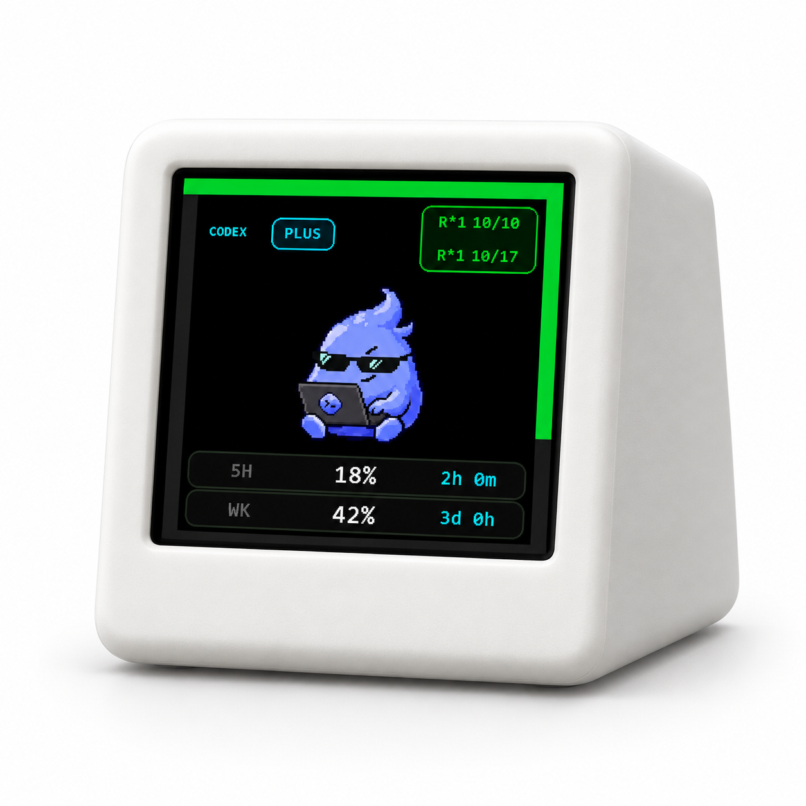
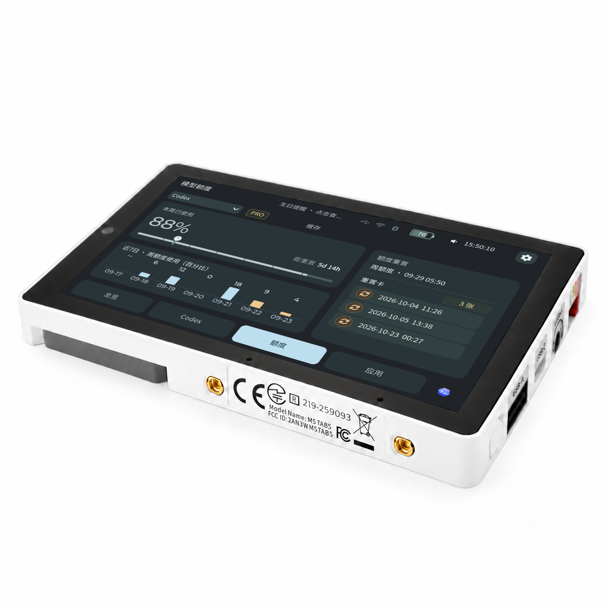
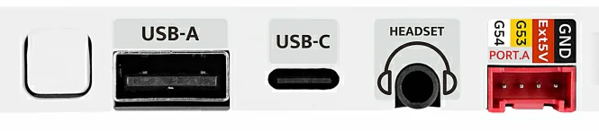
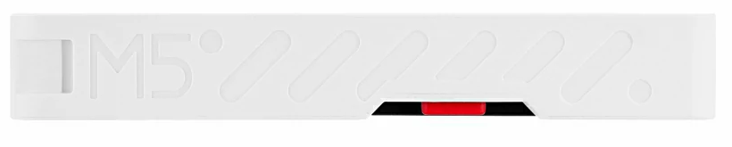
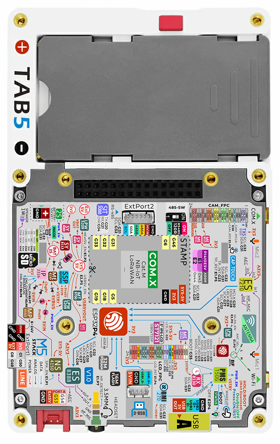

# AI-bot

**Your AI status, all on one screen.** AI-bot is a desktop AI companion that works with your computer, bringing AI task status, account quotas across providers and everyday information to a dedicated display, with fewer trips between windows. Follow Claude Code / Codex progress and view plan usage or API balances for Chinese AI services including DeepSeek, Zhipu, Kimi, MiniMax and Alibaba Model Studio.

Beyond work, AI-bot serves as a desk clock and information display for weather, stocks, music and computer activity. Optional daily painting and calligraphy collections turn the TAB5 into an art display during quieter moments.

[Complete download center](DOWNLOADS.en.md) · [Downloads and device pairing](#downloads-and-device-pairing) · [Installation guide](docs/INSTALL.zh.md) · [Release highlights and details](docs/RELEASE-0.6.12.md) · [简体中文](README.md)

This release: Windows **0.6.12**, Mac **0.6.11**, TAB5 **0.2.282-ui**, ESP8266 **0.5.7**. Windows refines account buttons and centers the TAB5 preview; TAB5 improves system alerts and diagnostic details. See [release details](docs/RELEASE-0.6.12.md).

## Choose your desktop display

AI-bot pairs a computer app with a desktop display. Choose the device that fits how you want to use it.

<table>
<tr>
<td width="50%" valign="top">

<a href="docs/FLASH_BUILD.zh.md#1-核对硬件并留好回退材料">Hardware details ↗</a>

<h3>ESP8266 compact display</h3>

<strong>Desktop status display</strong>

A compact ESP8266-based device with a 240 × 240 color screen. Keep AI task status, model quotas, weather and music information beside your computer, with settings managed from the computer app.

<strong>Cable note:</strong> The included power cable supplies power only. Use a USB data cable for flashing or connecting the display to the computer over USB.

<strong>Connections:</strong> USB / Wi-Fi <strong>Computer support:</strong> Windows / macOS <strong>Best for:</strong> keeping information visible at a glance.

<a href="docs/INSTALL.zh.md#esp8266">Setup and connection</a> · <a href="docs/FEATURES.zh.md#esp8266">Interface gallery</a>

</td>
<td width="50%" valign="top">

<a href="https://docs.m5stack.com/en/core/Tab5">Hardware details ↗</a>

<h3>M5Stack TAB5 touchscreen</h3>

<strong>Interactive desktop companion</strong>

<a href="https://shop.m5stack.com/pages/about-us">M5Stack</a> makes modular hardware for IoT development, including controllers, sensors and expansion modules. TAB5 is its 5-inch touchscreen terminal.

View all four sides and the back (5 official photos)

<strong>USB side</strong>

<strong>GPIO / microSD side</strong>

<strong>M5 logo side</strong>

<strong>External antenna side</strong>

<strong>Back</strong>

All five are official M5Stack photos, cropped only to remove whitespace. Click to enlarge.

A desktop device with a 5-inch touchscreen. View status and quotas, continue Codex conversations, dictate messages, add photo attachments and manage reminders, with clocks, paintings and calligraphy for everyday display.

<strong>Connections:</strong> USB / Wi-Fi / Bluetooth <strong>Computer support:</strong> Windows / macOS <strong>Best for:</strong> touch interaction, task handling and a wider range of display options.

<a href="docs/INSTALL.zh.md#tab5-first">Setup and connection</a> · <a href="docs/FEATURES.zh.md#tab5">Interface gallery</a>

</td>
</tr>
</table>

Both pictures combine hardware imagery with the AI-bot interface and demo data; they are not hardware photographs or shown to a common physical scale. <a href="docs/HARDWARE-IMAGES.md">Image sources and notes</a>

This project introduction compares the shared features of TAB5 and the ESP8266 display, then presents TAB5 highlights including overview, conversations, voice drafts, camera attachments, computer controls, agenda and art screensavers. Native interface footage uses demonstration data and composite hardware images, not hardware photography.

https://github.com/user-attachments/assets/219d758f-e3f9-4bf8-be64-641d01834922

[Watch separately](https://github.com/yaoyouzhong/AI-bot/issues/8) · [Download MP4](https://github.com/user-attachments/assets/219d758f-e3f9-4bf8-be64-641d01834922) · [Media credits](docs/PRODUCT_VIDEO.md)

## What it does

<table>
<thead><tr><th width="160" nowrap="nowrap">Feature</th><th>Details</th></tr></thead>
<tbody>
<tr><td nowrap="nowrap"><strong>AI task status</strong></td><td>Both displays show Claude / Codex working, idle and waiting states, with completion alerts.</td></tr>
<tr><td nowrap="nowrap"><strong>Model quotas</strong></td><td>Account usage, API balances, reset times and Codex reset cards; quota history on the computer. Available fields depend on the provider and account authorization.</td></tr>
<tr><td nowrap="nowrap"><strong>Codex sessions</strong></td><td>On TAB5, select a session, read replies and long histories, and edit a draft. Use voice input, add camera attachments and hold to clear text; review and confirm before sending.</td></tr>
<tr><td nowrap="nowrap"><strong>Agenda &amp; calendar</strong></td><td>TAB5 offers tasks, recurring and due reminders, a monthly calendar, lunar dates, solar terms and birthdays.</td></tr>
<tr><td nowrap="nowrap"><strong>Weather &amp; stocks</strong></td><td>Both displays show weather and watchlists; TAB5 also shows hourly and seven-day forecasts.</td></tr>
<tr><td nowrap="nowrap"><strong>Music &amp; PC status</strong></td><td>View media details, artwork and computer CPU, memory and network activity. TAB5 can control supported players; availability varies by Windows, Mac and player. <a href="docs/MEDIA-PLAYERS.md">Media support</a></td></tr>
<tr><td nowrap="nowrap"><strong>Computer control</strong></td><td>TAB5 can adjust volume, mute, lock, unlock and open configured shortcuts. Unlock setup and permissions differ on Windows and Mac. <a href="docs/COMPUTER-CONTROL.md">Guide</a></td></tr>
<tr><td nowrap="nowrap"><strong>Clocks &amp; screensavers</strong></td><td>Both devices show a clock; TAB5 adds clock faces, countdowns, annual dots and a floral calendar. Optional painting and calligraphy collections support landscape and portrait viewing.</td></tr>
<tr><td nowrap="nowrap"><strong>Pets &amp; display</strong></td><td>Show pets with AI activity; choose a fixed page, cycling or smart following, with page order and interval.</td></tr>
<tr><td nowrap="nowrap"><strong>Devices &amp; monitoring</strong></td><td>Manage connections and independent updates: ESP8266 uses USB / Wi-Fi; TAB5 also supports Bluetooth. Windows runtime monitoring and TAB5 diagnostics show status, causes and advice. <a href="docs/RUNTIME-MONITOR.md">Runtime monitor</a></td></tr>
</tbody>
</table>

<table>
<thead><tr><th width="33%" nowrap="nowrap">Computer app</th><th width="33%" nowrap="nowrap">ESP8266 display</th><th width="33%" nowrap="nowrap">TAB5 touch display</th></tr></thead>
<tbody>
<tr>
<td align="center" valign="middle"></td>
<td align="center" valign="middle"></td>
<td align="center" valign="middle"></td>
</tr>
<tr><td align="center" nowrap="nowrap">Accounts, devices and updates</td><td align="center" nowrap="nowrap">Status, quotas and daily info</td><td align="center" nowrap="nowrap">Touch controls and overview</td></tr>
</tbody>
</table>

Current native interfaces with fixed demo data; the small display uses its computer mirror renderer. [Complete feature gallery](docs/FEATURES.zh.md)

<strong>Explore TAB5 highlights: Codex Direct, Annual Dots and the floral calendar</strong>

**Agenda and scheduled reminders** are included in TAB5 210: aligned Today/All filtering, centered empty-state creation, local storage, offline edits/deletions and reconnect synchronization, with repeat and advance reminders. Up to 16 items; ended items remain until a full-capacity add evicts the oldest eligible expired one-time entry. [Usage and hardware boundaries](docs/RELEASE-0.6.11.md)

**Codex Direct:** pick one of five recent sessions, read replies, dictate a draft and confirm before sending. Cancel, recover from failures or hold to clear. [Guide](docs/TAB5-QUICK-CONSOLE.md)

<table><tr>
<td align="center" width="33%"><strong>Codex Direct</strong>  </td>
<td align="center" width="33%"><strong>Annual Dots</strong>  </td>
<td align="center" width="33%"><strong>Floral calendar</strong>  </td>
</tr></table>

Annual Dots gives every day a dot, with leap-year support, automatic day/night colors plus a separate warm-gray choice. The floral calendar includes lunar dates, solar terms and holidays. Neither needs an extra collection. Paintings and calligraphy support landscape and portrait and retain the work title, artist and museum; verified Chinese titles appear on screen, with original collection titles retained otherwise.

[Portrait painting](docs/assets/screens/tab5-painting-portrait.png) · [Portrait calligraphy](docs/assets/screens/tab5-calligraphy-portrait.png) · [Complete screensaver guide](docs/FEATURES.zh.md#tab5)

TAB5 PC controls: volume, mute, lock state and launchers

Configure up to four app/folder launchers in Windows Device Center → TAB5 → Computer control. Icons accompany names; mute uses a slashed speaker, and lock/unlock state follows the computer. Save up to ten Wi-Fi networks while retaining existing settings. [Usage](docs/COMPUTER-CONTROL.md)

## Downloads and device pairing

<!-- downloads:start -->
| Use | Version | Download | SHA-256 |
| --- | --- | --- | --- |
| Windows bridge · Windows 10/11 x64 | 0.6.12 | [Download · 30 MiB](https://github.com/yaoyouzhong/AI-bot/releases/download/v0.6.12/AI-bot-bridge-v0.6.12-windows-x64-setup.exe) | [SHA-256](https://github.com/yaoyouzhong/AI-bot/releases/download/v0.6.12/SHA256SUMS.txt) |
| Mac bridge · macOS 13+ / Apple Silicon | 0.6.11 | [Download · 17 MiB](https://github.com/yaoyouzhong/AI-bot/releases/download/v0.6.11/AI-bot-bridge-v0.6.11-macos-arm64.zip) | [SHA-256](https://github.com/yaoyouzhong/AI-bot/releases/download/v0.6.11/SHA256SUMS.txt) |
| ESP8266 display · first install / upgrade | 0.5.7 | [Download · 30 MiB](https://github.com/yaoyouzhong/AI-bot/releases/download/esp8266-v0.5.7/AI-bot-esp8266-0.5.7-firmware.zip) | [SHA-256](https://github.com/yaoyouzhong/AI-bot/releases/download/esp8266-v0.5.7/SHA256SUMS.txt) |
| TAB5 · first install from factory system | 0.2.282-ui | [Download · 5 MiB](https://github.com/yaoyouzhong/AI-bot/releases/download/tab5-v0.2.282-ui/AI-bot-tab5-0.2.282-ui-first-install.zip) | [SHA-256](https://github.com/yaoyouzhong/AI-bot/releases/download/tab5-v0.2.282-ui/SHA256SUMS.txt) |
| TAB5 · upgrade existing AI-bot | 0.2.282-ui | [Download · 5 MiB](https://github.com/yaoyouzhong/AI-bot/releases/download/tab5-v0.2.282-ui/AI-bot-tab5-0.2.282-ui-upgrade.zip) | [SHA-256](https://github.com/yaoyouzhong/AI-bot/releases/download/tab5-v0.2.282-ui/SHA256SUMS.txt) |
| Daily Calligraphy · standard | 2026.1 (package 2026.10.15.1) | [Download · 869 MiB](https://github.com/yaoyouzhong/AI-bot/releases/download/tab5-v0.2.205-ui/AI-bot-DailyCalligraphy-Curated-2026.10.15.1.zip) | [SHA-256](https://github.com/yaoyouzhong/AI-bot/releases/download/tab5-v0.2.205-ui/SHA256SUMS.txt) |
| Daily Calligraphy · complete HD | 2026.1 (package 2026.10.16) | [Download · 2.89 GiB](https://github.com/yaoyouzhong/AI-bot/blob/main/docs/GALLERY-HD.md#download) | [SHA-256](https://github.com/yaoyouzhong/AI-bot/blob/main/docs/GALLERY-HD.md#calligraphy) |
| Daily Painting · standard | 2026.1 (package 2026.10.14.1) | [Download · 191 MiB](https://github.com/yaoyouzhong/AI-bot/releases/download/tab5-v0.2.194-ui/AI-bot-DailyPainting-Curated-2026.10.14.1.zip) | [SHA-256](https://github.com/yaoyouzhong/AI-bot/releases/download/tab5-v0.2.194-ui/SHA256SUMS.txt) |
| Daily Painting · complete HD | 2026.1 (package 2026.10.16) | [Download · 1.86 GiB](https://github.com/yaoyouzhong/AI-bot/blob/main/docs/GALLERY-HD.md#download) | [SHA-256](https://github.com/yaoyouzhong/AI-bot/blob/main/docs/GALLERY-HD.md#painting) |

Install the computer bridge, then choose firmware for your device. Artwork collections are optional. Components update independently; reinstalling an unchanged version is unnecessary.

- **Factory TAB5**: choose the first-install ZIP. **Existing AI-bot**: extract the upgrade ZIP and select `aibot_tab5.bin`, keeping its release-notes file beside it. Firmware is not interchangeable between devices.
- **Collections**: import ZIPs directly through Windows Software and Firmware Updates → Artwork Collections. App upgrades preserve collections. Requires Windows bridge 0.6.0+ and TAB5 0.2.145-ui+.
- **Choose an edition**: choose standard or complete HD for each collection. HD includes standard previews and guides, so a separate standard import is unnecessary. Bridge 0.6.7+ displays HD originals; TAB5 uses device previews. Follow the HD size links in the table to download, merge and import. Standard painting is retained.
- Windows and Apple Silicon Mac support ESP8266 and TAB5; see the installation guide for Mac permissions and speech sources. Windows setup is unsigned; Mac is ad-hoc signed and not notarized.

[Installation guide](https://github.com/yaoyouzhong/AI-bot/blob/main/docs/INSTALL.zh.md) · [Collection sizes and licenses](https://github.com/yaoyouzhong/AI-bot/blob/main/docs/GALLERY-PACKS.md) · [Earlier releases](https://github.com/yaoyouzhong/AI-bot/releases)
<!-- downloads:end -->

## Setup and future updates

1. **Install and open the computer app.** On Windows, right-click the tray icon and open Device Center. Existing users should exit the bridge and install to the original location.
2. **Add your device.** Use a USB data cable and follow the [illustrated guide](docs/INSTALL.zh.md) for initial flashing, registration and pairing. Devices already running AI-bot can be verified and added directly.
3. **Choose what to display.** Configure accounts, everyday information and cycling pages. Import a collection before using its TAB5 art screensaver; keep the computer and bridge running during initial synchronization. Completed TF libraries remain available offline.

For later updates, open Windows Device Center → Bridge Settings → Software/Firmware to reach **Software and Firmware Updates** to read each component's notes, download and verify its package, then follow the installation prompts. Enable automatic checks for new-version notifications; installation still requires your confirmation. Download and import artwork collections separately as needed. [Full update steps](docs/UPDATES.md)

## Further reading

- **Use and updates:** [Feature gallery](docs/FEATURES.zh.md) · [Changes by component](docs/RELEASE-0.6.12.md) · [Changelog](CHANGELOG.md) · [TAB5 hardware acceptance](docs/development/TAB5-CONTROL-215-ACCEPTANCE-20261017.md)
- **Data and privacy:** [Data sources](docs/DATA_SOURCES.md) · [Quota-history boundaries](docs/QUOTA_TRENDS.md). Activity statistics extract local status and token metadata; account quotas come from provider interfaces and are counted separately.
- **Development and source:** [Development guide](docs/DEVELOPMENT.md) · [Protocol](docs/PROTOCOL.md) · [TAB5 source and builds](docs/development/TAB5-SOURCE.md) · [Independent component versions](docs/COMPONENT-VERSIONS.md)
- **Materials and licenses:** [Provenance](PROVENANCE.md) · [Third-party notices](THIRD_PARTY_NOTICES.md) · [Screenshots and art credits](docs/SCREENSHOTS.md) · [Optional pet animation pack](docs/assets/pet/README.md)

Own code, including TAB5, is [MIT licensed](LICENSE). Third-party components and artworks retain their original licenses. This independent project has no affiliation with the named AI providers. [Report issues](https://github.com/yaoyouzhong/AI-bot/issues) with your platform, versions, hardware and reproduction steps; remove credentials and private logs.
