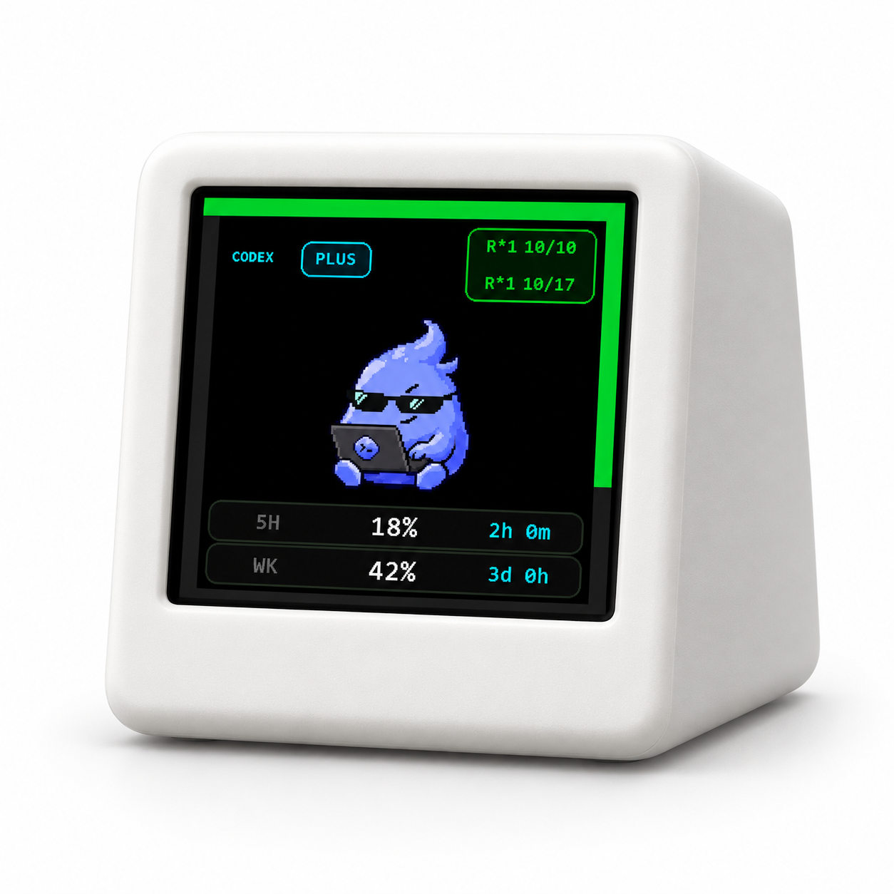
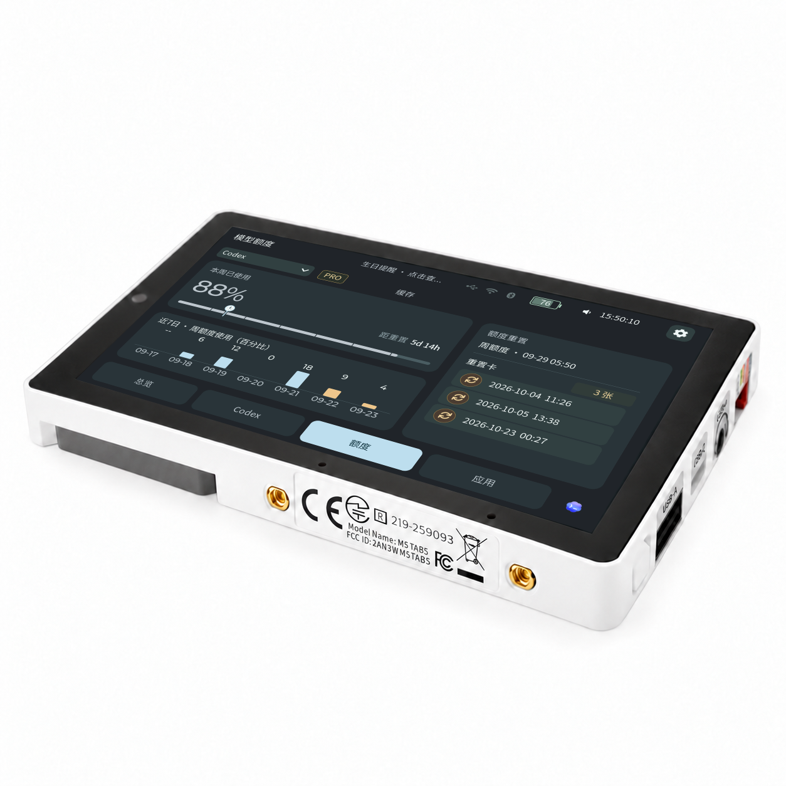

# AI-bot

在 ESP8266 小屏或 M5Stack TAB5 上查看 Claude Code、Codex、模型额度和电脑状态。

[完整下载中心](DOWNLOADS.md) · [首次安装图文](docs/FIRST-INSTALL.zh.md) · [更新说明](docs/RELEASE-0.6.18.md) · [English](README.en.md)

**源码：** [Windows 桥接](windows-app/) · [Mac 桥接](mac-app/) · [TAB5 大屏固件](tab5/) · [ESP8266 小屏固件](esp8266/)

## 下载与搭配

<!-- downloads:start -->
| 用途 | 版本 | 下载 | SHA-256 |
| --- | --- | --- | --- |
| Windows 桥接 · Windows 10/11 x64 | 0.6.18 | [下载 · 31 MiB](https://github.com/yaoyouzhong/AI-bot/releases/download/v0.6.18/AI-bot-bridge-v0.6.18-windows-x64-setup.exe) | [SHA-256](https://github.com/yaoyouzhong/AI-bot/releases/download/v0.6.18/SHA256SUMS.txt) |
| Mac 桥接 · macOS 13+ / Apple Silicon | 0.6.18 | [下载 · 19 MiB](https://github.com/yaoyouzhong/AI-bot/releases/download/v0.6.18/AI-bot-bridge-v0.6.18-macos-arm64.zip) | [SHA-256](https://github.com/yaoyouzhong/AI-bot/releases/download/v0.6.18/SHA256SUMS.txt) |
| ESP8266 小屏 · 首刷／升级通用 | 0.5.8 | [下载 · 384 KiB](https://github.com/yaoyouzhong/AI-bot/releases/download/esp8266-v0.5.8/AI-bot-esp8266-0.5.8-flash.zip) | [SHA-256](https://github.com/yaoyouzhong/AI-bot/releases/download/esp8266-v0.5.8/AI-bot-esp8266-0.5.8-flash.zip.sha256) |
| TAB5 · 出厂系统首次安装 | 0.2.318-ui | [下载 · 5 MiB](https://github.com/yaoyouzhong/AI-bot/releases/download/tab5-v0.2.318-ui/AI-bot-tab5-0.2.318-ui-first-install.zip) | [SHA-256](https://github.com/yaoyouzhong/AI-bot/releases/download/tab5-v0.2.318-ui/SHA256SUMS.txt) |
| TAB5 · 已有 AI-bot 升级 | 0.2.318-ui | [下载 · 5 MiB](https://github.com/yaoyouzhong/AI-bot/releases/download/tab5-v0.2.318-ui/AI-bot-tab5-0.2.318-ui-upgrade.zip) | [SHA-256](https://github.com/yaoyouzhong/AI-bot/releases/download/tab5-v0.2.318-ui/SHA256SUMS.txt) |

[首次安装图文指南](https://github.com/yaoyouzhong/AI-bot/blob/main/docs/FIRST-INSTALL.zh.md) · [升级与排错](https://github.com/yaoyouzhong/AI-bot/blob/main/docs/INSTALL.zh.md)
<!-- downloads:end -->

## 选择桌面屏幕

<table>
<tr>
<th width="50%">ESP8266 小屏</th>
<th width="50%">M5Stack TAB5 大屏</th>
</tr>
<tr>
<td align="center"></td>
<td align="center"></td>
</tr>
<tr>
<td>240 × 240 彩屏，USB / Wi-Fi。查看 AI 状态、额度、天气和音乐。</td>
<td>5 英寸触控屏，USB / Wi-Fi / 蓝牙。增加会话、语音输入、日程和艺术屏保。</td>
</tr>
<tr>
<td><a href="docs/INSTALL.zh.md#esp8266">安装小屏</a></td>
<td><a href="docs/INSTALL.zh.md#tab5-first">安装 TAB5</a></td>
</tr>
</table>

产品合成图，使用演示数据。<a href="docs/HARDWARE-IMAGES.md">图片来源</a>

[功能图鉴](docs/FEATURES.zh.md) · [演示视频](https://github.com/yaoyouzhong/AI-bot/releases/download/v0.6.18/AI-bot-project-overview-web-20261110.mp4) · [可选图库](docs/GALLERY-PACKS.md) · [开发资料](docs/COMPONENTS.md) · [反馈问题](https://github.com/yaoyouzhong/AI-bot/issues)

[MIT 许可](LICENSE) · [第三方声明](THIRD_PARTY_NOTICES.md)
