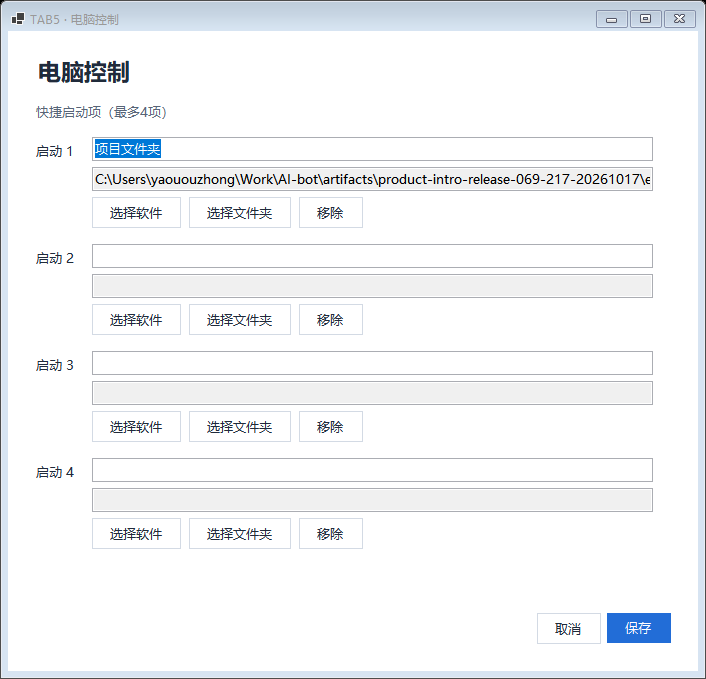

# TAB5 电脑控制 / Computer control

Windows 桥接提供电脑主音量、静音、锁屏和最多 4 个快捷启动项（软件或文件夹）；播放控制位于 TAB5 音乐页。软件和文件夹在电脑的“设备中心 → TAB5 → 电脑控制”或托盘 TAB5 菜单配置。配置保存到本机 AppPaths LocalApplicationData/AI-bot/computer-launchers.json，不进入仓库或设备。保存配置不执行启动或锁屏。

The Windows bridge provides master volume, mute, workstation lock and up to four locally selected application/folder launchers. Playback controls belong to the TAB5 music page. Configure launchers from Device Center → TAB5 → Computer control, or the TAB5 tray menu. Local paths stay in the AppPaths local application data profile and are never sent to the device. Saving configuration does not execute an action.

完整功能需要 Windows 桥接 **0.6.9** 与 TAB5 **0.2.217-ui**；其他平台未提供本轮控制。Full functionality requires Windows 0.6.9 and TAB5 0.2.217-ui; other platforms do not advertise these controls.




原生截图使用固定演示数据，不是真机照片；用户已确认真实音量、静音、启动图标与打开、锁屏状态及无闪动。临时启动项已恢复为空。 / Native fixtures are separate from physical acceptance; temporary verification launchers were cleared.

## Capabilities / 能力

状态快照的 `connectionHealth.computerControlVersion=1` 表示支持此协议。缺失标识的旧桥接或其他平台不能展示可操作状态。音量使用默认 Multimedia 输出端点；没有音频设备时禁用音量和静音。播放控制使用 Windows 当前 GSMTC 媒体会话和该会话报告的能力，仅当来源标识、歌名和歌手与桥接最近发布的歌曲一致时提供控制；执行前再次核验。没有会话、展示来源没有 GSMTC 身份或当前会话不匹配时禁用，避免展示 QQ 音乐却操作其他播放器。

`connectionHealth.computerControlVersion=1` advertises protocol support. Older bridges and other platforms without this field must not show enabled controls. Volume uses the default Multimedia output endpoint. Media operations require the current Windows GSMTC session's source ID, title and artist to match the bridge's most recently published song, and are checked again before execution. Missing identities, mismatched sessions or unsupported actions disable controls instead of controlling an unrelated player.

## Authenticated RPC / 认证 RPC

复用 `Tab5Service.RpcAsync` 的设备配对、HMAC、AES-GCM、session、issuedAt 和 nonce 重放防护。USB、BLE、Wi-Fi 使用同一处理器，不提供未认证控制路由。设备只发送预先配置的 launcherId，不能提交路径、参数、shell 命令或 URL；含多余字段或重复字段的请求会被拒绝。

All operations pass through the existing paired-device HMAC/AES-GCM RPC, session, timestamp and nonce validation. USB, BLE and Wi-Fi share one handler. Launch requests contain only an opaque launcherId; paths, arguments, shell commands, URLs, unexpected fields and duplicate fields are rejected.

公共 envelope：`kind="computer-control"`、当前 `session`、毫秒 Unix `issuedAt`；可用现有 `binaryReply`/`bulkReply`。`status` 无副作用，不要求 requestId；其他操作必须使用 UUID D 格式的 `requestId`。

Common envelope: `kind="computer-control"`, the current `session`, and Unix millisecond `issuedAt`; existing `binaryReply`/`bulkReply` flags are supported. Only `status` omits a requestId. Every command requires a UUID D requestId.

| op | Fields / 参数 | Action / 行为 |
|---|---|---|
| status | 无 / none | 当前能力、音量和启动名称 / current state and launcher names |
| volume | volume: integer 0–100 | 设置绝对音量 / set absolute master volume |
| mute | muted: boolean | 设置静音状态 / set mute explicitly |
| lock | 无 / none | 请求 Windows 锁屏 / request workstation lock |
| launch | launcherId: UUID D | 启动电脑端已配置目标 / launch a locally selected target |
| media | action: play-pause, previous, next | 操作当前 GSMTC 会话 / control current GSMTC session |

`status` 的 body：

```json
{"version":1,"volumeAvailable":true,"volume":40,"muted":false,"canLock":true,"mediaAvailable":true,"canPlayPause":true,"canPrevious":false,"canNext":true,"playing":false,"launchers":[{"id":"00000000-0000-0000-0000-000000000001","name":"项目文件夹"}]}
```

命令成功：RPC status 200，body `{ "ok": true, "state": <当前状态> }`。失败返回 400（参数）、404（启动项不存在）、409（能力不可用或 requestId 冲突）、429（回执容量）、503（操作失败或配置不可读），body 含 `error`；取得状态时附带 `state`。未知操作和 OS 返回失败不能作为成功。Windows 接受锁屏/启动请求不代表已完成物理界面验收；启动 API 未提供明确返回值时保守报告失败，客户端不得自动补发。

Successful commands return status 200 and `{ "ok": true, "state": <current state> }`. Errors return 400 (parameters), 404 (unknown launcher), 409 (unsupported capability or requestId conflict), 429 (receipt capacity), or 503 (execution/configuration failure). Error bodies contain `error` and include `state` when available. Unknown/failed OS operations never report success. An accepted lock/launch request is not physical UI acceptance; ambiguous launch results report failure and must not trigger automatic retries.

## Retry semantics / 重试约定

每次用户明确点击生成新的 requestId。固件只发一次，不自动重试或切换通道重发。需要恢复同一次请求时，必须同时沿用原 requestId、issuedAt 和业务参数，使用新的传输 nonce。不得用刷新 issuedAt 的方式复用旧 requestId。相同 requestId/业务参数在有效期内返回原回执，不重复触发副作用；业务参数冲突返回 409。

Each explicit user action gets a new requestId. Firmware sends once without automatic retry or cross-transport fallback. A recovery retry must retain requestId, issuedAt and command parameters, with a fresh transport nonce. Never refresh issuedAt for an old requestId. Matching retries return their original receipt; conflicting commands return 409.

回执保存 120 秒，超过 RPC 接受时间窗口（过去 90 秒、未来 10 秒）；最多 256 个，不驱逐仍有效回执，满时返回 429。所有动作串行执行，成功、明确失败以及执行异常都保存回执。过期请求由认证 RPC 的 issuedAt 校验拒绝；服务重启后旧 session 被拒绝。

Receipts live for 120 seconds, beyond the RPC timestamp acceptance window (-90/+10 seconds). Capacity is 256 and full capacity returns 429 without evicting valid receipts. Commands execute serially; successes, failures and execution exceptions are recorded. Expired retries fail RPC timestamp validation; old sessions fail after service restart.

## Validation / 验证

`--self-test-computer-control <output-directory>` 在隔离 profile 中使用 fake OS 后端覆盖音量、静音、锁屏、启动、播放控制、副作用去重、并发重复、冲突、无音频/媒体能力、参数拒绝、容量及过期回收，并经过真实加密 RpcAsync 认证链验证无效 HMAC、session 与过期时间不会触发动作。生成设置窗 100%/150%/200% 截图。测试不锁定真实电脑、不启动软件、不改变真实音量；这些仍需经授权的实际设备验收。

The isolated-profile self-test exercises fake OS volume, mute, lock, launch, media, concurrent/idempotent requests, conflicts, unavailable capabilities, parameter rejection, receipt limits/expiry and the real encrypted RpcAsync authentication chain. It captures the settings window at 100%, 150% and 200%. It never locks the real computer, launches applications or changes real volume; those remain separate authorized device acceptance checks.

## Launcher icons / 启动图标

Windows 从本机已配置的 exe 提取程序图标，文件夹使用 Windows 文件夹图标。每项可带 `kind`（`app` / `folder`）和 `icon`（32×32、逐行 BGRA8888、4096 字节的 Base64）；不传输路径。提取失败时固件显示通用类型图标，未设置项不显示图标。图标只用于当前用户的设备显示，不作为仓库或发布包素材。

Windows extracts icons from locally configured executables and uses the Windows folder icon for directories. Each launcher may include `kind` (`app` / `folder`) and `icon` (Base64 of 4096 row-major BGRA8888 bytes, 32×32). Paths remain local. Missing artwork uses a type glyph; empty slots have no icon. Artwork is runtime user content, not bundled repository or release artwork.

状态新增 `iconRevision`（64 位十六进制 SHA-256）；请求 envelope 可携带上次已收到的 revision。匹配时省略图像数据，降低轮询流量；版本变化时替换全部图标，避免换软件后仍显示旧图标。总响应仍在 65535 字节 RPC 上限内。旧客户端省略 revision 也可使用。

State includes a 64-character SHA-256 `iconRevision`. Requests may echo the last received revision; matching revisions omit image bytes. A changed revision replaces all cached icons. Responses remain within the 65535-byte RPC limit. Clients that omit the revision remain supported.

## Lock state and steady polling / 锁屏状态与稳定轮询

状态可带 `locked: true/false`；来自当前 Windows 会话的 WTSInfoEx SessionFlags，查询失败为未知，不能将未知写成已解锁。锁定后禁用重复锁屏，解锁后恢复。TAB5 显示“已锁屏／未锁屏”，旧桥接缺少此字段时保留通用按钮。

State may include nullable `locked`, read from the current Windows session's WTSInfoEx SessionFlags. Failed queries remain unknown. Locking disables repeated lock requests; unlocking restores the action. TAB5 shows locked/unlocked status and keeps generic behavior for bridges without the field. Reference: https://learn.microsoft.com/en-us/windows/win32/api/wtsapi32/ns-wtsapi32-wtsinfoex_level1_w

读取状态期间保留可用控件的外观，避免每两秒灰亮切换；操作仍受单请求门控，不在忙时重复发出。启动项和音乐布局只在实际变化时更新。

Read-only polling retains the last usable appearance rather than flashing controls disabled/enabled. Commands retain the one-request gate. Launcher and music layouts update only when they change.

## One-click unlock / 电脑一键解锁（0.6.10 / 234）

TAB5「应用 → 控制」按实际 USB、BLE 或 Wi-Fi 通道解锁 Windows。Windows PIN 独立加密保存在电脑；取消、断线和失败停止，不自动换通道重发。Windows「电脑控制 → 一键解锁设置 → Wi-Fi 解锁设置」可离线安装／自动接入 TightVNC，兼容已有安装保留原配置及归属，无需用户填写组件密码。安装／卸载需管理员确认，外部或已修改组件受到归属保护。

TAB5 .234 包含音量拖动遗留手势恢复、实际阅读后的双向 Codex 已读同步、BLE 启动报告整数时间和电量显示连续性。原版 c608 的纯 BLE 三实时样本／精确 ELF／VALID 核验与新增电量观察已通过，既有成功项目没有重复验收，见 [发布说明](RELEASE-0.6.10.md)。

TAB5 unlocks Windows through its actual USB, BLE or Wi-Fi path. The Windows PIN stays separately encrypted on the PC. Cancellation, disconnect and failure stop without automatic transport switching/replay. Wi-Fi settings install/import compatible TightVNC authentication automatically, retaining existing settings/ownership with administrator confirmation for component lifecycle operations. No manually entered component password is required. The .234 firmware also repairs volume-gesture recovery, rendered-reply read synchronization, integer BLE boot reports and battery continuity. Exact-image/VALID/three-live-sample BLE and new battery acceptance passed separately from native previews; earlier passed physical tests were retained.
