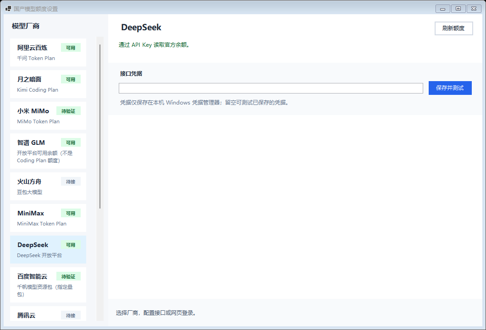

# 国产模型额度设置

## Windows 和 Mac 桥接 0.6.35 编程套餐

本节适用于桥接 0.6.35。Windows 与 Mac 都支持分开选择和保存套餐、余额和适用的资源包。Mac 新增百炼 Coding Plan 三个额度窗口、更新 MiniMax 和小米入口，并补充火山、腾讯、百度、阶跃和华为的网页采集。下表记录 Windows 端较详细的配置与模拟验证。入口仍是 **设备中心 → 账号数据 → 模型账号**，增加“统计内容”选择。已采集过的智谱余额、阿里 Token Plan、阶跃余额和百度资源包沿用原统计内容；新账号优先打开套餐。切换后缓存分别保存，不把钱包或资源包改名为编程套餐。

显示、额度徽标和下拉选项仅展示 `Coding Plan` / `Token Plan` 类型，不重复厂商／模型名；厂商由独立标题标识。Step Plan 显示为 Coding Plan，MiniMax M Plan 显示为 Token Plan；下表保留实际官方产品名供核对来源。

| 厂商 | 本轮实现 | 验证范围 |
| --- | --- | --- |
| 智谱 GLM | 个人版 Coding Plan Key 查询、官方用量页响应采集；5 小时／周窗口与账户余额分开 | 模拟 HTTP、缓存、状态与渲染；团队版仅网页登录入口，响应是否等价待验证 |
| 阿里百炼／千问 | Coding Plan 和 Token Plan 独立；Coding Plan 读取 5 小时、周、订阅月三个窗口 | 根据当前官方控制台契约构造响应测试；订阅月没有可信起点时不造 30 天周期 |
| MiniMax | M Plan / Token Plan 订阅 Key；当前中国站 `https://www.minimax.cn/v1/token_plan/remains`，保留旧凭据 | 现有额度、扩容比例和周期回归；网页登录只接收精确官方域名及用量路径 |
| 小米 MiMo | 打开 `/#/console/plan-manage` 登录后套餐管理页；沿用明确的 Credits 额度响应采集 | 现有接口、缓存与周期模拟测试；不新增未确认的 Key 余额接口 |
| Kimi Code | 保留官方本地服务与网页额度查询，增加统计产品与额度摘要 | 原有本地接口及周期回归 |
| 火山方舟 | Coding Plan 官方页面，有明确周期及已用／剩余比例的套餐进度采集 | 通用可见进度适配器及离线 WebView2 模拟；真实页面结构待验证 |
| 腾讯 | Coding Plan 与 Token Plan 分别选择、分别缓存 | 同上；两种套餐的实际登录后字段均待验证 |
| 百度千帆 | Token Plan 网页进度；原 AK/SK 指定资源包入口另列 | 同上；不读取云余额、不把资源包当订阅 |
| 阶跃 | Step Plan 网页进度；API 余额另列 | 同上；两种统计内容互不覆盖 |
| 华为云 | MaaS Token Plan 网页进度 | 同上；进入 MaaS 的“管理与统计 → 订阅”页 |
| DeepSeek | 保留按量账户余额与消费路径 | 官方定价仍按 Token 扣钱包余额；本次未找到自营 Coding Plan 的官方依据，不创建套餐入口 |

**本轮按用户要求只完成代码与模拟验收，所有新增链路均没有真实订阅账号验收。** 后五家的网页采集是保守的可见进度适配器，不是已核实的私有 JSON API：仅在精确官方 HTTPS 主机和套餐路由读取带明确周期标签及使用／剩余说明的百分比。未知结构、多个矛盾进度、余额、过期或无标签数字均不更新；页面不匹配时明确提示尚未识别，保留最后成功数据。它们在界面标为“待验证”，开通后需核对实际订阅页并按需收紧厂商适配。

火山、腾讯、华为的新增套餐进度在 Windows 和 Mac 的「模型账号」中查看和缓存。其余既有厂商使用已有额度字段；GLM 套餐的设备显示仍需对端核验，ESP8266 现有固件仍有余额专用分支，不能据 Windows 镜像预览宣称实机支持。本轮没有刷机。

验证入口：`--self-test-domestic-quota`、`--self-test-coding-plan-dom`、`--self-test-coding-plan-ui <目录>`。最后一项只用合成账号生成离屏界面，打开不可见且不激活的测试窗口，不连接厂商。实现来源、跨端待办和结果见[交接记录](development/WINDOWS-CODING-PLAN-HANDOFF-20261127.md)。下文保留既有发布版本的设置与历史验证记录；与本节不同的厂商范围、入口和智谱默认口径，以本节对应的桥接版本为准。

### Windows and Mac bridge 0.6.35 (English)

Model Accounts now separates subscription products from wallets/packages and preserves existing selections. GLM personal Coding Plan supports its official usage-plugin key contract; Alibaba Coding Plan retains five-hour, weekly and calendar-month quotas independently of Token Plan. MiniMax uses its current China domain; MiMo opens its authenticated plan-management route. Kimi retains its existing local service. Ark, Tencent, Baidu, StepFun and Huawei add conservative labelled-progress browser adapters, with separate Tencent Coding/Token products. Unknown or conflicting markup retains old data. These five adapters are **synthetic implementations awaiting real subscribed-page verification**, not verified private APIs. Ark/Tencent/Huawei have no new device modes; GLM device rendering also remains pending, with a known ESP8266 wallet-specific branch. DeepSeek retains its usage-based wallet. Mac also separates plans, API wallets and resource packages. It adds Alibaba Coding Plan's three quota windows, updates the MiniMax and MiMo entry points, and provides the same five console adapters. Live subscription checks remain pending.

> 本页入口按 Windows 0.6.0 更新。适用于 Windows 桥接 App；设备的缓存提示需要更新固件。

## 在哪里配置

右键托盘 AI-bot → **设备中心 → 账号数据 → 模型账号**，选择左侧厂商。

- **DeepSeek**：在右侧登录 [官方开放平台](https://platform.deepseek.com/)，设备使用该网页账户同一响应中的可用余额和累计消费。也可在 API Keys 页面创建 Key 并在桥接中保存测试；API 余额独立显示，不与网页账户金额拼接。
- **MiniMax**：在 [Token Plan 页面](https://platform.minimaxi.com/subscribe/token-plan) 获取对应的 Token Plan / Subscription Key，保存并测试；不要混用海外区域或普通按量付费 Key。
- **Kimi Code**：优先支持官方 `kimi web` 本地服务的额度 API。需先运行并登录该服务，将其访问令牌与端口填入桥接 App（默认端口 58627，实际以服务为准）。这里不是填写 Moonshot 按量付费 Key，也不读取其他工具的凭据文件。没有使用该服务时，保留网页授权。
- **阿里 Token Plan、智谱账户余额**：目前未确认有适用于这两个统计口径的公开查询 API，继续在右侧官方页面登录。阿里账户现金余额不能替代 Token Plan 额度；智谱 Coding Plan 用量不能替代账户余额。

API Key/本地服务令牌只保存在 Windows 凭据管理器。输入框为密码框；留空后点击“保存并测试”会测试已保存的凭据。不要将 Key 发到聊天、截图或代码仓库。Kimi 端口是普通设置，不是秘密。

配置接口后，DeepSeek 的 API 与网页数据分别刷新和保存，设备使用网页来源；未取得网页余额时设备显示未知。其他支持接口的厂商优先使用接口。凭据填错时重新填写正确值并保存测试即可。

## 刷新与故障提醒

- 已选中且已配置的官方接口每两分钟尝试查询；已选中且成功授权过的网页按厂商轮询，避免同时切换同一个浏览器。在账号窗口按需保存并测试配置，在“桥接设置 → 服务状态”查看最近成功更新时间。
- 网络失败、401/403、限流、无法识别的响应不会覆盖上次成功数据。限流按五分钟退避，网页超时约一分钟后报告。
- 网页跳转登录页、相关接口拒绝授权、浏览器进程中断、超时都会进入统一故障状态。自动检查和提醒依据已启用设备的数据需求，以及该厂商是否已授权或配置 API；ESP8266 还合并其已选额度页面。TAB5 的数据设置独立参与，不要求当前停在额度页。未启用需求的厂商不自动检查或提醒。
- 同一次故障只提醒一次，成功后解除；再次失效可重新提醒。多个厂商同时失败时，通知间隔至少 30 秒，避免相互覆盖。Windows 通知设置可能阻止气泡显示，但界面仍保留缓存提示。
- Windows 镜像将旧数据标为“缓存数据 · 等待更新”，并显示上次更新时间；设备显示 `CACHED - CHECK APP`。余额保留，不冒充实时值。
- 通常超过六分钟没有新数据会提示；选中多个网页厂商时，超时门槛会覆盖完整轮询周期，避免轮询尚未轮到就误报。官方余额 API 不返回累计消费，因此不会把旧的 USED 金额与新的余额拼在一起。

## 已核实的接口与边界

| 厂商 | 当前优先路径 | 官方依据 |
|---|---|---|
| DeepSeek | 设备使用已登录网页账户的余额与累计消费；API 余额独立 | [官方余额 API](https://api-docs.deepseek.com/api/get-user-balance/) |
| MiniMax 中国站 | `GET https://www.minimaxi.com/v1/token_plan/remains` | [官方 Token Plan 页面“如何查看用量”](https://platform.minimaxi.com/subscribe/token-plan) |
| Kimi Code | `GET http://127.0.0.1:<port>/api/v1/oauth/usage` | [官方本地 Server API](https://www.kimi.com/code/docs/en/kimi-code-cli/reference/server-api.html)，实验接口，版本变化可能需要适配 |
| 阿里 Token Plan | 已登录的百炼网页响应 | [官方 Token Plan FAQ](https://help.aliyun.com/zh/model-studio/token-plan-personal-faq)，未确认公开的对应额度 API |
| 智谱可用余额 | 已登录的财务总览响应 | [官方费用说明](https://docs.bigmodel.cn/cn/faq/fee-issues)，未确认公开的账户余额 API |

这里的 API 指有官方依据且统计口径相符的接口；不把第三方脚本使用的私有地址包装成“官方公开 API”。目录中尚未接入的其他厂商仍标记“待接”。

测试使用模拟 HTTP 与隔离配置，不代表已用真实 Key 完成五个厂商的在线验收，也不代表当前驻留程序已经升级。

## 额度周期与 TAB5 .159

周期信息随额度采集、缓存和 TAB5 协议传递。时间位置由当前重置时间减去完整周期得到起点，再用当前时间计算；不把剩余倒计时、首次观察时间或套餐到期日当作完整周期。短周期按分钟、周及套餐周期按小时比对，内部保留秒级精度。额度条仍只显示表盘与竖线，不增加解释文字或底部刻度。

| 来源 | 周期处理与边界 |
| --- | --- |
| Kimi Code | 官方本地 API 的 `limit5h` / `limit7d` 分别对应 5 小时 / 7 天，保存各自的重置时间；兼容旧版显式 `duration` / `unit`。`monthTotal` 优先、缺失时才使用 `monthCode`；月套餐须有同一额度行的实际起止时间，只有重置时间时不猜测月长度。 |
| MiniMax | 保留明确的 5 小时与周窗口；响应提供显式周期时以其为准，例如 7 小时。剩余毫秒数只用于重置时刻，不作为完整周期。 |
| 阿里 Token Plan | 优先使用该额度行实际起止时间。只有明确标为个人版 Token Plan 才能使用官方规定的 30 天周期；个人版不补造每周额度。通用或其他版本套餐不套用该规则。 |
| 智谱 Coding Plan | 已有接口解析器保留 `TOKENS_LIMIT` 的实际单位、次数和重置时间；例如小时单位、次数 7 为 7 小时。当前账号入口仍查询账户余额，不因本次改动切换到 Coding Plan，也不将余额换算为时间进度。 |
| 小米 MiMo | 仅在同一套餐额度响应提供可信起止时间时计算周期；单有百分比或到期时间时保留使用进度，隐藏时间标记。真实订阅响应仍待验证。 |
| 百度千帆模型资源包 | 只在指定资源包有有效生效与到期时间时比较整个有效期；这是资源包有效期，不改称周套餐。真实账号仍待验证。 |
| DeepSeek、阶跃余额及未接入厂商 | 余额没有额度周期；未接入套餐不编造周期或用量。 |

短周期默认分 5 份，明确为 1 至 7 个整小时的周期每小时一份；周额度分 7 份，套餐百分比分 5 份。旧缓存只有明确命名的五小时／周窗口可以恢复固定周期；显式空值或无效周期仍保持未知，不能用默认值覆盖。各额度条独立处理，缺少某一周期不影响其他条。

依据：[Kimi 本地 Server API](https://www.kimi.com/code/docs/en/kimi-code-cli/reference/server-api.html)、[Kimi Code 权益说明](https://www.kimi.com/help/kimi-code/benefits)、[MiniMax Token Plan](https://platform.minimaxi.com/subscribe/token-plan)、[阿里个人版 FAQ](https://help.aliyun.com/zh/model-studio/token-plan-personal-faq)。2026-10-10 的模拟接口、缓存重载、协议及原生显示测试已覆盖 5 / 7 小时、7 天和 28 / 31 天边界；这些测试不代替各厂商真实账号刷新或设备安装验收。时间标记需要配套新版 Windows 桥接；只刷固件不能使旧桥接补齐周期字段。

最终 .159 与配套桥接已本地安装并完成精确启动核验，用户确认 Codex 的实际周周期时间标记显示正常。现有国产套餐缓存已过期，仍缺少有效套餐的在线及物理页面验收；不能将 Codex 或模拟数据的结果推广为所有厂商已通过。见[实机验收记录](TAB5-ACCEPTANCE-159.md)。

### Quota periods and TAB5 .159

Collection, persisted cache and TAB5 conversion retain each quota row's reset instant and complete period. Minute comparisons apply to short windows; hour comparisons apply to weekly/package windows, with second precision internally. The UI keeps only the clock and vertical marker. Kimi's named five-hour/seven-day windows and its explicit legacy durations are supported; monthly rows require actual start/end bounds. MiniMax retains fixed or explicit windows. Ali's documented 30-day fallback applies only to an explicitly identified personal Token Plan, with no invented weekly allowance. GLM's existing Coding Plan parser preserves explicit units; the current wallet account configuration is not switched. MiMo and Baidu retain trustworthy same-row package bounds only. Wallets and pending adapters have no invented periods. A countdown or expiry alone is insufficient.

Explicit one-to-seven whole-hour windows use one internal division per hour; standard short/package percentages use five divisions and weekly percentages use seven. Unknown/invalid periods hide their own marker, while other valid bars continue. Only absent, explicitly named legacy five-hour/weekly fields can recover standard periods; explicit null/invalid fields remain unknown. Simulated API/cache/protocol/native checks are separate from live subscriptions and device acceptance. A matching bridge is required.

The final .159 image and matching bridge were installed locally, with exact-ELF boot verification and user-confirmed Codex weekly time markers. Retained domestic-plan records have expired; live current-plan and physical-screen acceptance are still unavailable. Codex or fixture results cannot establish acceptance for every provider. See the [hardware record](TAB5-ACCEPTANCE-159.md).

## English

Windows: open **Device Center → Account Data → Model Accounts**, select a provider, then save and test its credential. Devices use the DeepSeek web account's balance and cumulative spend from the same response; its official API balance remains separate. MiniMax uses the China Token Plan endpoint. Kimi Code optionally uses the documented local `kimi web` usage API with its server bearer token and port, not a Moonshot wallet key. Ali Token Plan and Zhipu account balance retain authenticated browser collection because no matching documented public endpoint has been confirmed.

Credentials stay in Windows Credential Manager. Selected, configured APIs take priority every two minutes except for DeepSeek device data, which uses the independently refreshed web account. Failed APIs never silently switch accounts through the browser. Browser fallback reports login redirects, authorization denial, process failure and timeout. Last-good data is retained and marked stale; notifications are deduplicated until recovery. Inspect recent successful updates in Bridge Settings → Service Status. Automatic checks use enabled devices’ selected quota providers, also merging the ESP8266 quota-page selection; TAB5 does not need to remain on its quota page. Unconfigured providers or providers outside that demand do not trigger automatic checks or tray warnings. Real-account integration and deployed/hardware acceptance remain separate from simulated tests. These adapters were introduced in the earlier v0.2.0 pre-release and remain part of 0.6.0.

## 厂商接入边界（初始实现于 v0.2.0）

只有模型专属额度进入显示；腾讯云、华为云、百度智能云、火山引擎的云账号总余额不接入。

- **阶跃星辰**：选择厂商，填写普通开放平台 API Key，点击“保存并测试”。查询开放平台人民币余额，**不是 Step Plan 套餐额度**。接口实现及模拟测试已补齐，真实账号尚未验证。
- **百度千帆**：填写安全认证 AK、SK 和已购买的**模型资源包 ID**（packageId），点击“保存并测试”。只查询指定资源包，不读取云余额，不合并不同模型、单位和有效期的量包；不要填写音视频/插件资源包 ID。三项全部留空可以测试已保存配置；部分填写会被拒绝。三项配置整体保存在 Windows 凭据管理器。显示已用比例、模型名称和到期时间（EXPIRES）；过期或耗尽不显示可用余量。该接口不是千帆 Token Plan 订阅接口。真实账号尚未验证。
- **火山方舟、腾讯混元、华为盘古、讯飞星火、百川、零一万物**：保留待接入状态。还没有与当前模型套餐匹配且能完成验证的查询实现；网页登录入口不代表额度采集已完成。没有用户已开通的套餐可用于核对登录后字段，不通过猜测字段或抓取云余额来填充数字。

依据：[阶跃账户信息](https://platform.stepfun.com/docs/zh/api-reference/accounts/get)、[百度千帆指定量包查询](https://cloud.baidu.com/doc/qianfan/s/3mh4sv4ve)、[百度 BCE 签名规范](https://cloud.baidu.com/doc/Reference/s/njwvz1yfu)、[MiMo Token Plan 官方说明](https://mimo.mi.com/docs/zh-CN/quick-start/faq/token-plan)。核查日期：2026-09-16。

Windows 与 ESP8266 新增阶跃余额/千帆量包显示页；旧固件需要更新才能显示。上述适配的初始构建不代表真实账号或逐项设备验收；当前发布状态见[发布说明](RELEASE-0.6.0.md)。macOS 仅同步可选协议字段与模式名称，未实现这两家的原生查询入口。

### Additional providers (v0.2.0 pre-release)

Only model-specific quotas are eligible. Whole-cloud wallets from Tencent, Huawei, Baidu and Volcengine are excluded.

StepFun uses its ordinary API key and documented `GET /v1/accounts` endpoint for the CNY API wallet, **not Step Plan**. Baidu uses AK/SK and an explicit model package ID with `POST /v2/charge?Action=DescribePackageResource`; it displays utilization and expiry for that package, never cloud funds or an aggregate of incompatible packages. It is not a Token Plan subscription endpoint. Enter all three fields together, or leave all empty to test saved credentials. Credentials stay in Windows Credential Manager. Expired/exhausted packages have no usable remainder. Both adapters have simulated-response tests; neither has live-account acceptance.

Volcengine Ark, Tencent Hunyuan, Huawei Pangu, iFlytek Spark, Baichuan and Yi remain pending: no verified model-specific adapter is enabled. A login link alone is not completed collection. Current users have no purchased plans for live browser verification. Firmware adds two display modes; flashing and hardware acceptance are pending. macOS only adds protocol compatibility, not native acquisition for these providers.

## 小米 MiMo（网页登录，待真实套餐验证）

入口：设备中心 → 账号数据 → 模型账号 → 小米 MiMo。在内嵌官方页面登录并打开 Token Plan 用量页。显示的是套餐 Credits 的**已用比例**，不是人民币余额，也不是按量调用的 Token 数。当前未确认有公开 API Key 用量查询契约，因此没有增加伪造的 Key 查询入口。

已接通官方控制台 `/api/v1/tokenPlan/usage` 响应采集、缓存、后台刷新、失效状态、Windows 镜像及 ESP8266 `domestic_xiaomi` 页面。地址必须是 HTTPS 官方精确主机与路径；HTTP 错误、登录错误、字段不明确、冲突计数和无套餐响应不覆盖旧值。解析规则仅接收明确的 `usagePercent`/`usedPercent`（0–100）、`usageRate`/`usedRate`（0–1），或 `totalCredits` 配合 `usedCredits`/`remainingCredits`，不递归猜测通用 `ratio`、钱款或限速字段。这些字段兼容规则已通过模拟测试，当前真实账号响应结构仍待验证；不匹配会明确报失败。

**提醒规则适用于全部国产厂商**：自动轮播开启时，只监测轮播列表中的国产页；指定单页时，只监测该页，不把保留的轮播列表也算进去。还必须有过成功授权取数，或已保存接口凭据。首次登录/保存测试的结果在当前窗口展示，但未配置厂商不弹托盘失效提醒。未选中厂商的故障不会阻塞其他提醒；重新选中时，如仍有故障且符合配置条件，再提醒一次。成功恢复后结束本次故障。

### MiMo and reminder scope

MiMo has a console-session adapter, cached plan utilization, refresh health, mirror rendering and optional ESP8266 mode `domestic_xiaomi`. Sign in using the official embedded Token Plan page; no undocumented API-key endpoint is presented. This displays plan utilization, not wallet funds. Only the exact HTTPS console host and usage path are accepted. The parser supports legacy percentage/rate/Credits fields and the current `usage.items` primary row, converts its 0–1 ratio to percent and checks supplied counters. Compensation is separate; multiple primary rows, conflicts and unknown shapes retain old data and report failure. Cycle bounds must belong to the selected row. Simulated contracts passed; live subscribed-account acceptance is pending.

2026-11-01 Windows 兼容补充：MiMo 支持 `usage.items` 中唯一主额度行的比例，`compensation_total_token` 单列且不合并；多主额度行不任取第一项。MiniMax 的 `end_time/weekly_end_time` 按绝对毫秒时间戳处理，存在但无效时不拿旧倒计时兜底；缺失时保留旧格式。`*_total_percent` 扩容额度按 `used / total` 归一化，例如 120 / 200 为 60%，上限为 100%。新入口 `--self-test-domestic-quota` 在隔离配置中运行额度契约、缓存及周期自测，不打开窗口、不发起真实账户请求。两家真实套餐刷新仍待验证，详见 [接口审计](development/DOMESTIC-QUOTA-INTERFACE-AUDIT-20261101.md)。

Windows compatibility update (2026-11-01): MiniMax `end_time/weekly_end_time` are absolute epoch milliseconds. Explicit invalid values stay unknown; absent fields retain the legacy countdown path. Expanded `*_total_percent` allowances use used/total utilization (120/200 is 60%, capped at 100%). Run `--self-test-domestic-quota` for isolated, headless contract/cache/cycle regression without live account requests. Live subscription acceptance remains pending.

All domestic background checks and tray warnings require **both** an active selection (enabled automatic cycle, or the explicitly selected single domestic page) **and** previous successful authorization or stored API credentials. Never-configured and unselected providers remain silent. Manual login/test results still appear in the settings window. Staleness covers a complete browser polling round, with a six-minute minimum. Recovery resets episode deduplication.
