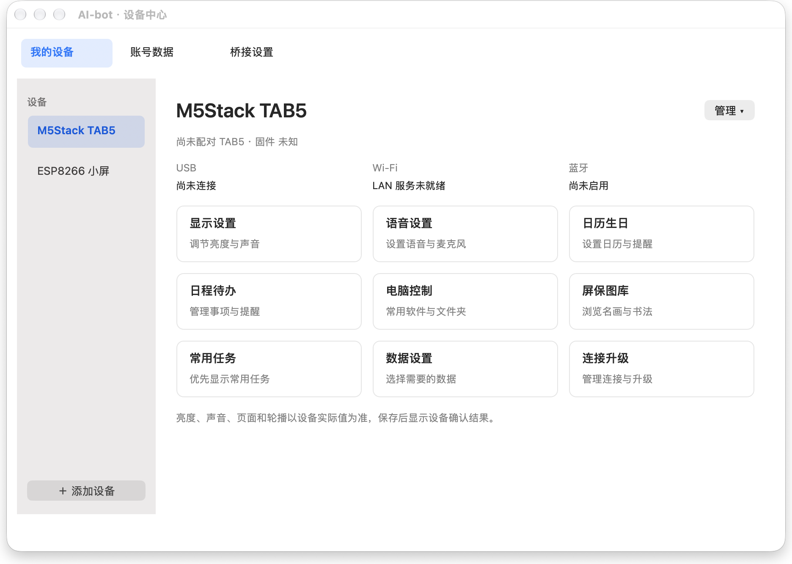
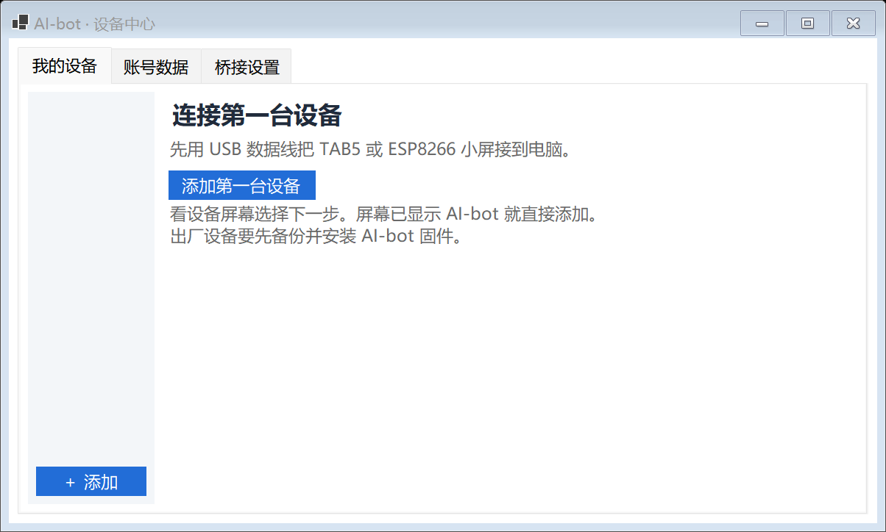
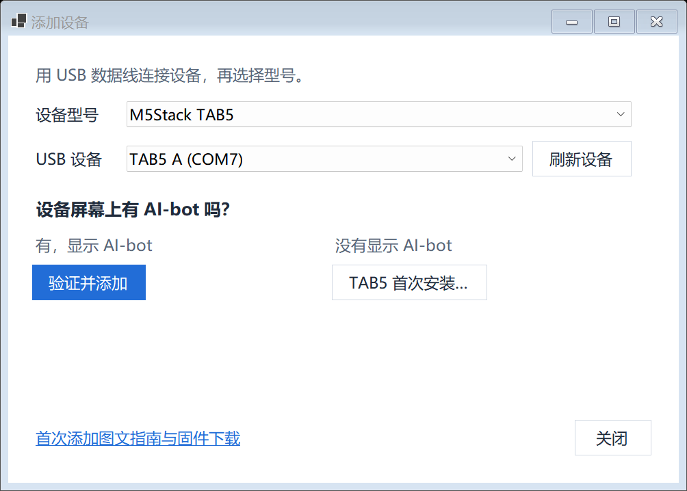
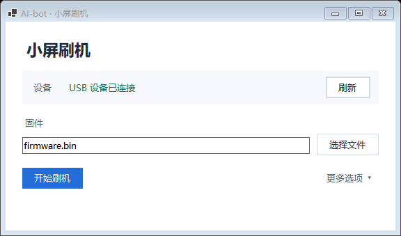
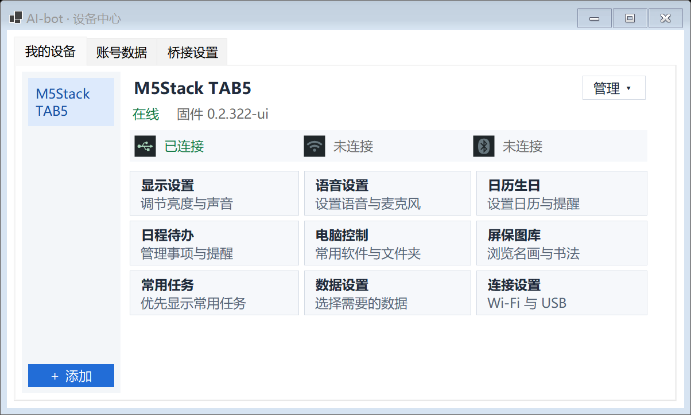
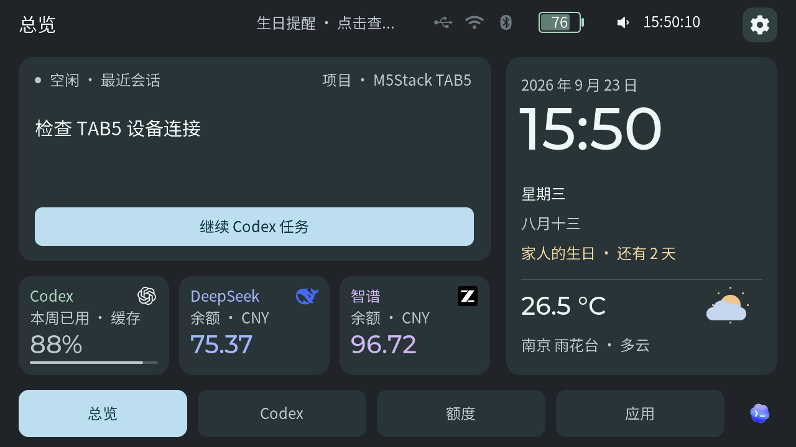

# AI-bot 首次安装图文指南

[下载中心](../DOWNLOADS.md) · [English quick start](INSTALL.zh.md#english-quick-start) · [升级与排错](INSTALL.zh.md#troubleshooting)

适用于 Windows 桥接 0.6.27、Mac 桥接 0.6.26、TAB5 0.2.322-ui 和 ESP8266 0.5.8。准备电脑、设备和一根 **USB 数据线**。首次接入只需 USB，账号、Wi-Fi 和语音可稍后配置。

## 1. 安装电脑桥接

### Windows 10／11 x64

1. 从[下载中心](../DOWNLOADS.md)点 **Windows 桥接**，下载 `*-windows-x64-setup.exe`。安装器未签名，先核对下载来源，再运行并按向导继续；通常保留默认安装位置。
2. 到 **检查运行环境** 时继续安装。缺少 .NET 8 桌面运行时或 WebView2 时，安装器会联网补装。等待向导显示 **AI-bot 安装完成**；若提示 **AI-bot 已安装，解锁配置尚未完成**，也可以先接入设备，按需稍后配置解锁。
3. 保留 **启动 AI-bot（在右下角托盘运行）**，点 **完成**。第一次启动会打开设备中心。若窗口已关闭，右键任务栏通知区里的 AI-bot 图标，选择 **设备中心**。图标可能在通知区的展开菜单里。

### Mac（Apple Silicon，macOS 13 或更新）

1. 从[下载中心](../DOWNLOADS.md)点 **Mac 桥接**，解压 `*-macos-arm64.zip`，把 `AIBotBridge.app` 拖入 Finder 的 **应用程序**。
2. 从 **应用程序** 打开 AI-bot。当前包未公证；如果系统提示无法验证开发者，先核对下载来源，再按 [Apple 的打开应用说明](https://support.apple.com/zh-cn/102445)处理。
3. 首次打开时，按 **系统授权** 引导确认适用的 macOS 提示。辅助功能在系统设置里也可能叫「设备控制和数据访问」。以后可从 **设备中心 → 桥接设置 → 系统授权** 继续。
4. 从菜单栏 AI-bot 图标打开 **设备中心**，首次连接走下方 USB 路线。

## 2. 添加第一台设备

### Windows 快速开始

1. **接好 USB 数据线，点「添加第一台设备」。** 第一次启动时，按钮就在设备中心的「我的设备」页。已添加过设备时，用左下角「＋ 添加」。

   

2. **选择设备型号，再看设备屏幕选路。** 如果屏幕已显示 AI-bot，点「验证并添加」。当列表只有一个可选 USB 设备时，程序会先选中它，确认是自己的设备即可。设备还在出厂状态时，点右侧对应型号的「首次安装…」。出厂固件需要先刷入 AI-bot，重启后才能验证并添加。

   

   USB 列表为空时，检查数据线和接口，再点「刷新设备」。有多个端口时，拔插自己的设备并刷新，核对出现的端口。出厂设备可以直接打开首次安装窗口，按里面的步骤接线或进入下载模式。

### 按设备当前状态选路线

| 你现在看到什么 | 下一步 |
| --- | --- |
| 屏幕已显示 AI-bot，只是首次连接这台电脑 | [直接添加设备](#add-existing)，无需刷机 |
| TAB5 仍运行出厂系统 | [TAB5 首刷](#tab5-setup)，下载 **TAB5 · 出厂系统首次安装** |
| ESP8266 小屏尚未安装 AI-bot | [ESP8266 首刷](#esp8266-setup)，下载 **ESP8266 小屏 · 首刷／升级通用** |

> 屏幕亮起只表示有供电。电脑找不到设备时，先换支持数据传输的 USB 线。TAB5 用 USB-C 数据口；部分小屏随附的线只能供电。

### 每一步看什么结果

| 当前步骤 | 看到这些再继续 |
| --- | --- |
| 接 USB | 电脑能选到自己的端口。TAB5 首刷要先看到设备内部的绿灯快速闪烁，再刷新端口。 |
| 选择 AI-bot 固件 | 已选中对应硬件的 ZIP。刷机工具会检查包和目标；备份或校验失败时，按窗口提示处理后再重试。 |
| 等待刷机完成 | TAB5 显示 **写入校验通过**，ESP8266 看到 **刷机完成**。保留工具生成的备份。 |
| 重启并添加 | 设备显示 AI-bot。Windows 点 **检查启动并返回**，验证通过后自动回到添加窗口。设备中心显示 **在线** 且 USB 已连接后完成。 |

### 路线 A：设备已经有 AI-bot

1. 用 USB 数据线连接设备，等它启动到 AI-bot 界面。
2. **Windows：** 点 **添加第一台设备**，选型号，确认 USB 设备，再点 **验证并添加**。TAB5 在这一步完成 USB 配对。添加后若要改名，在设备中心选中设备，打开 **管理 → 修改名称**。
3. **Mac：** 设备中心 → **＋ 添加设备**，选型号后点 **保存**。TAB5 会打开 **USB 配对**，点 **刷新设备**，选本机端口，再点 **配对**；看到 **配对已完成** 即可。ESP8266 添加后检查设备中心的 USB 状态。

### 路线 B：从出厂系统首次安装 TAB5

TAB5 的出厂系统走这条路线。首刷会替换出厂固件和设置，安装工具会先备份。请保留备份文件，以便恢复同一台设备。

1. **下载首刷包。** 从下载中心选 **TAB5 · 出厂系统首次安装**，文件名包含 `-first-install.zip`。直接选择 ZIP，不用解压。
2. **打开首次安装。** Windows 在 **添加** 窗口选 **M5Stack TAB5 → TAB5 首次安装…**。Mac 在设备中心添加 **M5Stack TAB5** 后，进入 **USB 配对 → 出厂设备首次安装…**。
3. **进入下载模式。** 接好 USB-C 数据线，长按 **RESET** 约 2 秒，看到内部绿灯快闪后松开。Windows 点 **刷新设备**，Mac 点 **刷新 USB 端口**，选择这台 TAB5 的下载端口。[M5Stack 官方图解](https://docs.m5stack.com/zh_CN/guide/tab5/restore_factory)
4. **备份并安装。** Windows 点 **选择安装包…**，选首刷 ZIP，点 **备份并安装**。在 **确认 TAB5 写入** 中核对设备、版本和替换提示后确认。Mac 点 **选择首刷 ZIP，备份并安装…**，选 ZIP 并核对端口，再点 **确认并开始**。保持供电和数据线连接，等到写入校验成功。
5. **重启并接入。** Windows 看到 **写入校验通过**、Mac 看到 **写入已校验，备份已保留** 后，短按 **RESET**，等 AI-bot 界面出现。重启后端口号可能改变。
   - **Windows：** 点 **刷新设备**，确认启动后的端口，再点 **检查启动并返回**。验证通过后会自动回到添加窗口，并选中刚验证的设备。点 **验证并添加** 完成 USB 配对。
   - **Mac：** 回到 **USB 配对**，点 **刷新设备**，选择启动后的端口并点 **配对**，等待 **配对已完成**。

*Windows 首刷窗口示例。Mac 按上面的 Mac 按钮名称操作。*

### 路线 C：首次安装 ESP8266 小屏

1. 从下载中心选 **ESP8266 小屏 · 首刷／升级通用**，文件名包含 `-flash.zip`。直接选择 ZIP，不用解压。
2. 用 USB 数据线连接小屏。**Windows：** 设备中心 → **添加 → ESP8266 小屏 → ESP8266 首次安装…**。**Mac：** 设备中心 → **＋ 添加设备**，选 **ESP8266 小屏** 并保存，再打开 **管理 ▾ → 手动刷机…**。
3. 等工具识别到目标小屏。Windows 点 **选择文件**，Mac 点 **浏览…**，选精简 ZIP；核对目标设备后点 **开始刷机**。工具会备份、写入和校验，看到 **刷机完成** 后再关闭窗口。
4. **Windows：** 回到 **添加**，刷新并选择小屏端口，点 **验证并添加**。**Mac：** 回到设备中心，查看已添加小屏的 USB 状态并等待重新连接。

*Windows 刷机窗口示例。文件栏显示演示 BIN；首次安装可直接选下载的精简 ZIP。*

## 3. 确认安装完成

1. **电脑端：** Windows 添加成功会回到设备中心并选中新设备。看到 **在线**，且 USB 图标旁显示 **已连接**，就可以开始使用。TAB5 会在验证并添加时完成 USB 配对。

   

   *Windows 界面截图使用演示设备和端口。操作时请核对自己的设备。*
2. **实体屏：** 出现 AI-bot 界面、时钟持续更新；TAB5 可点底部页面切换。屏幕无额度数据时，可以稍后到 **账号数据** 配置对应账号。
3. **遇到问题：** 看不到设备先检查 USB 线、端口和下载模式；校验或配对失败先记下提示，按[排错表](INSTALL.zh.md#troubleshooting)处理。

*总览界面示例，账号与日期为演示数据。*
