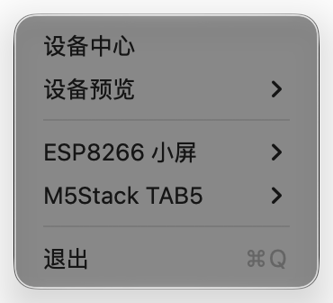
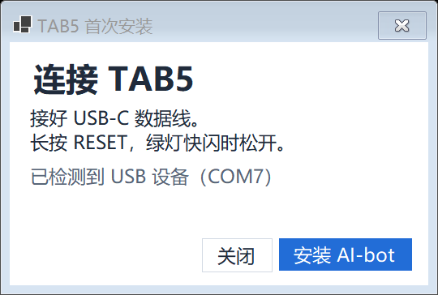
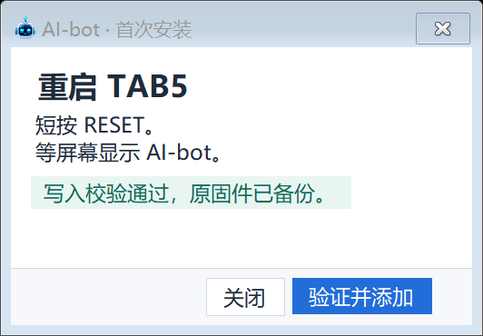
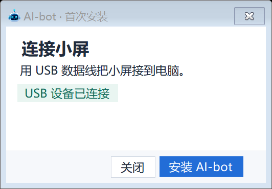
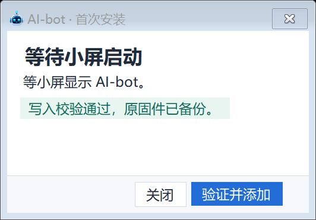

# AI-bot 首次安装图文指南

[下载中心](../DOWNLOADS.md) · [English quick start](INSTALL.zh.md#english-quick-start) · [升级与排错](INSTALL.zh.md#troubleshooting)

适用于 Windows 桥接 0.6.27、Mac 桥接 0.6.26、TAB5 0.2.322-ui 和 ESP8266 0.5.8。准备电脑、设备和一根 **USB 数据线**。首次接入只需 USB，账号、Wi-Fi 和语音可稍后配置。

## 1. 安装电脑桥接

### Windows 10／11 x64

1. 从[下载中心](../DOWNLOADS.md)点 **Windows 桥接**，下载 `*-windows-x64-setup.exe`。安装器未签名，先核对下载来源，再运行并按向导继续；通常保留默认安装位置。
2. 到 **检查运行环境** 时继续安装。缺少 .NET 8 桌面运行时或 WebView2 时，安装器会联网补装。等待向导显示 **AI-bot 安装完成**；若提示 **AI-bot 已安装，解锁配置尚未完成**，也可以先接入设备，按需稍后配置解锁。
3. 保留 **启动 AI-bot（在右下角托盘运行）**，点 **完成**。第一次启动会打开设备中心。若窗口已关闭，右键任务栏通知区里的 AI-bot 图标，选择 **设备中心**。图标可能在通知区的展开菜单里。

### Mac（Apple Silicon，macOS 13 或更新）

1. 从[下载中心](../DOWNLOADS.md)点 **Mac 桥接**，解压 `*-macos-arm64.zip`，把 `AIBotBridge.app` 拖入 Finder 的 **应用程序**。
2. 从 **应用程序** 打开 AI-bot。当前包未公证；如果系统提示无法验证开发者，先核对下载来源，再按 [Apple 的打开应用说明](https://support.apple.com/zh-cn/102445)处理。
3. 首次打开时，按 **系统授权** 引导确认适用的 macOS 提示。辅助功能在系统设置里也可能叫「设备控制和数据访问」。以后可从 **设备中心 → 桥接设置 → 系统授权** 继续。
4. 从菜单栏 AI-bot 图标打开 **设备中心**，首次连接走下方 USB 路线。

## 2. 添加第一台设备

### Windows 快速开始

1. **接好 USB 数据线，点「添加第一台设备」。** 第一次启动时，按钮就在设备中心的「我的设备」页。已添加过设备时，用左下角「＋ 添加」。

   

2. **选择设备型号，回答「设备屏幕上有 AI-bot 吗？」** 有就点 **验证并添加**；没有就点对应型号的 **首次安装…**。只有一个可选 USB 设备时，程序会自动选中。

   

   USB 列表为空时，检查数据线和接口，再点「刷新设备」。有多个端口时，拔插自己的设备并刷新，核对出现的端口。出厂设备可以直接打开首次安装窗口，按里面的步骤接线或进入下载模式。

### 按设备当前状态选路线

| 你现在看到什么 | 下一步 |
| --- | --- |
| 屏幕已显示 AI-bot，只是首次连接这台电脑 | [直接添加设备](#add-existing)，无需刷机 |
| TAB5 仍运行出厂系统 | [TAB5 首刷](#tab5-setup)，Windows 自动下载固件 |
| ESP8266 小屏尚未安装 AI-bot | [ESP8266 首刷](#esp8266-setup)，Windows 自动下载固件 |

> 屏幕亮起只表示有供电。电脑找不到设备时，先换支持数据传输的 USB 线。TAB5 用 USB-C 数据口；部分小屏随附的线只能供电。

### 每一步看什么结果

| 当前步骤 | 看到这些再继续 |
| --- | --- |
| 接 USB | TAB5 首刷先看内部绿灯快闪；Windows 会自动检测 USB 设备。 |
| 准备固件 | Windows 会自动下载并校验对应设备的首刷包。手动安装时，选择对应硬件的 ZIP。 |
| 等待刷机完成 | Windows 显示 **写入校验通过，原固件已备份** 后再继续。 |
| 重启并添加 | 设备显示 AI-bot 后，Windows 点 **验证并添加**。设备中心显示 **在线** 且 USB 已连接后完成。 |

### 路线 A：设备已经有 AI-bot

1. 用 USB 数据线连接设备，等它启动到 AI-bot 界面。
2. **Windows：** 点 **添加第一台设备**，选型号，确认 USB 设备，再点 **验证并添加**。TAB5 在这一步完成 USB 配对。添加后若要改名，在设备中心选中设备，打开 **管理 → 修改名称**。
3. **Mac：** 设备中心 → **＋ 添加设备**，选型号后点 **保存**。TAB5 会打开 **USB 配对**，点 **刷新设备**，选本机端口，再点 **配对**；看到 **配对已完成** 即可。ESP8266 添加后检查设备中心的 USB 状态。

### 路线 B：从出厂系统首次安装 TAB5

首刷会先备份，再替换 TAB5 的出厂固件和设置。请保留电脑上的备份。

**Windows · 三步**

1. **连接。** 在 **添加** 窗口点 **M5Stack TAB5 → TAB5 首次安装…**。接好 USB-C 数据线，长按 **RESET** 约 2 秒，内部绿灯快闪时松开。程序会自动检测，只有需要区分设备时才显示端口列表。[M5Stack 官方图解](https://docs.m5stack.com/zh_CN/guide/tab5/restore_factory)
2. **安装。** 点 **安装 AI-bot**，程序会下载并校验官方固件。在 **确认写入固件** 中核对设备和版本后确认。保持供电和数据线连接，等待 **写入校验通过**。

   

3. **重启并添加。** 短按 **RESET**，等屏幕显示 AI-bot，再点 **验证并添加**。程序会检查启动、完成 USB 配对，并回到设备中心选中新设备。

   

下载失败时，可重试，或点 **使用本地 ZIP…** 并选择下载中心的 **TAB5 · 出厂系统首次安装** 包。直接选择 ZIP 即可。

**Mac**

1. 在[下载中心](../DOWNLOADS.md)下载 **TAB5 · 出厂系统首次安装** ZIP。在设备中心添加 **M5Stack TAB5** 后，进入 **USB 配对 → 出厂设备首次安装…**。
2. 接线后长按 **RESET**，内部绿灯快闪时松开。点 **刷新 USB 端口**，选择目标端口。点 **选择首刷 ZIP，备份并安装…**，选择 ZIP，再点 **确认并开始**。
3. 看到 **写入已校验，备份已保留** 后短按 **RESET**，等屏幕显示 AI-bot。回到 **USB 配对**，刷新并选择启动后的端口，点 **配对**，等到 **配对已完成**。

### 路线 C：首次安装 ESP8266 小屏

**Windows · 三步**

1. **连接。** 在 **添加** 窗口点 **ESP8266 小屏 → ESP8266 首次安装…**，用 USB 数据线把小屏接到电脑。看到 **USB 设备已连接** 就可以继续。
2. **安装。** 点 **安装 AI-bot**，程序会自动下载并校验官方固件。在 **确认写入固件** 中核对目标设备后确认。保持连接，等待 **写入校验通过，原固件已备份**。

   

3. **验证并添加。** 等小屏显示 AI-bot，再点 **验证并添加**。设备中心自动选中新设备，并显示 USB 连接状态。

   

下载失败时，可以重试，或点 **使用本地 ZIP…** 选择从下载中心取得的 **ESP8266 小屏 · 首刷／升级通用** 包。

**Mac**

1. 从[下载中心](../DOWNLOADS.md)下载 **ESP8266 小屏 · 首刷／升级通用** ZIP，用 USB 数据线连接小屏。
2. 在设备中心 **＋ 添加设备**，选 **ESP8266 小屏** 并保存。打开 **管理 ▾ → 手动刷机…**，点 **浏览…** 选择 ZIP。
3. 核对目标设备，点 **开始刷机**。看到 **刷机完成** 后回到设备中心，确认 USB 已连接。

## 3. 确认安装完成

1. **电脑端：** Windows 添加成功会回到设备中心并选中新设备。看到 **在线**，且 USB 图标旁显示 **已连接**，就可以开始使用。TAB5 会在验证并添加时完成 USB 配对。

   

   *Windows 界面截图使用演示设备和端口。操作时请核对自己的设备。*
2. **实体屏：** 出现 AI-bot 界面、时钟持续更新；TAB5 可点底部页面切换。屏幕无额度数据时，可以稍后到 **账号数据** 配置对应账号。
3. **遇到问题：** 看不到设备先检查 USB 线、端口和下载模式；校验或配对失败先记下提示，按[排错表](INSTALL.zh.md#troubleshooting)处理。

*总览界面示例，账号与日期为演示数据。*
