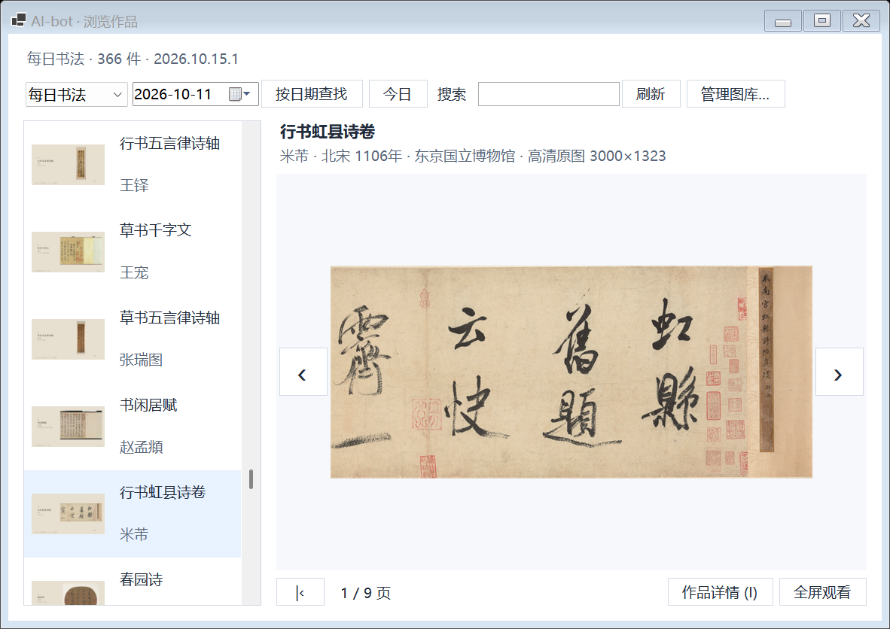

# 图库包 / Gallery packs

名画与书法各 366 件独立作品。两类的标准版和高清版均为 **2026.2** 内容版，内部包版本为 **2026.11.12.1**。本版更新逐件导览、赏析、可核实的书法正文或参考，以及对应来源。

| 作品 / Collection | 普通版 / Standard | 高清版 / HD |
| --- | --- | --- |
| 名画 / Painting | [下载 / Download](https://github.com/yaoyouzhong/AI-bot/releases/download/v0.6.20/AI-bot-gallery-painting-standard-2026.11.12.1.zip) | [2.93 GiB · 2 段 / parts](GALLERY-HD.md#painting) |
| 书法 / Calligraphy | [下载 / Download](https://github.com/yaoyouzhong/AI-bot/releases/download/v0.6.20/AI-bot-gallery-calligraphy-standard-2026.11.12.1.zip) | [2.89 GiB · 2 段 / parts](GALLERY-HD.md#calligraphy) |

[高清下载与合并 / HD download and merge](GALLERY-HD.md#download) · [普通版 SHA-256](https://github.com/yaoyouzhong/AI-bot/releases/download/v0.6.20/SHA256SUMS.txt) · [高清版 SHA-256](https://github.com/yaoyouzhong/AI-bot/releases/download/gallery-2026.11.12.1/SHA256SUMS.txt) · [版次说明 / Edition history](GALLERY-VERSIONS.md)

## 下载、浏览与导入

1. 只需设备展示图，下载标准 ZIP；希望电脑细看作品，下载高清完整包。两版均含作品和导读，高清包已带标准图，任选一版即可。高清原作不发送给 TAB5。
2. Windows 或 Mac 打开 **设备中心 → 屏保图库 → 安装图库包…**，直接选择完整 ZIP，无需解压。升级电脑软件保留图库；导入失败或取消保留旧内容，更新某类不改变另一类。
3. 点击 **浏览作品**，按标题、作者、日期或拼音查找。图片与阅读区独立；左右键循环翻页，I 展开阅读，F 全屏，Esc 返回。全屏可滚轮缩放、拖动、恢复适合屏幕。
4. TAB5 **设置 → 屏幕与声音**选择每日名画或每日书法并预览。横屏资料位于作品左侧，竖屏保留简化信息。

图片、简介、权威欣赏资料、已核实原文或明确标注的参考文本与来源一起更新。欣赏提示逐件保留权威出处，无证据留空，不将推测或参考文本写成馆方原文。原作按需有界解码；标准图放大不会增加原图细节。各作品原许可继续适用，项目 MIT 许可不替代图像许可。

## TF 卡整库保存

设备缓存为默认。主动在 **设置 → 存储管理**选择 FAT32 TF 后，Windows 桥接通过 USB／Wi-Fi 后台保存已安装图库的全部展示图与可用资料；插卡不会自动启用复制。首次复制保持桥接运行，中断后按校验进度续存，未变 JPEG 复用，文字更新不重传全部图片。BLE 用于单幅同步。

完成作品直接读卡，退出桥接或重启后可离线欣赏；未完成内容仍需同步。无卡、卡满、只读或介质异常时保留已有数据并回退，不格式化卡或删除其他文件。目录为 `/sdcard/aibot/gallery/`，见[目录约定](TF-STORAGE.md)。

2026.1 版完整高清包均用发布的 Windows 程序隔离导入，各 366 件，所有标准分页读取解码、高清浏览、全屏、缩放和阅读检查通过。新截图为实际安装内容的原生捕获；不能由此推定 205 已刷入实机。201／204 的既有硬件结果及满额腾位、BLE 整包 OTA、长期运行边界见[本版发布记录](RELEASE-0.6.7.md)。

## English

Edition 2026.2 contains 366 independent paintings and 366 calligraphy works, available in standard and complete HD packages (2026.11.12.1). Both editions include device previews, updated guides and source attribution. The HD edition adds desktop originals. Follow the [resumable download and merge guide](GALLERY-HD.md), then import the complete ZIP through Device Center → Artwork Collections. App upgrades preserve installed collections, and failed or cancelled imports preserve existing data.

On Windows and Mac, choose **Device Center → Artwork Collections → Install Gallery Package** and select a complete standard or HD ZIP. Desktop browsing supports title/artist/date/pinyin search, wrapped page navigation, independent reading, fullscreen, wheel zoom and pan. HD decoding is bounded and desktop-only; TAB5 receives standard previews. Explicit opt-in TF storage copies complete installed previews/guides over USB/Wi-Fi, resumes verified progress and reuses unchanged JPEGs. Device cache remains the default; no unrelated files are removed. Complete imports and full page reads were verified in isolation for edition 2026.1. Native captures are separate from physical firmware acceptance; see the release record for retained evidence and open boundaries.
