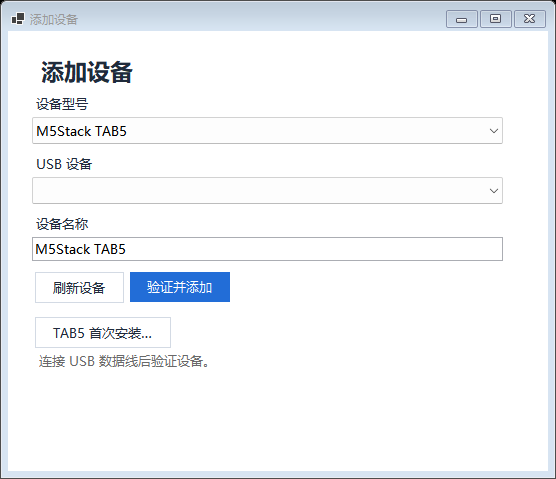
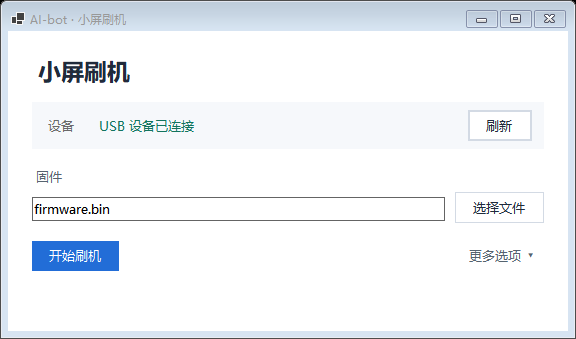
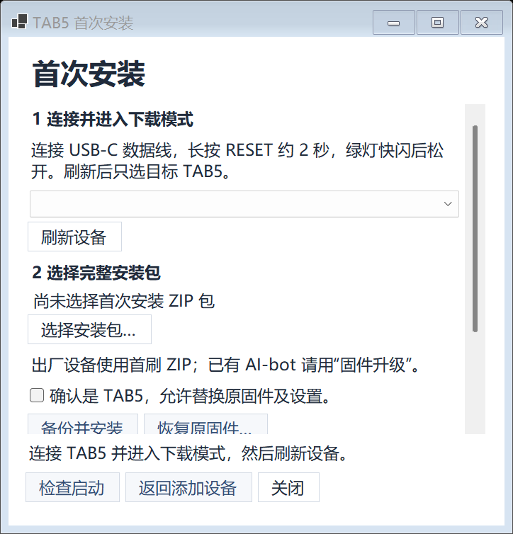
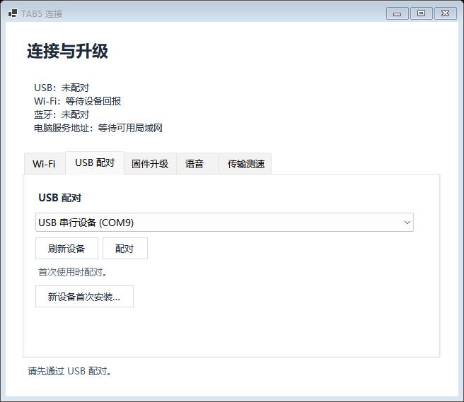
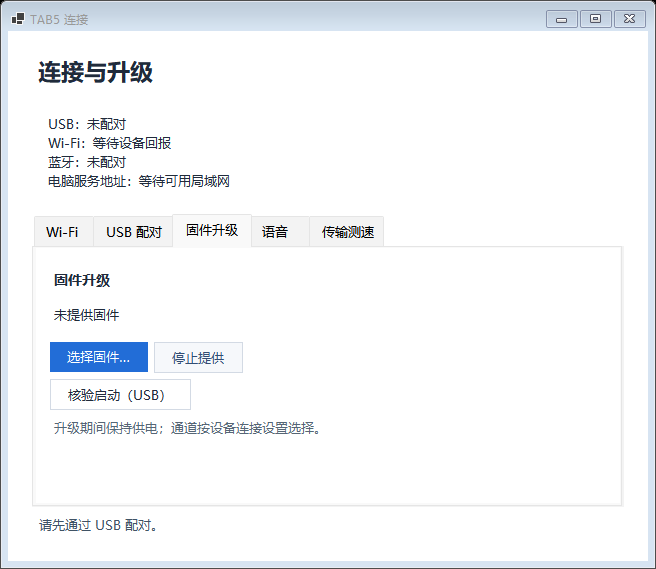
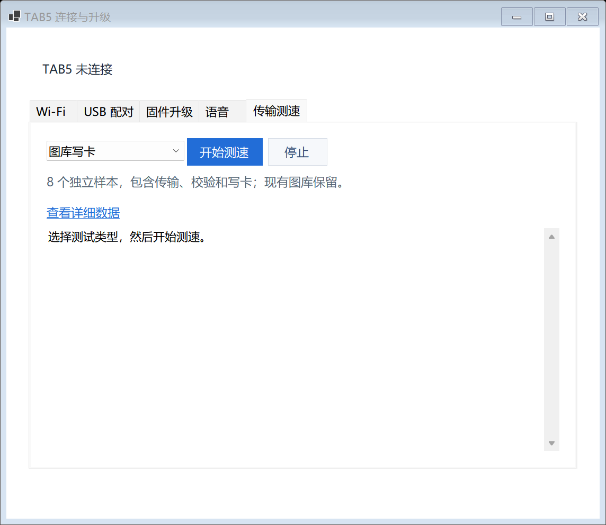
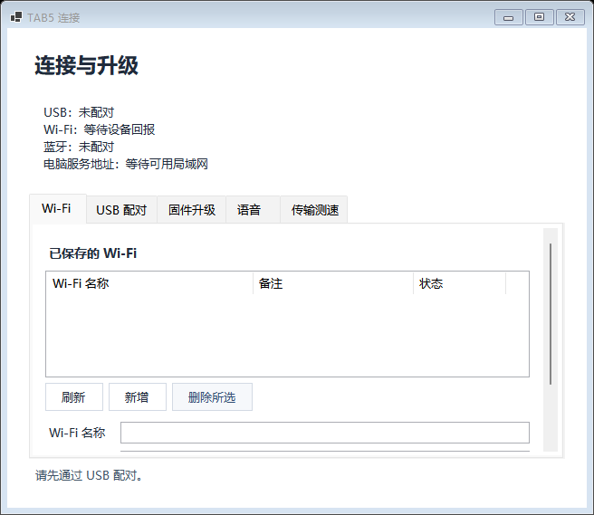

# AI-bot 安装与刷机指南

适用于 **Windows 0.6.10 / Mac 0.6.7 / TAB5 0.2.234-ui**，ESP8266 为 0.5.3，更新于 2026-10-19。Windows 支持 ESP8266 与 TAB5；Mac 的刷机入口目前支持 ESP8266。

**先安装应用，再按你的设备选择下面一条路线。** 每条刷机路线只需 4 步。

新增字库已编译进 TAB5 固件，无需单独安装。年度精选名画、书法各 366 件，以两个独立图库包提供；公开内容版次均为 **2026.1**；内部日期编号和现有文件名保留，见[版次说明](GALLERY-VERSIONS.md)。作品资料以实际安装包为准，整理中的文字不作为已发布内容。软件升级保留已安装图库，导入图文包时对应类别的图片和文字一起校验更新；分页不重复计作作品。使用方法见 [图库说明](GALLERY-PACKS.md)。ESP8266 0.5.3 增加固定设备身份与 USB 换口恢复；Apple Music 实际播放待有可播放内容后验收。

可选[高清完整图库](GALLERY-HD.md)各 366 件，包含标准图与资料。按说明下载三个工具文件，即可分段续传、自动合并并导入完整 ZIP，无需先装标准版。日程在「设备中心 → 日程待办」或 TAB5「应用 → 日程」管理，最多 16 项；离线修改重连后同步。210 的日程、内存、写入与重启电量已通过本地真机验收，详见[发布记录](RELEASE-0.6.8.md)。

## 1. 下载与安装

从[完整下载中心](https://github.com/yaoyouzhong/AI-bot/blob/main/DOWNLOADS.md)一次找到电脑桥接、小屏固件、TAB5 首刷／升级包与书法／名画图库。已有图库无需重下。按用途选择：

| 你要做什么 | 下载什么 |
| --- | --- |
| Windows 安装应用 | [Windows 安装器](https://github.com/yaoyouzhong/AI-bot/releases/download/v0.6.10/AI-bot-bridge-v0.6.10-windows-x64-setup.exe) |
| Mac 安装应用（macOS 13+、M 系列芯片） | [Mac 应用 ZIP](https://github.com/yaoyouzhong/AI-bot/releases/download/v0.6.7/AIBotBridge-0.6.7-local-candidate-macos-arm64.zip) |
| ESP8266 首刷或更新 | [ESP8266 固件 ZIP](https://github.com/yaoyouzhong/AI-bot/releases/download/esp8266-v0.5.3/AI-bot-0.5.3-firmware-materials.zip) |
| TAB5 从出厂系统首次安装 | [TAB5 首刷 ZIP](https://github.com/yaoyouzhong/AI-bot/releases/download/tab5-v0.2.234-ui/AI-bot-tab5-0.2.234-ui-first-install.zip) |
| TAB5 已安装 AI-bot，更新固件 | [TAB5 升级 ZIP](https://github.com/yaoyouzhong/AI-bot/releases/download/tab5-v0.2.234-ui/AI-bot-tab5-0.2.234-ui-upgrade.zip) |

**TAB5 首刷也是 0.2.234-ui，无需先刷旧版。** 首刷包直接选择 ZIP；升级包先解压，再选里面的 `aibot_tab5.bin`，同目录保留 `aibot_tab5.bin.notes.json`。两种硬件的固件不可互换；GitHub 的 Source code 不是刷机文件。

桥接、ESP8266 和 TAB5 分别更新，版本号可以不同；以后只升级更新说明要求的部分，无需每次一起刷机。

Windows 0.6.10 从“设备中心 → 桥接设置 → 软件固件”打开统一的[软件与固件更新](UPDATES.md)：自动提醒、显示明细、选择对应包、下载并校验，再进入现有安装流程。旧版用户先安装新的电脑端；首次安装方法不变。名画／书法是可选的[独立图库](GALLERY-PACKS.md)，不下载也可使用其他功能。

Windows：运行安装器，保持联网以便补齐缺少的运行环境；安装后在右下角托盘右键 → **设备中心**。已有用户先退出桥接，安装到原位置，再用原快捷方式启动。

新设备点 **我的设备 → 添加**，选择对应型号。已有 AI-bot 固件的设备可直接 **验证并添加**，无需首刷。当前支持每种型号一台。

截图来自当前原生 Windows 程序，使用隔离演示数据；端口号仅为示例，操作时选择自己的设备。

## 2. 按硬件刷机（选一条）

### A. ESP8266：首次安装或更新 · 4 步

准备 USB 数据线，设备须为支持的 ESP8266 / ESP-12S、240×240 ST7789 小屏；其他板卡先核对[引脚配置](../firmware/platformio.ini)。

**线材提醒：小屏随附电源线只能供电，不能用于刷机或 USB 桥接。请换用支持数据传输的 USB 数据线；屏幕亮起不代表电脑能识别设备。**

**Cable note:** The compact display's included power cable does not carry data. Use a USB data cable for flashing and USB bridge connections; a lit screen alone does not mean the computer can detect it.

1. **连接并打开刷机。** 插 USB；新设备在“添加”里选 **ESP8266 小屏 → ESP8266 首次安装…**，已有设备选中小屏 → **管理… → 固件升级**。关闭其他串口工具，保持 AI-bot 桥接运行。
2. **选择文件并刷入。** 点 **选择文件**，直接选下载的 ESP8266 固件 ZIP，无需解压；确认设备后点 **开始刷机**。工具自动先备份，再写入和回读校验；过程中保持供电与连接。

3. **看到完成后添加。** 提示“刷机完成”后关闭窗口；新设备回“添加”刷新，点 **验证并添加**；已有设备等待 USB 恢复。失败不要当作成功，按[排错](#troubleshooting)处理。
4. **检查屏幕并收尾。** 在设备中心打开 **显示设置**，确认实体屏能更新、切页；恢复自动显示与循环展示，保留原页面、顺序和间隔。

### B. TAB5：从出厂系统首次安装 · 4 步

使用 **USB-C 数据接口**连接电脑。首次安装会替换 P4 原固件与设置，工具先完整备份；保留备份以便恢复。已有 AI-bot 的设备使用下方升级路线。

1. **进入安装窗口与下载模式。** “添加”里选 **M5Stack TAB5 → TAB5 首次安装…**。连接 USB-C，长按 RESET 约 2 秒，内部绿灯快速闪烁后松开；点 **刷新设备**，选择这台 TAB5 的端口。[进入下载模式的官方说明](https://docs.m5stack.com/zh_CN/guide/tab5/restore_factory)。
2. **选择首刷 ZIP 并安装。** 点 **选择安装包…**，选 `AI-bot-tab5-0.2.234-ui-first-install.zip`，勾选“确认是 TAB5，允许替换原固件及设置”，点 **备份并安装**。按提示确认设备；等待备份、写入、校验结束，不拔线。

3. **重启并检查。** 提示“写入校验通过”后短按 RESET，等待屏幕启动；点 **刷新设备**，重新选择启动后的端口，再点 **检查启动**。检查通过后点 **进入 USB 配对**返回上层。端口号变化属于正常情况。
4. **添加并确认数据。** 回“添加”刷新，选重启后的 TAB5，点 **验证并添加**，此操作会完成 USB 验证与配对。确认实体屏、触摸和数据更新；需要重新配对时使用 **连接升级 → USB 配对 → 刷新设备 → 配对**。恢复自动连接与自动展示，保留原显示设置。

Windows 0.6.8 与 TAB5 0.2.190-ui+ 支持在“连接与固件升级 → 固件升级”选择固件后直接点击 **开始升级**，设备保存草稿、检查忙碌状态后回传结果，并按原连接设置下载／写入。较旧固件需先在 TAB5 上完成一次升级；之后不必每次在设备上点击。已有 TF 图库不重传，完成后仍核验启动。

Windows 0.6.8 with TAB5 0.2.190-ui+ supports **Start Upgrade** in the desktop firmware tab after selecting the image. Device drafts and busy guards remain active; older firmware needs one device-confirmed upgrade first. Subsequent updates can start from the desktop. Preserve TF data and verify the new boot afterward.

### C. TAB5：已有 AI-bot，后续升级 · 4 步

1. **解压并打开升级页。** 完整解压 `AI-bot-tab5-0.2.234-ui-upgrade.zip`。设备中心选中 TAB5 → **连接升级 → 固件升级**，保持有效连接和供电。
2. **提供固件。** 点 **选择固件…**，选解压后的 `aibot_tab5.bin`，同目录保留更新说明文件；核对版本 **0.2.234-ui** 与更新说明，确认提供。

3. **开始升级。** 支持的设备在电脑点 **开始升级**；旧固件先在 TAB5 上完成一次升级。等待传输、校验与重启。“已提供固件”只是准备完成，不代表已安装。
4. **核验并恢复显示。** 重启后用 USB 连接电脑，在升级页的核验状态旁点 **核验启动**，看到“启动核验通过”后检查触摸与数据；恢复原连接模式、自动展示及轮播设置。

**传输测速：** “连接升级 → 传输测速”选择 **图库写卡**或 **通信传输**，点 **开始测速**。前者测独立样本的传输、校验和写卡速度，保留现有图库；后者只测通信。默认显示速度和完成状态，点 **查看详细数据**展开分段耗时。需连接 USB 读取结果；图库测试通道按 TAB5 的连接方式选择。

**Transfer tests:** Select **Gallery/Card** or **Communication** in the transfer test tab, then **Start Test**. Gallery tests include sample transfer, validation and card writes while retaining installed collections; communication tests do not write to the card. Expand details for phase timings. USB is required to read results; gallery transport follows the device connection setting.

首刷 ZIP 不用于应用升级。旧分区不兼容时停止操作，按对应迁移方案处理，不用首刷来保留已有设置。

## 3. 可选设置

设备中心分三页：**我的设备、账号数据、桥接设置**。账号数据提供模型账号、天气定位、自选股票和额度历史；我的设备中选择一台设备，再配置显示、数据与连接；桥接设置提供开机启动、服务状态、软件固件、配置迁移和提醒管理。TAB5 另有语音、日历生日与常用任务。

ESP8266 的“显示设置”选择自动轮播、智能跟随或固定页；自动屏保等待时间在“连接设置”。TAB5 的屏保类型与预览在设备“设置 → 屏幕与声音”；名画／书法先按[图库说明](GALLERY-PACKS.md)导入。

TAB5 的 **设置 → 存储与缓存** 独立显示 TF 卡状态。默认使用设备缓存；主动选择 TF 卡后，通过 Windows 桥接的 USB／Wi-Fi 保存电脑已安装的整套图库，包括全部作品、分页、横竖屏及文字。完成后可离线查看；未完成的作品仍需桥接。卡不可用时回退设备缓存，不格式化或删除其他文件。当前固件使用 FAT32 卡，128GB 卡需先准备为 FAT32。

电脑端 **屏保图库 → 浏览作品** 支持往期作品、搜索、完整阅读资料、双击全屏、滚轮缩放、拖动及 Esc 退出。

Windows 0.6.10 新增 **电脑控制 → 一键解锁设置 → Wi-Fi 解锁设置**：点击“安装并启用”，通过 Windows 管理员确认后离线安装 TightVNC Server，自动生成并加密保存组件密码。已有 TightVNC 点击“自动接入”，验证兼容性后复用本机认证并保留原配置，全程无需填写或设置 TightVNC 密码；不兼容时明确提示，停止接入。仅 AI-bot 安装且未被修改的组件可从此页卸载。卸载 AI-bot 时也可选择移除该组件，Windows PIN 和配对保留。此功能已随本次 Windows 安装包正式发布。

Development candidate: Computer Control → One-click Unlock Settings → Wi-Fi Unlock Settings installs the bundled Server on demand after Windows administrator approval. Component passwords are generated and protected locally. Compatible existing installations automatically import local authentication without requesting a password or changing existing settings. Unsupported installations stop explicitly. Only unchanged AI-bot-owned components can be removed. AI-bot uninstall offers the same optional removal while preserving PIN and pairing. Current public packages do not yet include this feature.

TAB5 需要无线时，在 **连接升级 → Wi-Fi** 保存网络并确认有效数据。先把 USB 主流程完成，再按需设置无线；Wi-Fi 已关联不等于桥接数据已连通。ESP8266 无线设置见[进阶说明](FLASH_BUILD.zh.md)。

## Mac：应用安装与 ESP8266 刷机

解压 Mac 应用 ZIP，将 App 放入“应用程序”。应用临时签名且未公证，首次打开按 [Apple 标准方法](https://support.apple.com/zh-cn/102445)操作；Intel Mac 未验证。Windows 安装器也未签名。

连接 ESP8266，菜单 **AI-bot → 小屏刷机…**，选 ESP8266 固件 ZIP，按窗口提示完成备份、写入与回读校验，再检查真实屏幕和连接。本文 TAB5 首刷、配对和升级使用 Windows 工具；不把 Windows 截图当作 Mac 界面。

## 出错时怎么办

| 问题 | 处理 |
| --- | --- |
| 找不到设备 | 换 USB 数据线或接口；TAB5 首刷先进入下载模式，再刷新。ESP8266 确认缺驱动时安装 [WCH 官方驱动](https://www.wch.cn/downloads/CH341SER_EXE.html) |
| 文件选不了 | 核对路线：ESP8266 选自己的 ZIP；TAB5 首刷选首刷 ZIP；TAB5 升级选解压后的 BIN |
| 端口占用 | 关闭其他串口工具；使用内置刷机时保持桥接运行，由工具释放 USB |
| 备份、写入或校验失败 | 保留错误与备份，确认设备仍能启动，不强行跳过检查 |
| TAB5 重启后找不到 | 刷新并选择重启后的端口，再检查启动；不要重新首刷 |
| TAB5 首刷后需恢复原系统 | 重新进入下载模式，在首次安装窗口点 **恢复原固件…**，选同一台设备的 `.bin.json` 备份记录；校验通过后短按 RESET 检查原系统 |
| 已连接但无数据 | 确认设备已添加、USB 配对成功与桥接正在运行 |

备份保存在 `%LOCALAPPDATA%\AI-bot\device-backups\`，TAB5 的 `.bin` 和 `.bin.json` 一起保留；备份可能包含私人设置，不公开上传。USB 偶发中断仍有历史记录，失败先保留错误，不把重试成功理解为已修复。

需要核对下载完整性时，使用对应组件发布页的 SHA-256 清单：[Windows](https://github.com/yaoyouzhong/AI-bot/releases/download/v0.6.10/SHA256SUMS.txt)、[Mac](https://github.com/yaoyouzhong/AI-bot/releases/download/v0.6.7/SHA256SUMS.txt)、[TAB5](https://github.com/yaoyouzhong/AI-bot/releases/download/tab5-v0.2.234-ui/SHA256SUMS.txt)、[名画](https://github.com/yaoyouzhong/AI-bot/releases/download/tab5-v0.2.194-ui/SHA256SUMS.txt)、[书法](https://github.com/yaoyouzhong/AI-bot/releases/download/tab5-v0.2.205-ui/SHA256SUMS.txt)、[ESP8266](https://github.com/yaoyouzhong/AI-bot/releases/download/esp8266-v0.5.3/SHA256SUMS.txt)。[发布与验收记录](RELEASE-0.6.10.md) · [TAB5 开发者源码](development/TAB5-SOURCE.md) · [许可范围](TAB5-LICENSE-SCOPE.md)

## 电脑控制与十网络 / Computer controls and ten saved networks

Windows 0.6.9 与 TAB5 0.2.217-ui 配套提供音量、静音、实际锁屏状态和带图标的快捷启动；电脑端“设备中心 → TAB5 → 电脑控制”配置最多四项。十网络管理同样需要新桥接。先更新桥接，再按已有 TAB5 升级步骤选升级 ZIP 或应用 BIN；保留已存网络、配对和展示设置。这些功能已随 0.6.9／217 公开；本轮 0.6.10／234 的新变化见下节，本轮下载入口已更新。

Windows 0.6.9 and TAB5 0.2.217-ui jointly provide PC controls, launcher icons and ten-network management. Update the bridge first, then follow the existing TAB5 upgrade path; retain pairing, saved networks and display preferences. These controls were published with 0.6.9/217. New 0.6.10/234 changes are described below; their download links are now current.

## English summary

Current releases are Windows 0.6.10, Mac 0.6.7, TAB5 0.2.234-ui and ESP8266 0.5.3. Install the app and choose one hardware route. Windows Device Center separates My Devices, Account Data and Bridge Settings; open Bridge Settings → Software/Firmware for later updates. Each Windows flashing route has four steps: connect/open, select the correct firmware, complete installation/restart, and verify/register. ESP8266 accepts its firmware ZIP directly. Factory TAB5 devices use the full first-install ZIP at 0.2.234-ui: enter download mode, back up/install, reset and check boot, then verify/add to pair. Existing AI-bot TAB5 devices extract the upgrade ZIP and select the application BIN with its notes file, confirm installation on TAB5, then verify boot over USB. Do not interchange hardware packages. Preserve TAB5 display preferences. Restore automatic display/cycling only for ESP8266. Mac flashing currently covers ESP8266; Windows TAB5 support does not imply Mac TAB5 support. Images show native Windows controls with synthetic data, not hardware photographs. Original backups stay private. Optional annual packs contain 366 paintings and 366 calligraphy works. The public painting layout edition is 2026.10.14.1 and calligraphy edition is 2026.10.15.1; reading material follows the installed pack, and unpublished editorial work is excluded. Importing replaces images and reading material together while app upgrades preserve installed packs. Browse Works supports past works, search, fullscreen, wheel zoom, pan and full reading. Settings → Storage & Cache shows TF status independently; device cache remains the default. Explicitly select a FAT32 TF card to save complete installed libraries over a Windows USB/Wi-Fi bridge; only completed works are available offline. Own code is MIT licensed, with third-party terms preserved.

Complete optional HD collections include standard previews and guides. Use the [resumable download and import guide](GALLERY-HD.md); a separate standard import is unnecessary. Agenda/reminders are available in Device Center or TAB5 Apps → Agenda, with offline changes synchronized after reconnecting. Native previews use isolated data; 210 agenda, memory, writing and reboot battery acceptance are documented separately.

设备中心“管理 ▾”展开设备操作。Wi-Fi 黄色表示设备已联网，但 Wi-Fi 桥接通道尚未连通；USB 可独立保持连接。连接页与首页采用统一状态判断。

The Manage dropdown opens device actions. Yellow Wi-Fi means the device joined a network but its Wi-Fi bridge channel is not connected; USB can still work independently. Device overview and connection settings share the same state rules.

## 0.6.8／210 使用要点

- 更新下载中断后再次选择同一组件和版本，可继续下载；仍会完整校验 SHA-256，完成下载不会自动安装。
- 日程有事项时，左侧“今日／全部”筛选和“新建”与列表对齐，右侧显示时间和详情；无事项时居中显示“暂无事项”和“新建”。名称旁麦克风需要电脑语音服务；离线可使用键盘输入。
- “设置 → 屏幕声音”保留经典时钟、年度点阵和年度点阵暖灰等选项，没有独立“暗夜”或“自动昼夜”选项。经典时钟和年度点阵按本地时间 07:00–19:00 显示日间配色，其余为夜间。轻触退出预览；不要求 TAB5 改成轮播。
- 插电重启且尚无可信电量时会自动估算并恢复充电，无需拔线恢复；采样期间可能短暂显示“--”。USB 写入速度受连接和设备状态影响，本次验收写入为 9.609 秒，不作为所有连接的速度承诺。

Interrupted Windows update downloads can resume for the same component and package identity, with full verification before explicit installation. TAB5 210 has aligned agenda filtering, a centered empty state and keyboard input when offline; dictation requires the computer voice service. Classic Clock and Annual Dots follow local day/night time without separate Night/Auto choices. TAB5 keeps its display preferences. Battery estimation recovers automatically after a powered USB reboot; initial sampling can temporarily show “--”.

## Windows 0.6.10 / TAB5 234 更新

先正常退出旧 Windows 托盘程序，运行 0.6.10 安装器，保留设置、PIN、配对和图库。TAB5 已有 AI-bot 选择 0.2.234-ui 升级 ZIP；出厂系统首次安装选择首刷 ZIP，不能混用。通过现有固件升级入口提供应用 BIN，在 TAB5 核对版本后确认升级并等待自动重启；Windows 和固件分别编号，无需为本次固件修复再次安装相同桥接。

一键解锁首次在 Windows「电脑控制 → 一键解锁设置」配置自己的 Windows PIN；Wi-Fi 分支按需安装／自动接入 TightVNC，管理员确认仅用于组件安装或卸载。配套桥接不要求填写 TightVNC 密码。保留 TAB5 当前展示设置，不执行 ESP8266 轮播恢复。音量恢复、双向已读同步、纯 BLE 启动核验及电量显示的实际结果与剩余限制见 [0.6.10 说明](RELEASE-0.6.10.md)。已完成的真机项目不因升级重复验收。

Normally exit the old tray bridge and run the 0.6.10 installer, retaining settings, PIN, pairing and collections. Existing AI-bot devices use the .234 upgrade ZIP; factory-system devices use the distinct first-install ZIP. Offer the application BIN through the existing firmware-upgrade entry, confirm its version on TAB5 and wait for automatic reboot. Bridge and firmware versions are independent. Configure the Windows PIN in Computer control → Unlock settings; the Wi-Fi path installs/imports TightVNC automatically, with administrator confirmation for component installation/removal and no manually entered component password. Preserve TAB5 display settings. Hardware results and remaining limits are recorded in the linked release notes; previously passed tests are retained.
