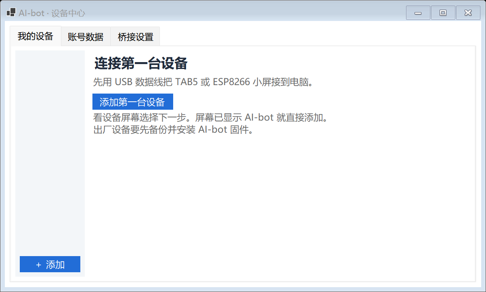
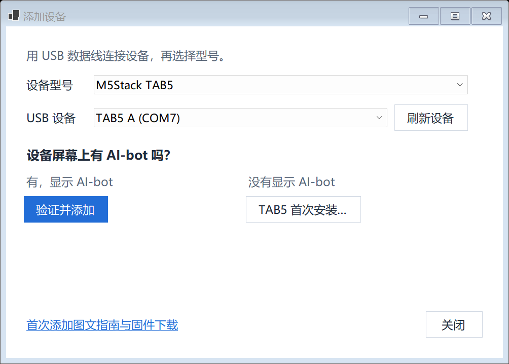
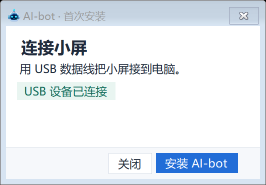
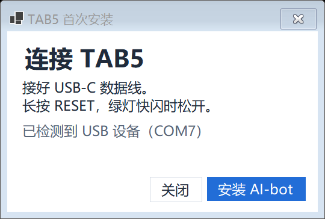
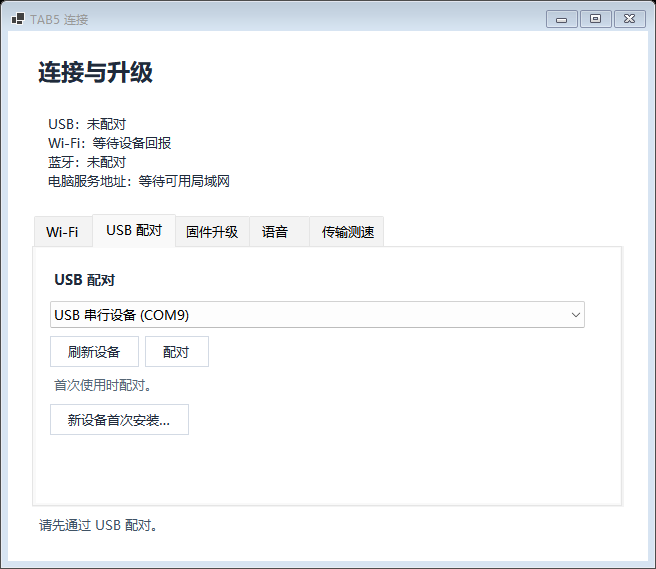
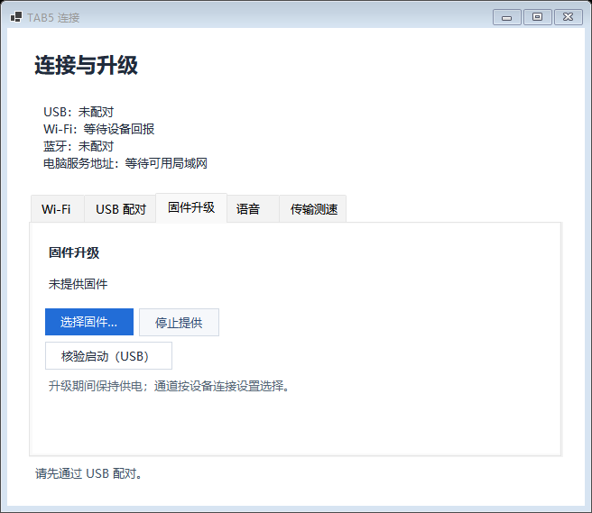
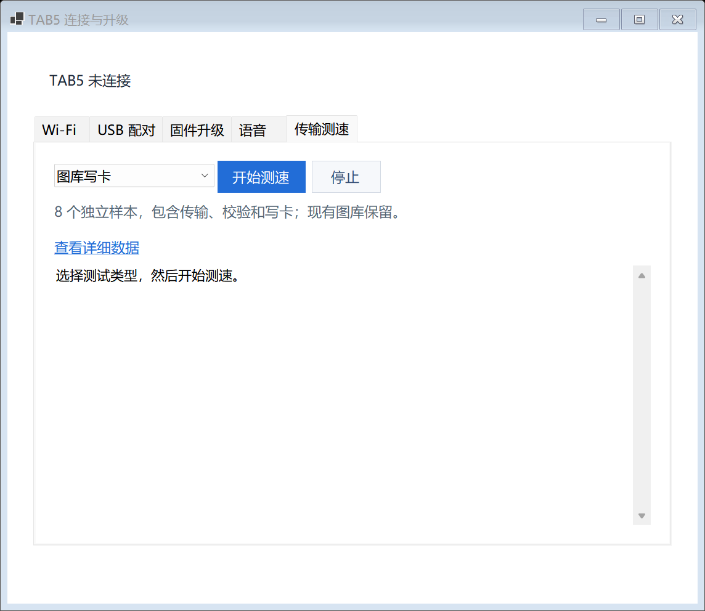
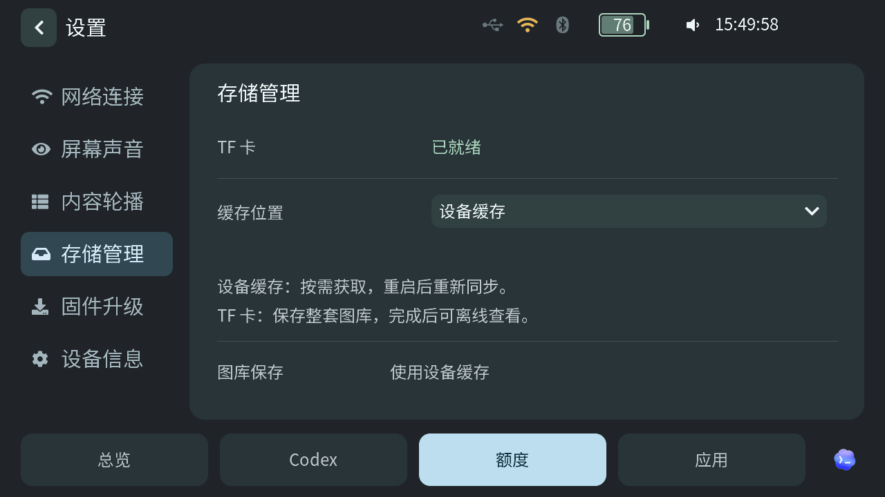
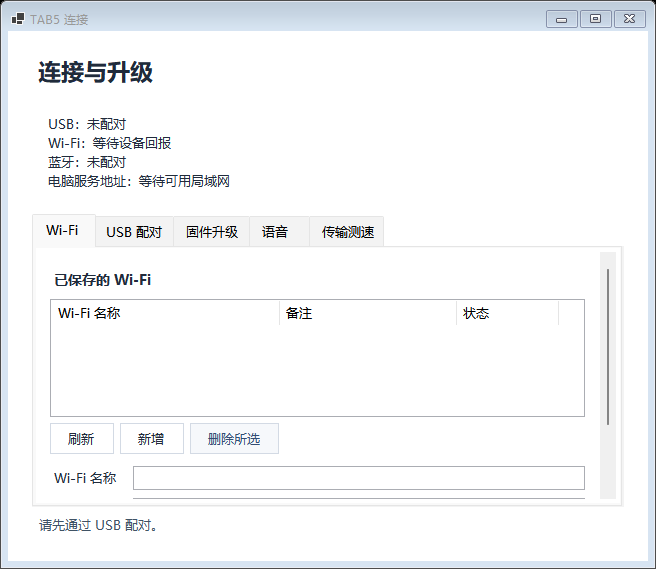
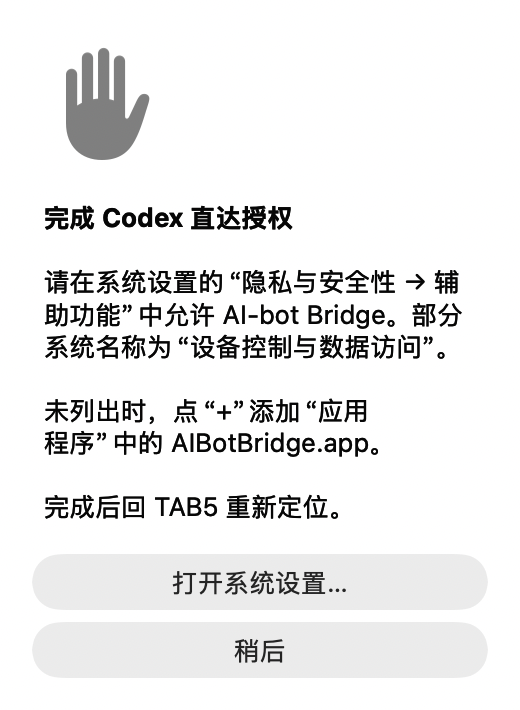

# AI-bot 安装与刷机指南

第一次安装？请先按[首次安装图文指南](FIRST-INSTALL.zh.md)逐步操作。

适用于 **Windows 桥接 0.6.27、Mac 桥接 0.6.26、TAB5 0.2.322-ui、ESP8266 0.5.8**，说明更新于 2026-11-20。Windows 与 Apple Silicon Mac 均支持两类设备。

**先安装电脑应用，再按设备当前系统选择路线。** 第一次只需完成 USB 接入、添加设备和屏幕检查；模型账号、语音、Wi-Fi 和图库都可稍后设置。

| 设备现在是什么状态 | 下一步 |
| --- | --- |
| 已有 AI-bot 界面，只是换了电脑或首次添加到应用 | [直接验证并添加](#connect)，不首刷 |
| TAB5 仍是出厂系统 | [TAB5 首次安装](#tab5-first)，使用首刷 ZIP |
| ESP8266 小屏尚未安装 AI-bot | [ESP8266 首次安装](#esp8266)，使用小屏固件 ZIP |
| 已在使用 AI-bot，需要更新 TAB5 固件 | [TAB5 后续升级](#tab5-upgrade)，使用升级 ZIP 中的 BIN |

Mac 用户先看[应用安装与权限](#mac)，再按相同设备状态选择安装或升级。本文电脑窗口截图来自 Windows，不表示 Mac 控件名称完全相同。

## 1. 下载与安装

从[下载中心](../DOWNLOADS.md)下载电脑桥接、小屏固件或 TAB5 首刷／升级包。按用途选择：

| 你要做什么 | 下载什么 |
| --- | --- |
| Windows 安装应用 | [Windows 安装器](https://github.com/yaoyouzhong/AI-bot/releases/download/v0.6.27/AI-bot-bridge-v0.6.27-windows-x64-setup.exe) |
| Mac 安装应用（macOS 13+、M 系列芯片） | [Mac 应用 ZIP](https://github.com/yaoyouzhong/AI-bot/releases/download/v0.6.26/AI-bot-bridge-v0.6.26-macos-arm64.zip) |
| ESP8266 首刷或更新 | [ESP8266 精简刷机 ZIP](https://github.com/yaoyouzhong/AI-bot/releases/download/esp8266-v0.5.8/AI-bot-esp8266-0.5.8-flash.zip) |
| TAB5 从出厂系统首次安装 | [TAB5 首刷 ZIP](https://github.com/yaoyouzhong/AI-bot/releases/download/tab5-v0.2.322-ui/AI-bot-tab5-0.2.322-ui-first-install.zip) |
| TAB5 已安装 AI-bot，更新固件 | [TAB5 升级 ZIP](https://github.com/yaoyouzhong/AI-bot/releases/download/tab5-v0.2.322-ui/AI-bot-tab5-0.2.322-ui-upgrade.zip) |

**TAB5 首刷版本是 0.2.322-ui。** Windows 首刷会自动下载。手动首刷可直接选择 ZIP；升级包先解压，再选里面的 `aibot_tab5.bin`，同目录保留 `aibot_tab5.bin.notes.json`。两种硬件的固件不可互换；GitHub 的 Source code 不是刷机文件。

桥接、ESP8266 和 TAB5 分别更新，版本号可以不同；以后只升级更新说明要求的部分，无需每次一起刷机。

后续更新从「设备中心 → 桥接设置 → 软件固件」进入，选中组件后点「一键升级」。[完整升级步骤](UPDATES.md)。名画／书法是可选的[独立图库](GALLERY-PACKS.md)，不下载也可使用其他功能。

### Windows 安装

1. 运行 Windows 安装器，通常保留默认位置。安装器未签名，请先确认文件来自本项目下载入口。覆盖升级时选择原安装位置，向导会自动请求正在运行的 AI-bot 正常退出，并在安装完成后重新启动。
2. 按“检查运行环境”页继续。缺少 .NET 8 桌面运行时或 WebView2 时会联网补装，已有组件会跳过；下载慢时查看下载进度，失败可按提示重试。
3. 首次安装会尝试配置电脑解锁组件，可能请求管理员许可。取消或配置失败时，仍可启动 AI-bot，并在 **TAB5 → 电脑控制 → 一键解锁设置** 中保存并重试。覆盖升级保留已有解锁设置。安装向导无需填写 Windows PIN 或密码。
4. 启动 AI-bot。没有设备时会自动打开设备中心；窗口关闭后，点右下角托盘 AI-bot 图标即可再次打开。已有小屏时单击可能打开预览，可右键选择 **设备中心**。

如果安装器下载运行环境很慢，可先从微软下载并安装 [Windows .NET 8 桌面运行时 x64](https://builds.dotnet.microsoft.com/dotnet/WindowsDesktop/8.0.31/windowsdesktop-runtime-8.0.31-win-x64.exe)，再重新运行 AI-bot 安装器；已检测到的组件会跳过。这是当前安装器使用的同一版本，不能用普通 .NET Runtime 或 ASP.NET Runtime 代替桌面运行时。

### 第一次连接设备

1. 用支持数据传输的 USB 线连接设备；屏幕亮起只说明有供电。TAB5 使用 USB-C 数据接口。
2. 在设备中心点 **添加第一台设备**，选型号。设备已经装过 AI-bot 时，点 **连接装过 AI-bot 的设备**。只有一个可选 USB 设备时会自动选中，找不到时再点 **刷新设备**。
3. AI-bot 只装在电脑上、设备还没装过时，点 **在设备上安装 AI-bot**。完成写入后点 **验证并添加**。TAB5 会在验证时完成 USB 配对，ESP8266 会验证小屏身份。
4. 在设备中心确认选中了刚添加的设备，状态显示 **在线** 和 **USB 已连接**。实体屏幕出现 AI-bot 界面、时钟开始更新后，即可开始使用。首次接入可只用 USB。

当前支持每种型号一台。验证超时、列表为空或只有供电时，先按[排错表](#troubleshooting)检查，不通过再次首刷修复普通连接问题。

[跟着图文完成首次添加](FIRST-INSTALL.zh.md#windows-first-device)

截图来自当前原生 Windows 程序，使用隔离演示数据；端口号仅为示例，操作时选择自己的设备。

## 2. 按硬件刷机（选一条）

### A. ESP8266：首次安装 · 3 步

准备 USB 数据线，设备须为支持的 ESP8266 / ESP-12S、240×240 ST7789 小屏；其他板卡先核对[引脚配置](../esp8266/platformio.ini)。

**线材提醒：小屏随附电源线只能供电，不能用于刷机或 USB 桥接。请换用支持数据传输的 USB 数据线；屏幕亮起不代表电脑能识别设备。**

**Cable note:** The compact display's included power cable does not carry data. Use a USB data cable for flashing and USB bridge connections; a lit screen alone does not mean the computer can detect it.

1. **连接小屏。** 在 **添加** 里选 **ESP8266 小屏**，点 **在设备上安装 AI-bot**，插上 USB 数据线。窗口会自动检测。
2. **安装 AI-bot。** 点 **安装 AI-bot**，程序会下载并校验固件。在 **确认写入固件** 中核对目标设备。保持连接，等到 **写入校验通过**。
3. **验证并添加。** 等小屏显示 AI-bot，点 **验证并添加**。设备中心显示 **在线** 且 USB **已连接** 即可。

已有设备可从 **桥接设置 → 软件固件** 检查更新。要安装手头的固件，可选中小屏并打开 **管理 → 手动刷机…**，选择对应 ZIP 后点 **开始刷机**。刷机后小屏恢复自动显示与循环展示，并保留原页面、顺序和间隔。

### B. TAB5：从出厂系统首次安装 · 3 步

使用 **USB-C 数据接口**连接电脑。首次安装会替换 P4 原固件与设置，工具先完整备份；保留备份以便恢复。已有 AI-bot 的设备使用下方升级路线。

1. **连接 TAB5。** 在 **添加** 里选 **M5Stack TAB5**，点 **在设备上安装 AI-bot**。连接 USB-C，长按 RESET 约 2 秒，内部绿灯快闪时松开。程序会自动检测设备，只有需要区分时才请你选择端口。[进入下载模式的官方说明](https://docs.m5stack.com/zh_CN/guide/tab5/restore_factory)
2. **安装 AI-bot。** 点 **安装 AI-bot**，程序会下载并校验官方固件。在 **确认写入固件** 中核对设备和版本后确认。保持连接，等到 **写入校验通过**。
3. **重启并添加。** 短按 RESET，等屏幕显示 AI-bot，再点 **验证并添加**。程序会验证启动并完成 USB 配对。设备中心显示 **在线** 且 USB **已连接** 即可。

下载失败可以重试，或点 **使用本地 ZIP…**，选择下载中心的 TAB5 首刷 ZIP。需要重新配对时，进入 **连接设置 → USB 配对**。

### C. TAB5：已有 AI-bot，后续升级 · 4 步

日常检查新版请从 **设备中心 → 桥接设置 → 软件固件** 进入。以下步骤用于手动安装已下载的升级包。

1. **解压并打开升级页。** 完整解压 `AI-bot-tab5-0.2.322-ui-upgrade.zip`。设备中心选中 TAB5 → **连接设置 → 固件升级**，保持有效连接和供电。
2. **提供固件。** 点 **选择固件…**，选解压后的 `aibot_tab5.bin`，同目录保留更新说明文件；核对版本 **0.2.322-ui** 与更新说明，确认提供。

3. **开始升级。** 支持的设备在电脑点 **开始升级**；旧固件先在 TAB5 上完成一次升级。等待传输、校验与重启。“已提供固件”只是准备完成，不代表已安装。
4. **核验并检查显示。** 重启后用 USB 连接电脑，在升级页的核验状态旁点 **核验启动**，看到“启动核验通过”后检查触摸与数据；保留原连接模式、亮度和展示设置，不要求 TAB5 恢复自动模式或启用轮播。

**传输测速：** “连接设置 → 传输测速”选择 **图库写卡**或 **通信传输**，点 **开始测速**。前者测独立样本的传输、校验和写卡速度，保留现有图库；后者只测通信。默认显示速度和完成状态，点 **查看详细数据**展开分段耗时。需连接 USB 读取结果；图库测试通道按 TAB5 的连接方式选择。

**Transfer tests:** Select **Gallery/Card** or **Communication** in the transfer test tab, then **Start Test**. Gallery tests include sample transfer, validation and card writes while retaining installed collections; communication tests do not write to the card. Expand details for phase timings. USB is required to read results; gallery transport follows the device connection setting.

首刷 ZIP 不用于应用升级。旧分区不兼容时停止操作，按对应迁移方案处理，不用首刷来保留已有设置。

## 3. 可选设置

设备中心分三页：**我的设备、账号数据、桥接设置**。账号数据提供模型账号、天气定位、自选股票和额度历史；我的设备中选择一台设备，再配置显示、数据与连接；桥接设置提供开机启动、服务状态、软件固件、配置迁移和提醒管理。TAB5 另有语音、日历生日与常用任务。

ESP8266 的“显示设置”选择自动轮播、智能跟随或固定页；自动屏保等待时间在“连接设置”。TAB5 的屏保类型与预览在设备“设置 → 屏幕与声音”；名画／书法先按[图库说明](GALLERY-PACKS.md)导入。

TAB5 的 **设置 → 存储与缓存** 独立显示 TF 卡状态。默认使用设备缓存；主动选择 TF 卡后，通过 Windows 桥接的 USB／Wi-Fi 保存电脑已安装的整套图库，包括全部作品、分页、横竖屏及文字。完成后可离线查看；未完成的作品仍需桥接。卡不可用时回退设备缓存，不格式化或删除其他文件。当前固件使用 FAT32 卡，128GB 卡需先准备为 FAT32。

电脑端 **屏保图库 → 浏览作品** 支持往期作品、搜索、完整阅读资料、双击全屏、滚轮缩放、拖动及 Esc 退出。

Windows **电脑控制 → 一键解锁设置** 在同一页设置开关、登录方式与凭据；保存时检查并补齐所需组件。明确选择 PIN 或密码，数字密码不等于 PIN；凭据仅在自己的电脑中填写。Wi-Fi 解锁使用随安装包提供的 TightVNC 组件，组件密码由程序生成并加密保存，不要求手动输入 TightVNC 密码。已有不兼容组件会停止接入并提示，不覆盖原配置。

Windows Computer Control → One-click Unlock Settings uses one page for the switch, explicit PIN/password type and credentials. Saving checks the required components. First-time installation also attempts their configuration, and upgrades keep existing unlock settings. The bundled Wi-Fi component generates and protects its own password. An incomplete unlock setup does not mean USB device registration failed. Incompatible existing components are preserved.

TAB5 需要无线时，在 **连接设置 → Wi-Fi** 保存网络并确认有效数据。先把 USB 主流程完成，再按需设置无线；Wi-Fi 已关联不等于桥接数据已连通。ESP8266 无线设置见[进阶说明](FLASH_BUILD.zh.md)。

## Mac：应用安装与两类设备接入

解压 Mac 应用 ZIP，将 App 放入“应用程序”。应用临时签名且未公证，首次打开按 [Apple 标准方法](https://support.apple.com/zh-cn/102445)操作；Intel Mac 未验证。Windows 安装器也未签名。

**Mac 系统授权**　首次启动时，桥接会集中引导定位、语音识别、麦克风、通知、蓝牙、本地网络和适用的自动化授权，最后打开辅助功能设置。未配对 TAB5 也可申请 Terminal 自动化，实际控制仍需配对。稍后可从 **设备中心 → 桥接设置 → 系统授权** 打开清单。

**辅助功能和升级：** 从 0.6.23 起，新版首次打开时只提示已启用功能中缺失的权限；已有授权不再弹。开启电脑控制时也会检查「系统事件自动化」。系统权限由 macOS 确认；明确关闭的功能设置会保留。

1. 在引导中点“打开系统设置…”，到“隐私与安全性 → 辅助功能”（部分系统名称为“设备控制和数据访问”）允许 **AI-bot Bridge**。
2. 如果系统开关已开但引导显示「权限未生效」，用「在 Finder 中显示当前 App」核对副本。关开仍无效时，移除旧条目，用「＋」添加当前 App 并开启。引导也可稍后完成。
3. 覆盖升级后，macOS 可能要求重新确认系统权限，或访问钥匙串中的 **“AI-bot Bridge 资料”**。确认提示来自刚安装的 AI-bot 后，再按需允许。钥匙串访问与辅助功能等系统权限分别确认。

升级前正常退出桥接；需要备份时用 ZIP 或“应用程序”外的独立目录，不把改名的旧 `.app` 留在“应用程序”中。[0.6.23 验收范围](RELEASE-0.6.23.md) · [旧版授权说明短片](MAC-AUTHORIZATION-VIDEO.md)

截图为本版原生应用控件的隔离渲染，不是 macOS 系统授权录屏，不含真实账号或凭据。

从 Mac 菜单栏打开 AI-bot 设备中心。新增 TAB5 后自动进入“USB 配对”页，连接数据线、选择目标设备后配对。已有 AI-bot 的设备先通过 USB 添加／配对；出厂 ESP8266 使用 **小屏刷机…** 和小屏固件 ZIP，出厂 TAB5 使用首次安装入口和首刷 ZIP。已有 TAB5 更新时选择应用 BIN 及同目录说明文件，不使用首刷包。

按实际使用的功能处理权限，未使用的功能无需先全部配置：USB 接入先验证设备；无线使用蓝牙／本地网络权限；电脑控制、语音分别按界面请求处理辅助功能、麦克风／语音识别等权限。权限被拒时回到对应功能查看提示，不要通过重新刷机处理电脑权限问题。Mac 实际权限与 Windows 不同，本文 Windows 截图不作为 Mac 窗口操作依据。

## 出错时怎么办

| 问题 | 处理 |
| --- | --- |
| 找不到设备 | 换 USB 数据线或接口；TAB5 首刷先进入下载模式，程序会自动检测。ESP8266 确认缺驱动时安装 [WCH 官方驱动](https://www.wch.cn/downloads/CH341SER_EXE.html) |
| 文件选不了 | 核对路线：ESP8266 选自己的 ZIP；TAB5 首刷选首刷 ZIP；TAB5 升级选解压后的 BIN |
| 端口占用 | 关闭其他串口工具；使用内置刷机时保持桥接运行，由工具释放 USB |
| 备份、写入或校验失败 | 保留错误与备份，确认设备仍能启动，不强行跳过检查 |
| TAB5 重启后找不到 | 刷新并选择重启后的端口，再检查启动；不要重新首刷 |
| TAB5 首刷后需恢复原系统 | 重新进入下载模式，重新打开首次安装窗口，点 **恢复备份…** 并选择同一台设备的 `.bin.json` 备份记录；校验通过后短按 RESET 检查原系统 |
| 已连接但无数据 | 确认设备已添加、USB 配对成功与桥接正在运行 |
| 安装器下载运行环境失败 | 保留错误信息，检查能否访问微软下载服务；重试安装会跳过已安装组件。单位电脑的管理员许可需由管理员处理 |
| 安装完成但提示解锁配置未完成 | 可以先添加设备、检查显示；需要解锁时在“电脑控制 → 一键解锁设置”保存并处理组件提示 |
| 添加或配对超时 | 确认设备已经启动 AI-bot、所选端口属于它，关闭其他串口工具后重试；出厂 TAB5 才走首次安装 |
| 设备中心在线，某个模型没有额度 | 先在“账号数据 → 模型账号”配置对应来源；设备连接成功不代表模型账号已授权 |

备份保存在 `%LOCALAPPDATA%\AI-bot\device-backups\`，TAB5 的 `.bin` 和 `.bin.json` 一起保留；备份可能包含私人设置，不公开上传。USB 偶发中断仍有历史记录，失败先保留错误，不把重试成功理解为已修复。

使用对应发布页的 SHA-256 清单核对下载完整性。[Windows 桥接](https://github.com/yaoyouzhong/AI-bot/releases/download/v0.6.27/SHA256SUMS.txt) · [Mac 桥接](https://github.com/yaoyouzhong/AI-bot/releases/download/v0.6.26/SHA256SUMS.txt) · [TAB5](https://github.com/yaoyouzhong/AI-bot/releases/download/tab5-v0.2.322-ui/SHA256SUMS.txt) · [名画与书法](https://github.com/yaoyouzhong/AI-bot/releases/download/v0.6.20/SHA256SUMS.txt) · [ESP8266 精简包](https://github.com/yaoyouzhong/AI-bot/releases/download/esp8266-v0.5.8/AI-bot-esp8266-0.5.8-flash.zip.sha256) · [TAB5 开发者源码](../tab5/) · [许可范围](TAB5-LICENSE-SCOPE.md)

## 日常功能与更新说明

首次接入完成后，再按需要设置以下功能：

- **账号与数据：** 在“账号数据”配置模型账号、天气、自选股票；授权失败时检查对应来源，不重新配对设备。
- **语音：** 在电脑端“设备中心 → TAB5 → 语音设置”选择可用服务；Mac 本地 Speech 与豆包输入法使用各自权限。识别结束自动填入原目标，核对后再明确发送。本地对齐候选采用后台加载、保存前检查和取消不保存，详见 [Mac 候选记录](MAC-TAB5-CANDIDATE.md)。
- **电脑控制：** 在设备中心选择 TAB5 → 电脑控制，设置快捷启动、音量与一键解锁。Windows 的登录组件与 Mac 权限分别配置。
- **日程：** 在设备中心或 TAB5 应用页管理，最多 16 项；离线修改在重连后同步。
- **图库：** 名画与书法各 366 件，按需选择[标准图库](GALLERY-PACKS.md)或[高清完整版](GALLERY-HD.md)，同类无需重复安装。Windows 0.6.24 起可在[软件固件 → 屏保图库 → 管理图库…](UPDATES.md#windows-0624)下载或导入；设备卡片的「屏保图库」用于浏览。字库已在固件中，不必单独下载。

后续版本变化见[当前发布说明](https://github.com/yaoyouzhong/AI-bot/releases/tag/v0.6.27)与[更新日志](../CHANGELOG.zh.md)。界面示例见[截图说明](SCREENSHOTS.md)。

## English quick start

Current downloads are Windows bridge 0.6.27, Apple Silicon Mac bridge 0.6.26, TAB5 0.2.322-ui, and ESP8266 0.5.8. Install the desktop app first. Model accounts, speech, wireless access and artwork packs can be configured after the USB connection works.

1. **Install the app.** On Windows, keep the default installation path unless needed. For an upgrade, keep the current path. Setup closes a running AI-bot gracefully and starts it again after installing. Setup downloads missing .NET 8 Desktop Runtime / WebView2 components and skips existing ones. First-time installation attempts to configure the unlock components and may request administrator approval. If setup cannot configure unlock, you can still start AI-bot and retry in Computer Control. Upgrades keep existing unlock settings. On Mac, extract the ZIP into Applications. The current Apple Silicon app is ad-hoc signed and not notarized. Follow [Apple's opening guidance](https://support.apple.com/102445) and grant only the permissions requested by the features you use. Intel is unverified.
2. **Connect with a USB data cable.** On Windows, Device Center opens on first launch. Choose **Add Your First Device**, select the model and confirm your USB device. Refresh the list if the device is missing. On Mac, open Device Center from the menu bar and choose **Add Device**.
3. **Choose the next action.** If AI-bot is already installed on the device, select **Connect a device with AI-bot** on Windows. If AI-bot is installed only on the computer, select **Install AI-bot on the device**. Connect USB. For TAB5, hold RESET until the green light flashes quickly. Select **Install AI-bot** and confirm the write. After verification, press RESET briefly on TAB5 or wait for the ESP8266 to start. Select **Verify and Add** when the device is ready. [Illustrated steps for both devices](FIRST-INSTALL.zh.md#windows-first-device)
4. **Check the result.** The device appears in Device Center as online, USB shows as connected, and the clock on the device updates.

For later TAB5 updates, extract the upgrade ZIP and select `aibot_tab5.bin` with its adjacent notes file. Start the upgrade, wait for restart and verify boot. Existing paired settings and artwork stay in place. Firmware ZIPs for the two hardware types are not interchangeable; GitHub Source code archives are not firmware packages.

If no USB device appears, check the data cable, port and appropriate driver. If pairing times out, confirm the device has booted AI-bot and close competing serial tools. For a slow prerequisite download, install the [same Microsoft .NET 8 Desktop Runtime x64](https://builds.dotnet.microsoft.com/dotnet/WindowsDesktop/8.0.31/windowsdesktop-runtime-8.0.31-win-x64.exe) separately, then rerun setup; detected components are skipped. The ordinary .NET and ASP.NET runtimes do not replace the desktop runtime. Missing model quota requires account authorization, not reflashing. Keep original firmware backups private in `%LOCALAPPDATA%\AI-bot\device-backups\`.

Optional sources are configured from Account Data or the selected device: speech, computer controls, agenda and [artwork packs](GALLERY-PACKS.md). Standard and complete HD editions contain the corresponding previews and guides; app upgrades preserve installed packs. See [release notes](https://github.com/yaoyouzhong/AI-bot/releases/tag/v0.6.27), [updates](UPDATES.md) and [screenshots](SCREENSHOTS.md) for ongoing features.

On a fresh install, Mac guides you through location, speech recognition, microphone, notifications, Bluetooth, local network, and applicable Automation permissions at first launch. Terminal Automation can be requested before TAB5 is paired. Reopen the guide under **Device Center → Bridge Settings → System Permissions**.

Mac onboarding: adding TAB5 opens USB Pairing directly, including reused connection windows. Normal reopening preserves the selected tab, and firmware updates open the Firmware tab.

When the guide opens Accessibility (Device Control and Data Access on some systems), allow the current AI-bot Bridge. If the switch is on but access has not taken effect, reveal the current app in Finder and verify the entry. If toggling it fails, remove the old entry and add the current app. You can finish later. On the first launch after upgrading to 0.6.23, the bridge checks System Events Automation when computer control is enabled and prompts only for missing permissions. macOS may separately ask for Keychain access. Quit before replacing the app and keep backups as ZIPs or outside Applications. The [authorization video supplement](MAC-AUTHORIZATION-VIDEO.md) depicts an earlier version.

## 0.6.18 安装更新提示 / Update notes

Windows 与 Apple Silicon Mac 桥接均为 **0.6.18**；TAB5 固件为 **0.2.318-ui**，ESP8266 保持 **0.5.8**。从[完整下载中心](../DOWNLOADS.md)取得对应附件。要使用 0.6.18 的完整对话改进，建议先更新电脑桥接，再升级 TAB5；已经安装同一份固件的设备无需重刷。

Windows 安装器会自动退出并重启正在运行的桥接；Mac 正常退出后替换应用。升级保留设置、配对及草稿。公开的 Mac ZIP 使用临时签名（ad hoc）、未经公证，系统权限仍按 macOS 要求处理。TAB5 底部选择 **对话 → Codex／Claude → 项目／会话**，总览可直接进入当前会话；受支持的 Claude Code 会话在桥接确认目标及权限后可操作；其他外部会话仍只读。需要批准的工具请求在电脑上确认。屏保在 **设置 → 屏幕声音**选择“Codex萌宠”或“Claude萌宠”。Windows 系统语音识别依赖已安装的微软识别器，识别文字应检查后再发送。

Desktop **0.6.18** is available for Windows x64 and Apple Silicon Mac, paired with independent TAB5 **0.2.318-ui**; ESP8266 remains **0.5.8**. For all the Dialogue improvements in 0.6.18, update the desktop bridge first, then TAB5. Quit before replacing the app and preserve settings, pairing and drafts; an identical firmware image needs no repeat flash. The public Mac ZIP uses an ad-hoc signature and is not notarized. Select Dialogue, client, project and conversation on TAB5; supported Claude Code sessions can be controlled once the bridge verifies the target and permissions. Other external sessions remain read-only. Approve tool requests on the computer when prompted. Companion savers are selected under Settings → Screen/Sound. Review recognized text before sending.

## 0.6.19：软件固件 / Software and Firmware Updates

从 0.6.19 起，Windows 和 Mac 的「软件固件」优先下载带对应校验文件的 ESP8266 精简刷机包，仍兼容原有完整材料包。只更新桥接时无需重刷设备。下载、校验与手动安装步骤见[软件与固件更新](UPDATES.md)。

Starting with 0.6.19, Software and Firmware Updates on Windows and Mac prefers the compact ESP8266 flash ZIP when its matching checksum file is available. The full materials package remains supported. A bridge-only update does not require reflashing. See [Software and firmware updates](UPDATES.md) for download, verification, and installation.
