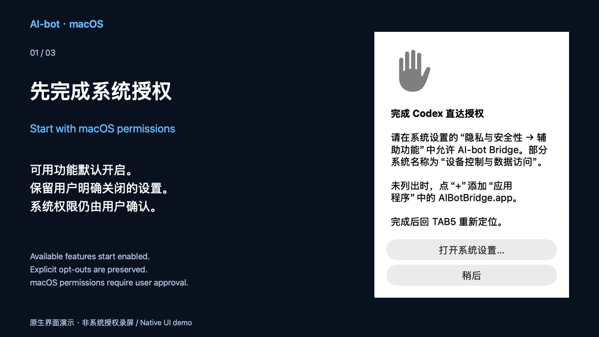

# Mac 授权说明短片 / Mac authorization supplement

这段 24 秒静音短片记录 Mac 0.6.15 的授权步骤，作为[项目介绍片](PRODUCT_VIDEO.md)的补充。当前版本从「设备中心 → 桥接设置 → 系统授权」打开授权向导。[当前安装说明](INSTALL.zh.md#mac)

[下载 720p MP4](https://github.com/yaoyouzhong/AI-bot/releases/download/v0.6.15/AI-bot-mac-authorization-20261102.mp4) · [可复现工程](https://github.com/yaoyouzhong/AI-bot/releases/download/v0.6.15/AI-bot-mac-authorization-source-20261102.zip) · [媒体摘要](https://github.com/yaoyouzhong/AI-bot/releases/download/v0.6.15/MEDIA-SHA256SUMS.txt) · [实际安装步骤](INSTALL.zh.md#mac)

| 时间 | 内容 |
| --- | --- |
| 0–8 s | 可用功能默认开启、用户关闭选择保留、系统权限仍需确认 |
| 8–16 s | 允许当前应用、旧勾选无效时重新添加、返回 TAB5 定位 |
| 16–24 s | 本机统一钥匙串一次提示、同包重启零次；旧资料首迁仍可能逐项批准 |

画面来自已验收源码 `8f4a5ed` 的真实 AppKit 控件隔离渲染；不是系统授权录屏或设备实拍，不包含真实账号、标识或凭据。1／0 为本机已迁移资料场景的验收结果，不保证所有首次安装或跨版本升级次数。三幅实际静帧已检查，视频完整解码通过；没有音轨是设计选择。补充片作为下载提供，不宣称 GitHub 主页内嵌播放。

渲染代码、布局与文案为本项目原创 MIT；不分发系统字体、AppKit 或 FFmpeg 二进制。源工程包含两张原生控件图、Swift／Python 构建脚本、许可及来源说明；依赖 macOS 字体渲染，跨系统像素完全一致不作保证。

| 文件 | SHA-256 |
| --- | --- |
| MP4 | `5ee0de101504b1377de6b18667428ad07feda9bf87c67acfa80395608463d4db` |
| 工程 ZIP | `78ba61eaa99f4cf4ade245534a94f478bf1b117a85bf871abac0b2b92e6a7c70` |

This silent 24-second clip illustrates authorization in Mac 0.6.15. In the current bridge, open Device Center → Bridge Settings → System Permissions. It uses genuine isolated native controls from accepted commit `8f4a5ed`, not footage of OS permission approval. The 1/0 card is explicitly scoped local acceptance after migration; legacy-first approval may require multiple items. Original MIT code/text, no font/framework/tool binaries or audio are distributed. All three frames and full decoding were checked. The clip is offered as a download, without an embedded-playback claim.
