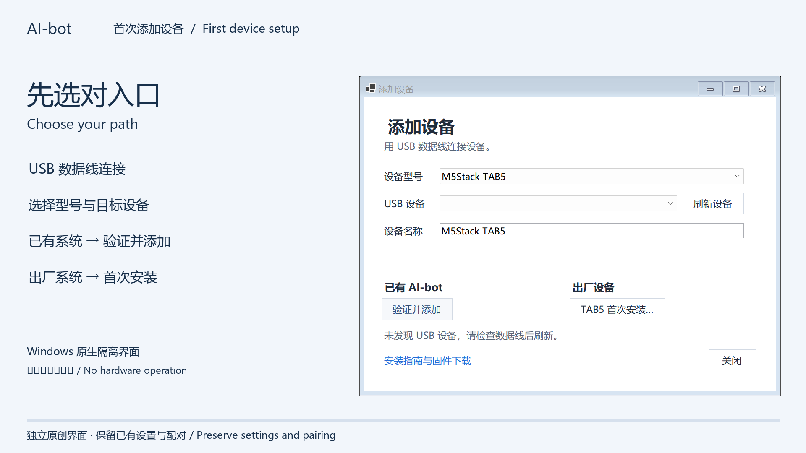

# 首次添加设备短片 / First-device setup supplement

20 秒说明本次 Windows 与 Mac 桥接的接入变化，作为[完整项目介绍片](PRODUCT_VIDEO.md)的补充。Windows 画面来自 0.6.13 原生隔离控件；Mac 使用功能路径示意，不冒充窗口录屏。没有对设备执行刷机或配对。

[观看／下载 MP4](https://github.com/yaoyouzhong/AI-bot/releases/download/v0.6.13/AI-bot-onboarding-20261028.mp4) · [可复现工程](https://github.com/yaoyouzhong/AI-bot/releases/download/v0.6.13/AI-bot-onboarding-source-20261028.zip) · [校验清单](https://github.com/yaoyouzhong/AI-bot/releases/download/v0.6.13/MEDIA-SHA256SUMS.txt)

| 时间 | 内容 |
| --- | --- |
| 0–5 秒 | 选择已有 AI-bot 或出厂设备入口 |
| 5–10 秒 | Windows 验证并添加、USB 选择保留与失败清理 |
| 10–15 秒 | TAB5 备份、安装、检查启动与返回添加 |
| 15–20 秒 | Mac 新增 TAB5 自动进入 USB 配对 |

原生截图源码为 `3a9ebfb`。脚本、文案与声音原创，采用 MIT；系统字体不随工程分发。画面原像素和许可摘要登记于 `licenses/materials.json`。本地完整解码、2 fps 联系表及转场静帧已检查；实际浏览器播放与主观听感另行记录。

MP4 SHA-256: `e0e794aaced974463c1ae254658db4bcfedd87f441a607074985b9d1a50a3354`

Source ZIP SHA-256: `4a08c81e8d69d76807552de925daccff0482fb5611ff6c7724d81c6b88583330`

This 20-second bilingual supplement explains the Windows/Mac onboarding update. Windows uses native isolated WinForms captures; Mac is explicitly a navigation diagram. It preserves the whole-project film and does not claim hardware flashing or pairing. Rendering code, text and synthesized audio are original MIT work; system fonts are not redistributed. Full local decoding and visual still review are separate from browser playback and subjective listening.
