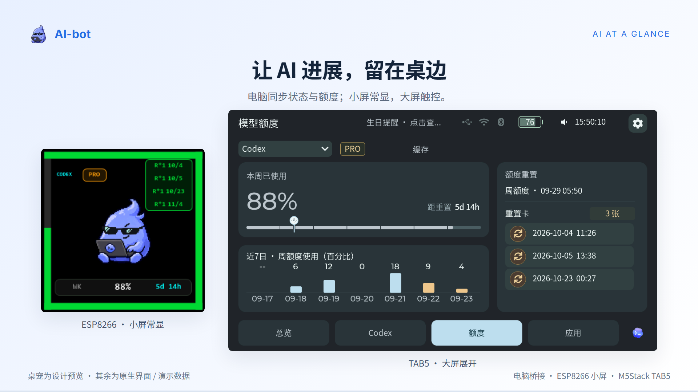

# 产品介绍视频 / Product introduction video

Windows **0.6.10** / TAB5 **0.2.234-ui**，116 秒中文片，1920×1080、30 fps。新增一键解锁与 TightVNC 自动安装／接入、双向已读同步，最后一镜加载实际 .234 sidecar；其他表盘、日程、额度和艺术界面保留已登记原生素材。ESP8266 0.5.3 沿用原画面，Mac 0.6.7 不出镜。

[下载 MP4](https://github.com/yaoyouzhong/AI-bot/releases/download/bridge-v0.6.10/AI-bot-product-intro-20261019-0610-234.mp4) · [可复现工程](https://github.com/yaoyouzhong/AI-bot/releases/download/bridge-v0.6.10/AI-bot-product-video-source-20261019-0610-234.zip) · [媒体摘要](https://github.com/yaoyouzhong/AI-bot/releases/download/bridge-v0.6.10/VIDEO-SHA256SUMS.txt) · [4:3 封面](assets/product-intro/AI-bot-cover-4x3.png) / [3:4 封面](assets/product-intro/AI-bot-cover-3x4.png)

## 分镜 / Timeline

| 时间 | 内容 |
| --- | --- |
| 0–8 s | 让 AI 进展，留在桌边；电脑同步状态与额度；小屏常显，大屏触控。 |
| 8–15 s | 不用切回主屏，也知道任务进展；Claude / Codex · 工作状态 · 等待输入 · 完成提醒 |
| 15–21 s | 还剩多少额度，什么时候恢复；账户额度、余额与重置时间，抬眼便知。 |
| 21–31 s | 日常信息，也有自己的位置；天气、负载与网速；汽水音乐的封面和进度同步。 |
| 31–39 s | 解锁电脑，接着做事；USB、蓝牙与 Wi-Fi 按当前连接解锁；组件认证自动处理。 |
| 39–50 s | 选好会话，说出下一步；最近会话 → 语音草稿 → 检查后发送；返回入口统一。 |
| 50–56 s | 在任一端读过，另一端同步；在 TAB5 打开新回复，也会清除电脑 Codex 的未读标记。 |
| 56–65 s | 九款表盘，换一种看时间的方式；经典圆盘、昼夜环与绿色液晶；日出日落随当地数据变化。 |
| 65–72 s | 专注这一刻，也期待重要那一天；时钟计时只显示剩余时间；屏保按天倒数，各自独立。 |
| 72–78 s | 空闲时，把时间变成风景；经典时钟与年度点阵，跟随本地时间自动切换昼夜。 |
| 78–89 s | 在桌面，细看每一件作品；两套高清完整图库；图片、导读与设备展示图一起安装。 |
| 89–95 s | 连接与系统压力，有异常及时知道；运行监控、原因与建议；中断提示和自动恢复。 |
| 95–103 s | 把日程，放在顺手的位置；今日／全部与列表对齐；空闲时居中新建，离线可用。 |
| 103–110 s | 一个入口，管理自己的设备；连接状态、十个已存网络，软件与固件分别更新。 |
| 110–116 s | 把进展留在桌边，把注意力留给工作；从电脑端开始，选择适合你的桌面屏。 |

## 来源、许可与检查 / Provenance and checks

窗口来自实际 c608 生产界面的隔离捕获；固件更新说明来自实际 .234 sidecar 的原生 LVGL。当前版本 .21 是合成夹具，目标 .234 和说明为实际元数据。其他原生像素的原始来源保留在工程 SOURCES.md 和 NATIVE-SHA256.json，不将隔离演示写成硬件摄影或真实服务调用。图库镜头中的米芾《行书虹县诗卷》来自东京国立博物馆／[ColBase TB-1459](https://colbase.nich.go.jp/collection_items/tnm/TB-1459?locale=zh)，CC BY 4.0；按原生界面缩放裁切，不表示馆方背书。桌宠与虚构专辑封面为项目原创，没有商业歌曲。

配乐沿用项目原创 104 BPM 合成音乐，35 个独立动作音效按镜头落点混音。脚手架、音效与混音代码来自 guizang-product-video-skill，工程保留 AGPL-3.0 LICENSE／NOTICE／THIRD_PARTY_NOTICES；Inter 与 Noto Sans SC 保留 OFL。媒体工程与 AI-bot MIT 自有代码分别说明许可。

完整 3,480 帧解码、232 张联系帧、14 处转场、6 张原尺寸关键画面和三种封面已审阅；字体／图片加载、确定性定位、35 项音效结构与电平通过。工程 417 文件与 178 份原生像素摘要已核对；独立解压后重建得到相同 HTML 摘要，并通过字体、图片及时间定位检查。主观试听未验；浏览器控制接口暂不可用，当前新片公开播放／暂停／跳转仍待单独确认，不沿用旧片验收结果。实际 BLE 与电量验收见 [实机记录](development/TAB5-BLE-UPTIME-20261019.md)，不靠视频证明硬件成功。

The current 116-second Chinese film covers Windows 0.6.10, TAB5 .234 and retained ESP8266 0.5.3 footage; Mac .67 is not demonstrated. It adds unlock/component setup and bidirectional read-sync explanations and uses the actual .234 sidecar. Native fixtures and retained captures keep their provenance; .21 is a synthetic current-version fixture, not a device claim. The 417-file reproducible project retains AGPL/OFL notices, original music/effects, source attributions and 178 native-image hashes. Full decoding, contacts, all transitions, dense frames, covers and browser/audio structural checks passed. An independently extracted project rebuilt identical HTML and passed its browser checks. Subjective listening and interaction with the new public player remain unverified because browser control is unavailable. Earlier published video and player results remain in [the .69 history](https://github.com/yaoyouzhong/AI-bot/blob/1b51f24317e06cb1046a0a82391e5fda1701e671/docs/PRODUCT_VIDEO.md).
