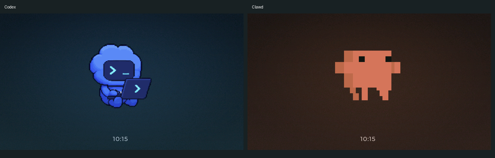

# 0.6.17 桥接与 TAB5 0.2.312-ui / Desktop and TAB5 release

本轮范围为 Windows x64、Apple Silicon Mac 桥接 0.6.17，以及 TAB5 0.2.312-ui。ESP8266 保持 0.5.8，图库继续使用现有正式版本。发布候选从同一干净桥接源码提交构建；TAB5 使用此前已验收的应用镜像，不重新编译或刷写已运行的相同镜像。

## 变化与兼容 / Changes and compatibility

- 桥接投影固定的 Codex 任务状态，区分答题、授权、受阻和未知，保留任务与轮次绑定；不传输请求正文，不改变既有发送及防重复保护。
- TAB5 总览只显示当前受支持客户端的一个萌宠：Codex 或 Clawd。使用其他模型时保留客户端萌宠；没有新增第三方 Harness 接入。
- 两种屏保使用官方动作和本项目状态映射，屏保循环、总览完成后停住；保留底部居中数字时间，改进 Clawd 的视觉大小、位置及两种品牌氛围背景。
- TAB5 包含已验收的词库减包、图库栈和绘图后端优化。既有配对、草稿、展示偏好和旧屏保编号保持兼容。

上图为生产 LVGL 的两个独立屏保离屏渲染，使用演示时钟，不是实拍；设备每次只显示所选的一只萌宠。来源、再分发授权确认与图片摘要见[素材声明](../licenses/companion-art/NOTICE.md)。

## 原包与验收边界 / Artifact and acceptance boundaries

TAB5 原应用为 **6,907,792 字节**，SHA-256 `21d78bcce33bdbdb531588b225b59a9902e53ecff620c9b614863f56cdb34d8c`，ELF SHA-256 `aa12dd1673e155c53a15c22a0a9a940443a4da3aa8520b452b59a5080891a39b`。已确认精确镜像的 VALID 启动、两种屏保显示/退出，以及后续位置、背景和字体；414 个完整原生界面场景及图像逐帧比对通过。首刷和升级包必须包含同一应用字节。

真实 Claude Code 活跃任务切换、部分等待/完成、所有通道断连及告警点击路径仍保留原验收边界，不能将原生回归称为这些场景全部实机通过。新桌面候选的原包、原生测试、安装及可复用证据随 `CANDIDATE.json` 和 `ACCEPTANCE.json` 公开，不以普通 CI 输出冒充安装包验收。

Windows 安装包未签名；Mac 使用 ad-hoc 签名、未经公证。钥匙串、配对、加密、安装器与提交执行路径未新增格式或迁移，未变更场景可按实际基线证据复用。正式公开附件和最终下载入口以公开 Release 为准。

既有宣传片继续展示仍准确的共有功能和 TAB5 功能，复用其原摘要及播放验证；本轮新增上述原生屏保预览补充新外观，不声称旧视频或全部截图已经更新，不重排宣传片。

## English

Windows x64 and Apple Silicon Mac advance to 0.6.17; TAB5 ships independently as 0.2.312-ui. ESP8266 0.5.8 and optional collections remain unchanged. Desktop bridges project exact, sanitized task-state metadata without changing submission safeguards. TAB5 shows one supported client mascot, with original Codex/Clawd animation, project-defined state mapping, aligned framing, quiet brand backdrops and a centered numeric clock.

Promote the exact accepted TAB5 application above. Both saver display/exit and the visual refinements were physically accepted; active Claude routing and several special-state/disconnection paths remain native-tested rather than fully exercised on hardware. Native production renders use a demonstration clock and are separate from device acceptance. The project owner confirmed redistribution rights for both original asset sets; artwork remains outside MIT. Candidate and acceptance records identify the actual desktop packages and any justified evidence reuse. Windows is unsigned; Mac is ad-hoc signed and not notarized. Existing unchanged video/screenshots retain their original validation; the new saver preview documents this release's appearance without redesigning the video.
