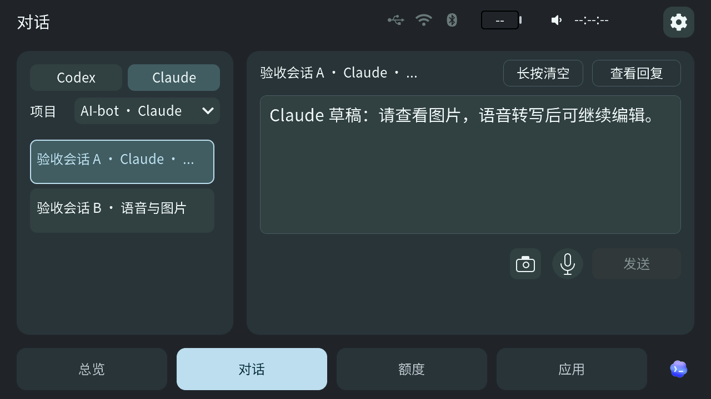

# 0.6.17 桥接与 TAB5 0.2.313-ui / Desktop and TAB5 release

**已正式发布。** Windows x64 与 Apple Silicon Mac 桥接 0.6.17、TAB5 0.2.313-ui 均已公开；候选源码为 `854f679c7a2d06e23c234f0166cd35108045cc25`。完整纳入上次发布后的图库范围／画质、客户端萌宠、Claude／Codex 对话和两端取消草稿修复。[电脑桥接发布](https://github.com/yaoyouzhong/AI-bot/releases/tag/v0.6.17) · [TAB5 发布](https://github.com/yaoyouzhong/AI-bot/releases/tag/tab5-v0.2.313-ui) · [完整 .313 工程](development/tab5-313-source/README.md)

**Released:** both desktop platforms and TAB5 promote their accepted original packages from source `854f679`. Windows native packaging/isolated regressions and final archive startup passed; unchanged installer evidence is reused. Mac local acceptance includes 465 tests (1 skipped, 0 failures), 29,068 parity checks, the three cancellation cases, exact clean-source package signing and background/USB startup. Hosted Mac runner capacity did not gate publication.

本轮范围为 Windows x64、Apple Silicon Mac 桥接 0.6.17，以及 TAB5 0.2.313-ui。ESP8266 保持 0.5.8，图库使用既有正式版本。两端正式包已从同一干净提交原生构建；TAB5 沿用 Mac 已构建并通过 USB 核验的精确 .313 镜像，不为 Windows 对齐重新刷机。

## 变化与兼容 / Changes and compatibility

- TAB5“对话”共用 Codex／Claude 的项目、历史、公开回复、草稿、发送／追加、中断、照片和语音入口；总览精确进入当前会话或未读轮次，返回原入口，实际显示后才确认已读。
- Claude 使用已安装的官方 CLI，外部仍运行的会话只读；工具请求由用户在电脑手工确认，默认拒绝，未知送达只核对、不自动重发。已确认的排队输入随后被明确取消时恢复文字／照片，保留后来编辑的新草稿。
- 两端按精确会话及提示处理受控 Claude CLI 的完成结果，不以 Stop、空闲或静默日志推断成功。通用外部会话仍受可观测证据限制，不宣称所有 Claude 任务都能触发完成动画。
- 总览显示当前受支持客户端的一个萌宠：Codex 或 Clawd；使用其他模型时保留客户端萌宠，没有新增第三方 Harness 接入。状态、已读、草稿、照片和语音均绑定客户端及设备。
- 屏保使用官方原始动作及本项目状态映射，循环播放；总览完成后保持动作。保留柔和背景、底部居中时间和视觉对齐，.313 Claude 待命改为原始小人的轻微呼吸。
- Windows／Mac 图库分别选择年度／全量范围和普通／高清电脑画质，保留完整图库和备份，防止年度包覆盖全量库。TAB5 图片质量不随电脑浏览选项改变。[图库交接](development/GALLERY-COLLECTIONS-20261103.md)
- TAB5 包含 .312 已验收的词库减包、图库栈和绘图后端优化；既有配对、草稿、展示偏好和旧屏保编号保持兼容。后台 USB 自动验收仅在显式诊断入口运行，普通桥接不自动点击。

上图复用 .312 生产 LVGL 的两个独立屏保渲染及演示时钟，适用于保留的背景、时间与分别选择萌宠的展示方式；不是 .313 实拍或其待命动作证据。设备每次只显示所选的一只萌宠。官方素材的归属、再分发授权和图片摘要见[素材声明](../licenses/companion-art/NOTICE.md)。

## 原包与验收边界 / Artifact and acceptance boundaries

Mac 交接的 .313 应用为 **6,923,744 字节**，SHA-256 `e0c0981beae8525e74fc1aeb3880904aeb95df909d63f5b9a39162ec72deb587`；ELF SHA-256 `e5f52c3aff72315dec130342b4a16705b3205ba60da3cb41bc367ba4ffeb8ef7`。交接记录包含精确 VALID 启动、实际 USB 截图、两端入口、已读、目录暂缺、待命及设置保留；此前 .312 屏保背景／时间／退出的用户验收仅在未变更范围内复用。首刷和升级包必须包含同一 .313 应用字节，不混入同版本旧镜像。

Windows 原生测试、实际安装 Claude CLI 的隔离 loopback 测试、审批窗渲染及合成协议检查见[接收结果](development/WINDOWS-CLAUDE-DIALOGUE-RESULTS-20261104.md)。这些不等于实际 TAB5 Windows USB、真实输入法准确性、所有等待／断连状态或正式候选安装验收。最终两端包的源码、哈希、原生与后台启动证据已绑定公开 `CANDIDATE.json` 和 `ACCEPTANCE.json`；旧 `2aa7acc` 候选及 `9973f9b` Mac 开发包均未用于本次发布。Windows 新物理设备路径仍按上述边界披露。

Windows 安装包未签名；Mac 沿用本地 AI-bot 开发签名身份、未经公证。未新增钥匙串、配对、加密或安装器格式迁移；未变更场景仅按实际基线证据复用。公开下载已更新为电脑桥接 0.6.17、TAB5 0.2.313-ui；[下载中心](../DOWNLOADS.md)按实际附件列出两个平台及独立设备版本。

宣传片继续复用仍准确的共有功能和 TAB5 片段，保留原摘要及播放记录，不重排整片，也不声称旧视频已展示新的对话工作区。需要更新的镜头及安装说明在正式发布收尾逐项核对。

## English

Windows x64 and Apple Silicon Mac ship 0.6.17, with independent TAB5 0.2.313-ui. ESP8266 0.5.8 and optional collections remain unchanged. The shared dialogue workspace preserves exact client/conversation/unread-turn identity, encrypted drafts/photos and manual approvals. External live Claude sessions are read-only. Owned CLI completion requires the matching result; silence and Stop events never imply success. Explicit cancellation revokes accepted queued receipts and restores only an empty composer, preserving newer drafts.

Promote the exact accepted TAB5 application identified above. Mac USB acceptance, Windows native/loopback tests, final-package installation and affected physical paths are recorded separately. The reused .312 saver render illustrates unchanged backgrounds, clock and separate selection; it is not .313 device or idle-animation evidence. Original artwork retains its recorded redistribution authorization outside MIT. Existing video remains valid only for unchanged scenes and does not claim to show the new workspace. Published downloads now point to the exact accepted packages. The Mac app retains its existing local development certificate and is not notarized; Windows installation behavior is reused with final-package startup and unchanged-profile verification.
