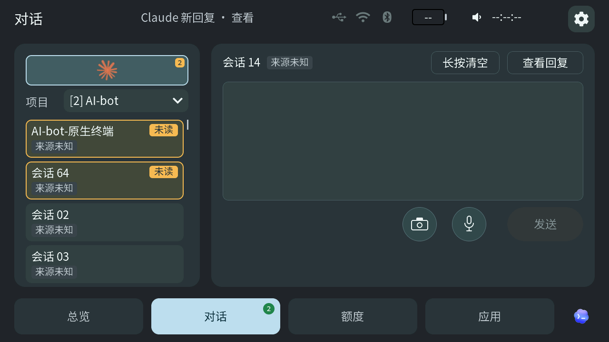

# 0.6.18 / TAB5 0.2.318-ui 发布准备

> 准备中，尚未发布。版本日期和各平台最终包、验收记录须在正式发布前核对。当前公开版本为 Windows／Mac 0.6.17、TAB5 0.2.313-ui 和 ESP8266 0.5.8。

本次计划发布 Windows x64 和 Apple Silicon Mac 桥接 0.6.18，以及独立版本 TAB5 0.2.318-ui；ESP8266 和图库不在本次发布范围。Mac 正在完成对齐，两个桌面包须从汇合后的同一冻结源码提交构建，分别在对应系统验收，使用验收过的原包发布。现有 Windows 日常运行程序、旧 Mac 包及开发测试构建不能直接改名作为最终包。

## 面向用户的变化

双语发布说明草稿见[桌面和 TAB5 说明](development/WINDOWS-RELEASE-DRAFT-20261110.md)，最终内容以完成 Mac 对齐及验收后的变更为准。主要包括 Claude Code 原生会话接入与识别、对话和未读状态、语音授权恢复、Windows 桥接升级和 TAB5 固件升级体验，以及对话页和总览显示优化。组件版本、安装入口、下载与校验文件按各自发布状态更新。

## TAB5 候选与证据

设备上已验收的 318-R12 应用镜像 BIN SHA-256 `f845cf2205a48332b613d7d38c12ffd95eb8aa8103609bca84d238c176e28877`，ELF SHA-256 `9d9e62aec233904d10fa09d9f22b4aff39275287888144868c43be89d950fd32`。它包含 R11 缓存负载和升级准备修复，以及 R12 图标边缘修复。用户批准后已经 Wi-Fi 安装并核验启动，用户确认对话图标及总览／对话滑动正常。[R12 实现与验收范围](development/TAB5-318-R12-WORKSPACE-ICON-20261110.md)。

用户对 R11 总览观察约 5 分钟未见闪动；不能将这段观察冒充 R12 的长期观察，也不能保证屏闪永不复现。R12 的首刷包、升级包和完整源码须与该镜像对应；工厂镜像结构校验不等于实体设备首次安装验收。重启后核验按钮恢复时间的 Windows 修复已通过针对性自动测试，尚待后续真实升级测时；无线独立通道没有新增提前释放策略。

发布准备中的完整离屏回归发现：默认选中的最近会话可能位于列表视野之外。用户选择以 [318-R13](development/TAB5-318-R13-DEFAULT-SESSION-20261110.md) 作为本次正式固件：公共版本仍为 `0.2.318-ui`，BIN SHA-256 `f9b7a58db88aeecd8e38935c62a1f1bef32c35dd88475855ec36db28d4949c34`。该镜像已构建并通过完整离屏及专项回归，尚未刷入设备或完成真机验收；TAB5 目前接在 Mac 上，发布前须补实际设备验收并绑定这一镜像。

固件提示音采用用户试听选择的素材；发布时保留来源和许可记录。候选是否能公开再分发以最终素材和权利依据核对为准，不以旧 R4／R6 素材代替 R12 的实际输入。

图中项目、会话和未读数量为合成演示数据；这是 R13 源码的原生离屏渲染，不是设备实拍或真机验收记录。该帧与 R12 对应夹具逐像素一致。

## 文档与媒体

正式发布时同步中英文主页、下载目录、安装说明、更新日志和受影响的实际截图，核对已公开链接和校验文件。宣传片保留用户确认的镜头顺序、整体结构和配乐，仅替换过时或会误导的画面；合成演示或离屏渲染应明确标识，不冒充实体设备录制。已准备事项和待办见[发布前工作记录](development/RELEASE-0618-TAB318-PREPARATION-20261110.md)。

## English

Preparation only: the planned releases are Windows x64 and Apple Silicon Mac bridge 0.6.18, plus the independently versioned TAB5 0.2.318-ui. ESP8266 and artwork galleries are unchanged. Mac alignment is in progress. Both desktop packages must be built from the same frozen commit, accepted independently on their native platforms, and promoted without rebuilding.

The installed and verified R12 image is SHA-256 `f845cf2205a48332b613d7d38c12ffd95eb8aa8103609bca84d238c176e28877`; the user confirmed the icons and page swipes. R13, SHA-256 `f9b7a58db88aeecd8e38935c62a1f1bef32c35dd88475855ec36db28d4949c34`, additionally fixes visibility of the default selected conversation and has passed local build and offscreen tests, but has not been installed or physically accepted. A five-minute no-flicker observation applies to R11, not a long-duration R12 or R13 test. First-install packaging verification is not a physical factory-install test. The post-upgrade verification-button timing fix has automated coverage but still needs a future real-upgrade measurement.

Update the bilingual homepage, downloads, installation guide, notes and affected media when the actual packages are published. Preserve the approved video sequence and audio, and label rendered demonstrations accurately. See the [preparation record](development/RELEASE-0618-TAB318-PREPARATION-20261110.md) for the current evidence and outstanding work.
