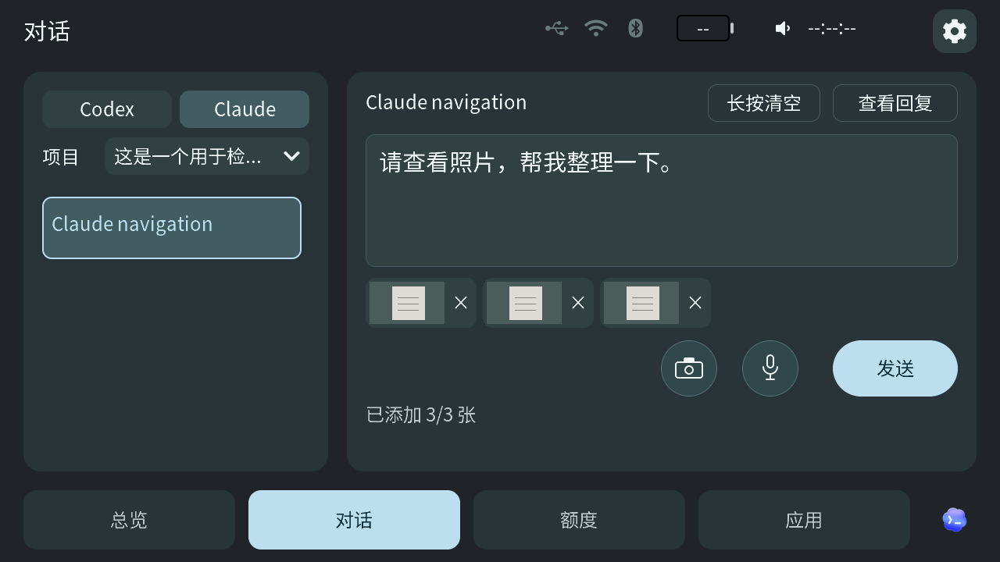

# 0.6.18 / TAB5 0.2.318-ui 发布准备

本页是发布准备记录，当前公开下载仍为 Windows／Mac 0.6.17、TAB5 0.2.313-ui。计划同时交付 Windows x64、Apple Silicon Mac 0.6.18 与 TAB5 0.2.318-ui；ESP8266 0.5.8 和图库保持不变。准备阶段不创建正式标签或替换公开附件。

## 本次变化

- 两端豆包自动检测已正确路由到本次大疆物理端点时直接复用；需要临时选择时继续读回、恢复并保护用户手动改选。Windows 语音小窗改善提示换行。
- TAB5 项目菜单切页即关闭，长项目名与箭头分开；底部双圆与发送等高，采用 72px 双圆、统一底色与细边框，以及胶囊发送／追加／取消按钮。
- 修复取消后文字／照片恢复、长按清空后旧文字残影、录音停止后的按下态及色差；保护相机之外的持续 LCD 读取。

## 原包与验收

TAB5 沿用 `20261105-controls72` 原包，应用 SHA-256 为 `fad7d04c5585f222951aa7ac13deb01e8664a2069679d32547fa9f058563e2be`，ELF 为 `af70f82932432ab033d59b7df72cdf82e05656e33bf43f533fa4de6489546679`。不重建、不改写版本。14 项原生用例、精确启动与用户手指操作已通过，见[验收记录](development/TAB5-CONTROLS72-ACCEPTANCE-20261105.json)。约 351 秒显示观察中欠载／刷新错误为 0；用户后续未再复现闪屏，此有限观察不保证所有环境永不闪屏。首刷容器与升级 ZIP 使用同一应用，首刷包结构校验不代表新做了恢复出厂刷机。

Windows 自动模式录音、停止回填、客户端草稿／照片隔离、USB→Wi-Fi→USB 接续已有对应开发候选实测；Mac 自动模式大疆录音与停止回填也已有其独立原包实测。正式 0.6.18 的元数据和包身份变化需要各自补实际原包安装／启动核验，功能代码不变的实测按原范围复用。Mac 诊断入口曾有焦点保护拒绝，不写成该入口录音成功。

桥接双平台须采用同一冻结源码提交。Mac 当前已验收 ZIP 仍为 `0.6.17-development-79670da`，不能改名为 0.6.18；正式 Mac 包是本轮尚需补齐的交付物。安装器、配对、加密、协议、权限及依赖格式没有新增迁移。Windows 未签名；Mac 使用实际本机开发签名、未经公证，不声称 Developer ID 公证。

## 图示与兼容

图示来自本次生产 LVGL 的实际离屏渲染，使用合成项目、草稿和附件数据，不是实体屏实拍或账户内容；素材摘要登记于 `licenses/materials.json`。原宣传片仅复用仍准确的既有场景，不声称它展示本次新按钮；不改变片段顺序和整体结构。

TAB5 保持桥接 0.6.17 兼容下限；自动音源优化需对应的新桥接。现有用户选升级 ZIP，首次安装用首刷 ZIP，不要求重配对或恢复出厂。完整源码采用既有归档规范，保留工程、配置、锁文件、必要依赖覆盖与 SDK 补丁，排除缓存、主机工具链、BIN／ELF 和私有运行数据。

## English

This is release preparation, not a publication announcement. Plan Windows x64 and Apple Silicon Mac 0.6.18 with independent TAB5 0.2.318-ui; ESP8266 and galleries stay unchanged. Reuse the exact accepted controls72 firmware bytes above. The release improves automatic DJI routing, dialogue controls, dropdown cleanup, draft repaint, microphone state recovery and continuous display reads. Native and physical results retain their explicit scope; finite display observations do not guarantee that flashing can never occur.

Each desktop platform must produce its final archive from the same frozen source. Reuse unchanged functional evidence and check final-package identity and installation/startup separately. The accepted Mac development archive is still 0.6.17 and cannot be relabeled. Mac final packaging remains pending on the Mac host. Existing Windows signing and Mac development-signing/notarization limits remain explicit. The illustration is a real native LVGL offscreen render with synthetic data, not device footage. Preserve exact firmware bytes, existing pairing/settings and the accepted video structure.
