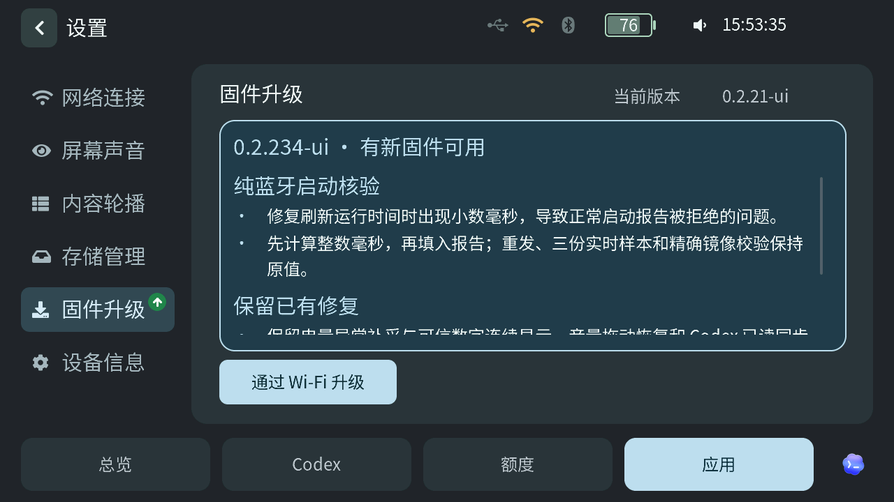
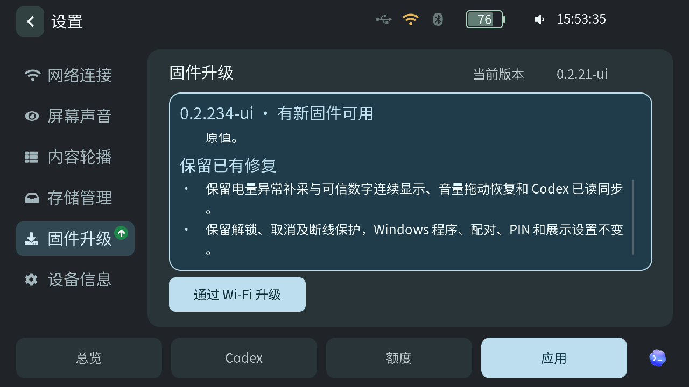
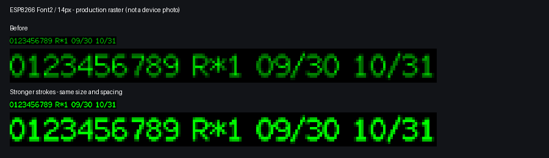

# 当前截图来源 / Screenshot provenance

## 2026-10-28 Bridge 0.6.13 onboarding

更新 `add-device.png` 与 `tab5-first-install.png`：来自发布源码 `3a9ebfb` 的 Windows Release 程序 `--self-test-onboarding` 原生 WinForms 隔离渲染，保留原始像素。截图无真实端口或设备，未执行刷机、配对或配置写入。首装窗口按原生滚动区域显示；完成按钮为“返回添加设备”。Mac 原有五张图保留其 0.6.11 来源，不把旧图冒充本轮导航修复的截图。

Refreshed two Windows onboarding captures from the 0.6.13 production WinForms fixture, without repainting controls. They contain no real device or port and do not establish hardware acceptance. The first-install completion now says Return to Add Device. Existing Mac gallery images retain their original 0.6.11 provenance.

<a id="mac-native-20261028"></a>

## 2026-10-28 Mac 原生窗口 / Native Mac captures

新增五张 macOS **真实 AppKit 窗口／菜单的隔离演示捕获**，不是网页仿制、生成图片或实体设备照片。先核对本机正在运行的 R36 设备中心、账号数据和桥接设置；该旧候选的 bundle 仍标为 0.6.10。正式依据为已公开 [v0.6.11](https://github.com/yaoyouzhong/AI-bot/releases/tag/v0.6.11)，发布提交 `58a88ba4250ffd404e68aa8392b9847f5a6e9300`。捕获基线 `fbf8456cf6f1bdba35cc583ef18ffac46894c25a` 的 `mac-app/Sources` 与此标签无差异，不把候选版本标签或未发布功能写成正式发布。

从公开 Release 下载 `AI-bot-bridge-v0.6.11-macos-arm64.zip`，完整 SHA-256 为 `ead2f8602190372c08fc7cbcbd063c75881068efe38fabaa3e7fbf9dd213f858`，与下载目录一致。包内原始可执行文件的 `--self-test-tab5-ui` 通过，输出 `MAC_MODEL_ACCOUNT_UI_OK` 和 `MAC_TAB5_NATIVE_UI_RENDER_OK`；该自检是原生控件及布局验证，不是实时设备验收。

| 文件 | 原生内容与演示边界 | 发布像素 |
| --- | --- | --- |
| `mac-menu.png` | `MacDeviceCenterMenu.build` 原生 NSMenu；两个演示设备，无真实身份 | 370 × 336 |
| `mac-device-center.png` | `MacTab5Window` 我的设备页；未配对、未连接，展示九个主要入口 | 1872 × 1336 |
| `mac-accounts.png` | 同一窗口的账号数据页；只展示配置入口，状态写明隔离演示 | 1872 × 1336 |
| `mac-bridge-settings.png` | 同一窗口的桥接设置页；开机启动为演示进程状态，未点击或保存 | 1872 × 1336 |
| `mac-tab5-preview.png` | `MacTab5ScreenPreviewContent`；载入既有 `tab5-clock-1.png`，明确标注“演示画面／非实时连接” | 1712 × 1256 |

本地捕获入口复用上述未改动的生产控件，在独立临时配置目录创建演示注册表和禁用外部调用的服务依赖；不运行 `AppDelegate`，不启动网络监听、串口、蓝牙、账户刷新、钥匙串读取或权限请求。TAB5 预览只创建内容视图和原生窗口，不启动设备预览会话。菜单使用生产工厂弹出，所有动作回调为空。窗口逐个捕获并关闭，不替换正在运行的桥接。

通过 macOS `screencapture -x -l <window-id>` 直接捕获各原生窗口与 NSMenu，保留标题栏、圆角与窗口边界；只用 `sips` 等量裁去外层阴影／留白，未重画、拼接或覆盖控件。三个 1932 × 1396 窗口裁为 1872 × 1336，1772 × 1316 预览裁为 1712 × 1256，638 × 604 菜单裁为 370 × 336；未缩放内容像素。逐图检查没有真实账号、用量／余额、地址、SSID、设备标识、凭据、私人桌宠或其他应用内容，无须遮挡业务字段。既有 TAB5 时钟图的日期为固定演示值，沿用原来源和许可。

本地原始截图、隔离入口及验证日志位于忽略目录 `artifacts/mac-gallery-20261028/`，不上传私有核对画面或运行日志。隔离入口源文件 SHA-256：`a8abd1222557a03c87dbef1995a9a4f0d58b8a8afbe95b0b470532f8401c21fd`。项目原创界面及原有时钟素材沿用本仓库 MIT 许可；macOS 系统窗口装饰为原生系统渲染，不另行打包系统素材或字体。五张最终文件逐一登记于 `licenses/materials.json`，公开检查同时匹配文件名和字节。

Five genuine AppKit menu/window captures use isolated demo state and the same UI source as the published Mac 0.6.11 release (`58a88ba`). The running R36 app was visually checked; its older 0.6.10 bundle label is not release evidence. The downloaded release ZIP matched its complete catalog SHA-256 and its bundled native UI self-test passed. An isolated capture entry point reused unmodified production controls, with no AppDelegate, listeners, device connections, account refresh, credentials or real settings writes. Native windows and the production NSMenu were captured directly by macOS; only outer shadow/padding was cropped, without repainting controls or rescaling pixels. The TAB5 preview loads the existing original digital-clock fixture and explicitly labels it non-live. All five images were checked for private information and individually hash-registered. These captures add no hardware, network, voice, permission, Intel Mac or long-term acceptance evidence; earlier device captures retain their original provenance and license.

2026-10-27 图鉴核对：新增 `tab5-music-controls-282.png`、`tab5-firmware-notes-282.png` 与 `windows-runtime-monitor-0612.png`。前两图来自正式 .282 对应源码的 LVGL 隔离预览：音乐使用虚构曲名和无封面状态，显示真实播放控件；升级图使用正式 .282 sidecar，“当前 .21”是固定夹具。运行监控图来自 Windows 0.6.12 Release 程序的 WinForms 隔离自检，PAC 异常及数值均为演示数据，不是本机监控记录。图中不含真实账户、曲目或设备状态；未修改设备、桥接设置或图库。原图保留，新增文件的精确 SHA-256 见 `licenses/materials.json`。

2026-10-28：对照 .282 原生预览刷新网络连接、屏幕声音、内容轮播、日期倒计时设置、十网络与三种电脑控制图。网络名、电脑名称、连接状态、时间与音量为固定演示数据；“已保存到 TAB5”是预览夹具的界面反馈，不表示对实体设备执行了保存。原截图的历史版本仍见 Git 记录。 / Refreshed .282 network, display, rotation, countdown, saved-network and computer-control views from native fixtures. All names, states and the save feedback are synthetic; no hardware settings were changed.

2026-10-28：Codex 任务、活动、分页回复、录音、识别结果和照片草稿截图也已对照 .282 原生预览更新，照片缩略图为测试色块；任务主图只在隔离夹具中清除了测试用语音错误提示，其他界面由原生控件绘制。项目、会话和语音文字均为演示数据。 / Refreshed Codex task, activity, reply pagination and voice fixtures from .282. The task capture clears a simulated error notice for the documentation sample; all other UI is native and data is synthetic.

2026-10-28：托盘菜单与 TAB5 设备中心图使用 Windows 0.6.12 源码的 DocCapture 隔离夹具重新捕获，显示当前“设备预览”入口、电脑控制等操作；名称、版本和在线状态为夹具，不是用户设备配置。 / The tray menu and TAB5 Device Center were captured with the Windows 0.6.12 DocCapture fixture, with synthetic names, version and connection state and the current device-preview entry.

October 27 gallery audit: added isolated native .282 TAB5 music controls and actual .282 release-notes fixtures, plus a Windows 0.6.12 runtime-monitor fixture. Song metadata, missing artwork, PAC fault and readings are synthetic; .21 is a fixture installed-version label. These are not device photos, live monitoring or hardware acceptance. The existing images remain; new file hashes are recorded in `licenses/materials.json`.

2026-10-27：账号数据截图更新为 Windows 0.6.12 候选的紧凑按钮原生隔离界面，使用演示窗口，不含真实账户；图鉴对桥接窗口限制显示尺寸，原图可点击查看。 / Updated the account-data capture from the Windows 0.6.12 compact-button native fixture; documentation images link to their full-size originals.

2026-10-27：更新 TAB5 0.2.282-ui 诊断与检测详情截图，来自该版本原生 LVGL 隔离夹具，数值为演示数据，非硬件照片；设备实际界面另经用户确认。 / Updated .282 diagnostics and details from native isolated LVGL fixtures; the device was separately confirmed by the user.

2026-10-27 项目介绍片封面展示 TAB5（左）和 ESP8266（右）的原生额度界面，使用演示数据；不是硬件照片。封面及影片素材来源见 [视频说明](PRODUCT_VIDEO.md)，封面摘要登记在 `licenses/materials.json`。 / Project-overview covers show native synthetic quota interfaces; TAB5 is on the left and ESP8266 on the right.

2026-10-27：新增 TAB5 .281 长按清空前、清空后、继续输入与四额度卡片原生 LVGL 截图，来源为冻结 .279 加已核对 .281 补丁及测试；新增 Windows 账号来源隔离原生 WinForms 虚构账户截图。时间、金额、项目名均是固定夹具，不是私人账号或实机照片。Mac 功能使用共用 TAB5 画面说明，不把 Windows 账号窗口标成 Mac。精确 SHA-256 见 materials.json。

October 27: new .281 native LVGL draft-clear and quota fixtures, plus a native Windows account-source fixture. Synthetic data is not hardware photography or private account data. Shared TAB5 views illustrate Mac support without impersonating AppKit windows.

2026-10-17 0.6.9／217：新增电脑控制、静音、锁屏、十网络、Windows 启动配置，刷新应用入口、音乐空闲和实际 217 sidecar。TAB5 来源 `d31a601` 的原生 LVGL；Windows 配置来自最终发布 ZIP 内 DLL 的隔离自检。程序／文件夹画面使用通用类型字形，不打包本机软件提取图标。固定时间、电量、网络名与旧当前版本均是夹具，不冒充真机运行态。逐张 SHA-256 在 materials.json；真实验收另见发布记录。 / New native control, mute, lock, ten-network and final Windows settings fixtures; updated Apps, music idle state and actual 217 notes. Synthetic state is separate from physical acceptance.

2026-10-17：新增首页硬件介绍配图，均为硬件外观与 AI-bot 原生额度页的合成展示，非实机拍摄，使用固定演示数据。来源、修改方式与提示词见 [硬件配图记录](HARDWARE-IMAGES.md)。原生截图保持不变。 / Added two hardware composites using native quota screen references; not hardware photographs. Sources, edits and prompts are recorded separately.

2026-10-17：刷新 Windows 0.6.8 原生设备中心、更新窗口和服务状态，TAB5 210 日程首页／空状态／编辑／提醒、经典时钟昼夜、年度点阵、屏幕声音及实际 210 sidecar。Windows 来源为发布提交 `68382bf`；TAB5 原生来源为已验收独立源码 `dc61c08`，同一批原生回归 PPM 保留像素转 PNG。设备信息和升级页的旧“当前版本”、电量及时间均是固定夹具，不是运行态或真机版本证据；新固件身份见发布包。新 Windows 窗口在读取设置前启用隔离测试目录，无账户、硬件写入、真实麦克风或消息发送。未变化画面保留原来源与许可。新版视频及三种封面见 [PRODUCT_VIDEO](PRODUCT_VIDEO.md)，精确摘要在 `licenses/materials.json`。

October 17 refresh: native Windows 0.6.8 management/update/status controls and TAB5 210 agenda, centered empty state, classic-clock day/night colors, annual dots and real update notes. These are isolated synthetic fixtures, not hardware photographs. Older installed-version labels, missing battery readings and fixed times are fixture state. Release identity and physical 210 acceptance are recorded separately. Unchanged captures retain their original provenance.

2026-10-16：刷新桥接 0.6.7 原生设备中心、安装／连接窗口；新增 TAB5 205 原生日程、编辑与提醒截图，固件页读取真实 205 sidecar。电脑浏览／全屏来自正式 Windows 发布包对两套最终高清完整包的实际隔离导入，各 366 件；全目录标准分页解码通过，所示米芾《行书虹县诗卷》沿用下述 ColBase TB-1459／CC BY 4.0 署名。图库管理图来自实际完整包导入与公开发布元数据的离线副本；设备、状态和旧安装版本为演示夹具，不调用私人账户，不刷机。未变画面保持原来源。当时的 108 秒影片与封面为历史素材；当前影片见 [PRODUCT_VIDEO](PRODUCT_VIDEO.md)。精确截图哈希登记在 materials.json。

2026-10-16 refresh: native bridge 0.6.7 device/install/connection controls; TAB5 205 agenda/editor/reminder and real sidecar captures; actual final HD imports and full-page reads in the release Windows binary. Both categories have 366 works. Mi Fu / ColBase TB-1459 retains CC BY 4.0. Gallery management uses real complete imports and a cached public-release response. Native fixtures are not hardware photography or physical 205 acceptance. Unchanged captures retain earlier provenance. Hashes are individually registered.


2026-10-12 本轮刷新 Windows 图库、浏览／全屏、设备中心、安装和更新入口；图库底部保持单行，浏览底部只保留紧凑分页、阅读与全屏。浏览图像来自两个最终年度包的真实隔离导入和全目录读取，示例为米芾《行书虹县诗卷》，[东京国立博物馆／ColBase TB-1459](https://colbase.nich.go.jp/collection_items/tnm/TB-1459?locale=zh)，CC BY 4.0，按图库排版缩放。管理窗口的线上状态来自隔离发布数据夹具，不代表再次安装或公开下载验证。TAB5 存储、直达、轮播和真实 .178 sidecar 来自冻结源码 f6d5f74 的 LVGL 原生捕获；更新预览中的“当前版本 .21”是演示旧设备，不能作为真实镜像证据。瞬时保存反馈在隔离捕获中清除。截图为原生渲染，不是硬件照片；逐张许可哈希登记在 materials.json。

The 2026-10-12 refresh includes current gallery management/browsing/fullscreen, device/install/update windows and frozen .178 native storage/navigation/sidecar captures. The browser reads actual final installed packs in an isolated profile; the displayed Mi Fu scroll is attributed to Tokyo National Museum / ColBase TB-1459, CC BY 4.0. Online update statuses and older installed versions are offline fixtures. Transient feedback is dismissed in the isolated capture only. No image is hardware photography or proof of a public download.

2026-10-12：新增 TAB5 独立「存储管理」画面，来自 .178 源码的原生 LVGL 隔离预览。卡已就绪、设备缓存为演示状态，不代表实卡验收；原始捕获及 SHA-256 保留。最终升级与新图库的画面另在本次发布记录核验。

2026-10-12: Added the independent TAB5 Storage Management screen from the .178 native LVGL fixture. Ready card status and the default device cache are demonstration data, not hardware acceptance. The capture and SHA-256 are retained; final firmware and collection captures are verified in this release record.

2026-10-11 本地宣传素材修正：开场与三种封面恢复大小屏 Codex 周额度对比，保留新表盘专属镜头；未推送或替换 GitHub 视频附件。原生界面来源沿用，新的媒体 SHA-256 已登记，见 [修正说明](PRODUCT_VIDEO.md#本地对比修正--local-comparison-correction)。

2026-10-11 local media correction restores same-function Codex weekly-quota comparison in the opening and three covers, retaining the dedicated clock scene. Native provenance remains unchanged and replacement media hashes are registered; nothing has been pushed or uploaded.


2026-10-11：桥接 0.6.5／TAB5 .176 发布选择性更新时钟表盘、绿色液晶、昼夜环、倒计时、显示模式及 Codex 返回标题画面，来自本次源码的原生 LVGL 演示捕获，非硬件实拍。宣传视频和三种比例封面同步刷新；现有图库仍为正式 2026.10.09 内容。实际功能范围及待验收项见 [发布说明](RELEASE-0.6.5.md)。图片逐张复核，并登记 SHA-256。

2026-10-11: Selectively refreshed native LVGL clock faces, green LCD, solar ring, countdown, display modes and Codex navigation/title captures for bridge 0.6.5 / TAB5 .176. These use fixtures, not hardware photography. The film and all three cover ratios are refreshed; artwork remains the published 2026.10.09 edition. See the release record for acceptance boundaries. Captures are visually reviewed and hash-registered.


2026-10-09 本次发布：选择性刷新 Windows 更新、设备中心、股票、天气及图库窗口，另同步主页所用 Codex 直达、十二月历与七等分周额度截图，并改用精选名单内《快雪时晴帖》书法示例，以及 TAB5 总览、系统、音乐、天气预报、模型额度、设置和日历画面。Windows 使用当前生产控件的隔离演示数据，图库窗口来自两个年度精选包（2026.10.09，各 366 件）的真实隔离导入；TAB5 使用 .156 源码的原生 LVGL 捕获，音乐为项目原创角色封面和虚构歌曲，主机夹具中的固件版本字段设为 .156。截图不是硬件实拍，未变化的素材与历史说明保留。逐图像素和路径／SHA-256 已复核并登记于 `licenses/materials.json`；本地记录位于 `artifacts/release-063-156-ready/`。

2026-10-09 release selectively refreshes changed Windows update/device/stock/weather/collection controls and homepage Codex Direct/monthly calendar/weekly quota views plus TAB5 overview/system/music/weather/quota/settings/calendar frames. Windows uses isolated production-control fixtures; the collection screenshot follows actual imports of both curated packs (2026.10.09, 366 works each). TAB5 uses native LVGL from .156 source, an original project character as a fictional album cover, and a host-only .156 version fixture. These are not hardware photographs. Reviewed image paths and fingerprints are registered; unchanged media and historical evidence remain intact.

2026-10-08：更新窗口截图已替换，展示桥接 0.6.2、TAB5 .150、小屏 0.5.1 及旧小屏手动准备入口。截图为隔离的原生控件与固定演示数据，不代表真实下载安装；宣传视频另修复第 0 帧双设备画面、对齐 WK 88% / 5d 14h 并移除画面版本号，见 PRODUCT_VIDEO.md；其他截图保留以下原始捕获说明。

2026-10-08: Only the Update Center capture is refreshed for bridge 0.6.2, TAB5 .150, ESP8266 0.5.1 and legacy screen manual preparation. This is an isolated native-control fixture, not installation evidence; the promotional film separately aligns weekly usage/reset data, removes explicit release numbers and displays both devices from frame zero. Other screenshots retain their original provenance below.

2026-10-07 同步至 Windows AI-bot 0.6.1 与 TAB5 0.2.149-ui。仅刷新显示版本变化的更新中心、设备中心及 TAB5 固件设置页，其他截图和视频沿用已复核素材。Windows 窗口和 TAB5 页面来自原生 WinForms/LVGL 代码的隔离渲染，使用固定演示数据，**不是硬件实拍，也不替代真机验收**。基础功能见 [.145 验收记录](TAB5-ACCEPTANCE-145.md)，本次补丁另见 [.149 BLE 验收记录](TAB5-BLE-GALLERY-148.md)。

2026-10-11 补充审核：重新捕获当前 Windows 设备中心、各类安装与连接窗口、更新窗口及设置控件；刷新 TAB5 总览、模型页、应用入口和设置导航，补齐几何玩色、星轨与设备信息图。固件升级画面读取本版真实 .176 sidecar；“当前版本 .21”来自离线夹具，实际固件版本以镜像元数据为准，不作为真机版本证据。新图库和宣传视频未替换。[逐项审核](RELEASE-MEDIA-AUDIT-20261011.md)。

Additional audit: current Windows controls and TAB5 overview/model/apps/settings frames are refreshed, with geometric/star faces and device information added. The upgrade view uses the actual .176 sidecar. Older installed-version labels are offline fixtures, not device or binary identities. New collection data and the historical film are retained unchanged.

## Windows 捕获

`tools/doc-capture/DocCapture.cs` 在读取设置前启用公共测试隔离目录。不启动 BridgeRuntime、串口、HTTP 服务、账户刷新或授权浏览器，也不读取用户桌宠缓存。演示设备身份、账户额度、会话和音乐信息均为虚构样例。

在仓库根目录运行：

```powershell
dotnet build tools/doc-capture/DocCapture.csproj -c Release
dotnet tools/doc-capture/bin/Release/net8.0-windows10.0.19041.0/DocCapture.dll <output-directory> --release-current
dotnet tools/doc-capture/bin/Release/net8.0-windows10.0.19041.0/DocCapture.dll <output-directory> --release-ui
dotnet tools/doc-capture/bin/Release/net8.0-windows10.0.19041.0/DocCapture.dll <output-directory> --quota-api
dotnet tools/doc-capture/bin/Release/net8.0-windows10.0.19041.0/DocCapture.dll <output-directory> --design-pet docs/assets/pet/AI-bot-mascot.gif
dotnet tools/doc-capture/bin/Release/net8.0-windows10.0.19041.0/DocCapture.dll <output-directory> --codex-pro-cover --design-pet docs/assets/pet/AI-bot-mascot.gif
```

- `--evergreen-media`：宣传视频专用的原生更新、设备中心与图库控件；具体版本显示为“已安装／可用更新”等占位文字，不改运行程序的版本检查或显示。
- `--release-current`：使用真实更新窗口与图库管理窗口，模拟发布查询、旧版本设备和已安装图库的元数据。`update-center.png` 是“发现可用更新”的示例；`gallery-packs.png` 的 366/366 件状态来自与发布包一致的固定数据，不是另一次导入验证。不下载、安装或刷机。
- `--release-ui`：当前托盘菜单、设备中心、添加设备、小屏刷机、TAB5 首刷、配对、连接与升级窗口；TAB5 固件演示版本从 `versions/TAB5` 读取，不依赖文档中的手写版本。
- `--quota-api`：固定的 DeepSeek 设置界面，输出 `api-settings-deepseek.png` 后用作公开 `api-settings.png`。
- `--design-pet`：原生镜像和设置窗口；使用批准的项目 GIF 作为桌宠设计预览和虚构曲目的封面。它不改变已安装程序或固件的默认形象。
- `--codex-pro-cover`：为视频生成与 TAB5 演示对应的 PRO、仅 WK 周用量 88%、距重置 5d 14h、四张重置卡及新款桌宠六帧画面。额度截图使用与 TAB5 一致的固定演示时间，四张卡日期为 10/4、10/5、10/23、11/4。浏览器时间轴选择整页原生帧，不用图层覆盖业务控件。

## TAB5 捕获与艺术作品

此前 `.145` 工程的 `tests/ui-preview/preview.c` 生成 LVGL 原生 PPM；转为 PNG 时保留像素，竖屏图只作 90° 物理方向调整。新图包括 Codex 直达、全年点阵（默认/暗夜/暖灰）、十二月历、名画/书法的横竖排版。额度、任务、日历与语音页面也重新生成。

素材库另用隔离原生测试夹具生成余额、音乐及语音/相机流程；当时的 108 秒影片选取其中部分画面，不逐项展示所有功能：实际调用原生按钮处理函数，模拟收音、识别、拍摄确认与附件返回；不调用真实语音服务、不发送消息。相机和专辑封面采用项目原创角色，曲目“桌面之光 · 示例曲目”为虚构数据。本地生成脚本在 `artifacts/product-intro-story-20261007/`，见[视频来源](PRODUCT_VIDEO.md)。

此前界面图鉴另补充 **26 张 TAB5 原生截图**：总览、应用、任务列表、四个设置分区、桌宠和经典圆盘 9 张在隔离夹具中重新生成，其余 17 张从上述当前影片的原生素材库选用并逐张复核。覆盖天气三种视图、行情、电脑状态、音乐、余额、回复、五种时钟及语音／相机草稿。重新生成批次的 LVGL 界面源码对应 TAB5 commit `02df4f2dbcb1c8535af7f5ffd518ae39f52844c1`；固件版本标签使用 `.145` 演示值，桌宠加载项目原创角色。脚本和捕获日志保存在本地 `artifacts/tab5-feature-guide-20261007/`，不操作设备或运行中的桥接。

小屏的 Claude / Codex、双额度、活动、其他模型、天气、股票、系统、音乐、桌宠和时钟屏保截图也已逐项复核，沿用当前 Windows 镜像渲染；它们不是 ESP8266 的新一轮实机截图。本次只完善公开图鉴，没有替换程序或固件。

| 画面 | 作者与作品 | 馆藏与许可 | 加工 |
| --- | --- | --- | --- |
| 每日名画横/竖屏 | 林良《孔雀竹石圖》（Peacocks and Bamboo） | [Cleveland Museum of Art，1964.242](https://www.clevelandart.org/art/1964.242)，CC0 | 图库排版、缩放；竖屏原生画面转正 |
| 当前精选书法横/竖屏 | 王羲之《快雪时晴帖》（传唐摹本） | [国立故宫博物院（台北），馆藏记录](https://digitalarchive.npm.gov.tw/Collection/Detail/19?dep=P)，随包保留 Public domain 来源记录 | 当前 .156 原生布局、RGB565 解码；竖屏原生画面转正 |
| 此前书法横/竖屏（历史素材） | 王嗣奭《行书七言律诗轴》 | [东京国立博物馆 / ColBase，TB-6](https://colbase.nich.go.jp/collection_items/tnm/TB-6?locale=zh)，[CC BY 4.0](https://creativecommons.org/licenses/by/4.0/) | 图库排版、缩放；竖屏原生画面转正 |

作品图像保留原图条款，项目 MIT 许可不替代作品许可；署名及来源同时保留在原生画面和本页。博物馆未为本项目背书。图库逐件来源与加工记录随独立 ZIP 分发。

十二月历花卉沿用项目已登记素材；新版尖顶蓝紫角色及六帧动画见[桌宠素材说明](assets/pet/README.md)。Codex 等标识仅用于识别对应产品。

## 本次选择性同步

发布前核对当前界面、版本及下载入口；只有画面内容变化时才替换截图。保留未变化的截图与视频，注明原捕获版本；历史验收结果不改写为新版本的验收。新图逐张复核，并同步 `licenses/materials.json` 的精确路径与 SHA-256。

本次三张图的来源：

- `update-center.png`、`device-center.png`：当前 Windows 源码及隔离捕获工具；更新示例显示桥接 0.6.0 → 0.6.1、TAB5 .147 → .149，设备示例显示 .149。捕获工具从根目录 `VERSION` 和 `versions/TAB5` 读取可用版本；旧 `--release060` 参数保留为兼容别名。
- `tab5-settings-firmware.png`：TAB5 源码 commit `08de19b62e2e36cad0aac6d26b5e21e735ece401` 的原生 LVGL 设置页，演示版本为 .149。其余控件和布局未变。

捕获与逐图哈希记录保存在本地 `artifacts/docs-sync-061-149/`；不启动运行中的桥接，不读取私人配置，不操作设备。

## 验证与历史

本次审查发现旧截图生成器误用已退役的 `TrayMenu`。现已改为生产托盘使用的 `DeviceCenterMenu.Build`，并重新捕获、检查当前设备分组菜单。功能图鉴的入口同步改为设备中心三页布局；不再把旧七组菜单当作当前界面。

早前批次已检查 52 张重新生成或新增的公开截图，重点窗口另以原尺寸复核。精确路径和 SHA-256 登记于 `licenses/materials.json`；公开内容检查同时约束路径与字节。相同布局可能产生相同哈希，不表示仍用旧代码。Windows 字体、主题与绘图库会影响外观，不承诺跨机器字节一致。

`assets/guides/*.svg` 为独立绘制的流程示意，不是刷机结果；`hero.*.svg` 与 `scenes.svg` 保留为历史素材。历史上 2026-09-16 的导入桌宠和后续 BYTE SPROUT 预览不作为本次默认形象变更证据。源码中的显式 APET 捕获入口仍保留，但本次未读取个人 APET。安装过程中的原始备份和运行日志不公开。

## English

Synchronized 2026-10-07 for Windows AI-bot 0.6.1 and TAB5 0.2.149-ui. Only the version-bearing Update Center, Device Center and TAB5 firmware settings frames were refreshed; unchanged screenshots and the existing film are retained with their original capture provenance. Public screenshots are native WinForms/LVGL renders with isolated synthetic data, not hardware photography or new acceptance evidence. The Windows capture tool starts no bridge, serial service, account refresh or authentication browser. Update and collection windows use fixture release/install metadata; they perform no downloads, imports or flashing. Device Center now shows a synthetic `.149` device. Available update versions come from VERSION and versions/TAB5; --release-current replaces the legacy --release060 name, which remains an alias. The native firmware settings frame uses TAB5 source commit 08de19b62e2e36cad0aac6d26b5e21e735ece401 and a .149 fixture label. Reviewed bytes are registered in licenses/materials.json. Future release checks compare visible content before replacing media, preserving unchanged captures and historical acceptance records.

The earlier .145 TAB5 previews cover Codex Direct, Annual Dots in three colors, the floral calendar, landscape/portrait art, quotas, tasks, voice and calendar. Portrait screenshots are rotated to their physical viewing orientation. The earlier 108-second film used selected captures; it is not an exhaustive feature tour. Separate offline fixtures exercise native voice/camera handlers and simulated results without sending messages or contacting speech services. The original project character supplies sample camera and album artwork. Optional pet designs do not alter installed defaults.

The earlier gallery update added 26 reviewed native TAB5 captures: nine freshly rendered overview/apps/tasks/settings/pet/classic-clock frames and 17 selected from the film capture library available at that time. They cover the ordinary pages and draft workflows as well as highlights. Fresh LVGL captures use source commit `02df4f2dbcb1c8535af7f5ffd518ae39f52844c1`, a synthetic `.145` label and original project pet artwork. The existing ESP8266 mirror frames were also reviewed across all displayed page groups; they are not new physical-device captures. This update changes documentation and reviewed media only.

Current art attribution: Lin Liang, *Peacocks and Bamboo*, Cleveland Museum of Art 1964.242, CC0; attributed Wang Xizhi / Tang copy, *Timely Clearing After Snowfall*, National Palace Museum Taipei collection 19, with the published public-domain source record. The Wang Sishi / ColBase TB-6 CC BY 4.0 example belongs to historical exports. Source and license links appear in the table above. Images were resized and laid out for the gallery; portrait native frames were rotated upright. These licenses remain separate from the project's MIT terms, with no museum endorsement.

The earlier batch contained 52 regenerated or added screenshots. A subsequent audit found that the tray fixture still used the retired TrayMenu factory; it now calls the production DeviceCenterMenu.Build factory, and the corrected grouped menu was recaptured and visually checked. Exact bytes and paths remain enforced in `licenses/materials.json`. Fonts/themes may affect cross-machine appearance. Historical diagrams are identified as illustrations, and private backups/runtime data are not published. See the separate hardware acceptance and video provenance records.

## 0.6.10 Wi-Fi unlock settings / Wi-Fi 解锁设置

[Wi-Fi 解锁原生预览](assets/screens/tab5-wifi-unlock-candidate.png)：隔离合成状态，无真实凭据。此前图片保留各自捕获版本；最终发布媒体另行核验。

## TAB5 234 actual firmware notes / 实际升级说明





上述画面由 .234 实际 sidecar 的原生 LVGL 预览生成，顶部和滚动后的内容均已审阅。“当前 .21”为隔离夹具；目标 .234 及说明来自真实交付元数据，不能视为硬件摄影。原版 c608 的精确 .234／VALID／三实时样本纯 BLE 实机核验另见 [验收](development/TAB5-BLE-UPTIME-20261019.md)。其他界面没有因报告时间修复重画；既有原生素材来源保留。

These are native LVGL previews using the actual .234 sidecar. The current .21 is a synthetic fixture; target .234 and its notes are actual delivery metadata. Both top and scrolled states were visually reviewed. They are isolated captures, with separate linked exact-image/VALID/three-sample BLE hardware acceptance. Unchanged native footage retains its existing provenance.

## ESP8266 0.5.7 重置信息 / Reset text



来自生产 Font2 / 14px 栅格的隔离对照，保持原字号与间距；不是实机照片。用户已另行确认刷入后字体更清晰。 / Production Font2 raster comparison, same size and spacing; not a device photo. The user separately accepted the installed appearance.
