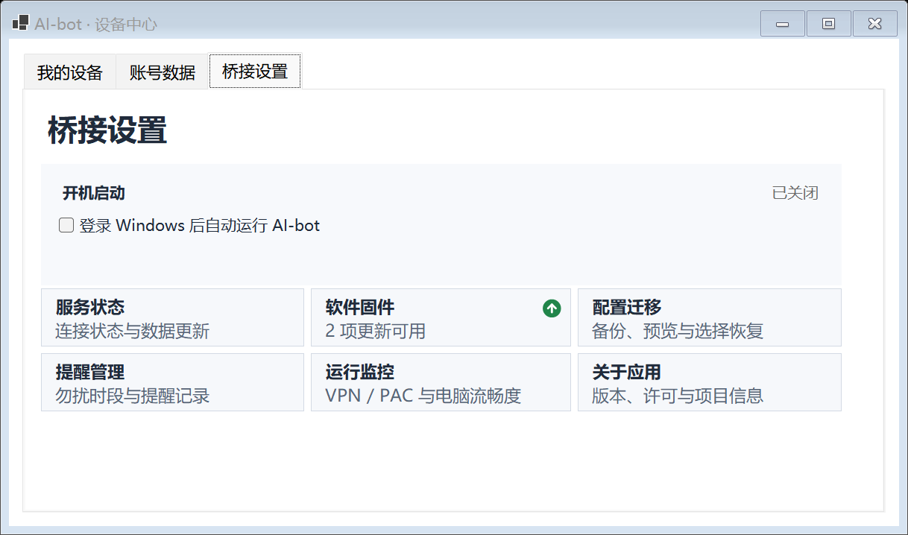

# 软件与固件更新 / Software and firmware updates

本页对应 Windows 桥接 0.6.32 和 Mac 桥接 0.6.34。Windows 从托盘打开设备中心，Mac 从菜单栏打开。检查更新统一从「设备中心 → 桥接设置 → 软件固件」进入。旧版 v0.5.0 用户先更新电脑应用。

[完整下载中心](../DOWNLOADS.md)集中提供 Windows / Mac 桥接、ESP8266 固件、TAB5 首刷与升级包、书法和名画图库。桥接 0.6.10 的「完整下载与安装说明」链接也指向此处。

## 安装与首次接入 / Setup and first device

Windows 安装器会请求正在运行的 AI-bot 正常退出，安装完成后自动重启。刷机中或暂时无法退出时，按安装器提示处理后重试。第一次添加设备时，看设备屏幕选择直接添加或先安装 AI-bot 固件。[首次安装图文指南](FIRST-INSTALL.zh.md#windows-first-device)

Windows Setup closes a running AI-bot and starts it again after the upgrade. If the bridge cannot close safely or a flash is in progress, follow the installer prompt before retrying. First-time setup guides you to add a device already showing AI-bot or install AI-bot firmware on a factory device. [Illustrated guide](FIRST-INSTALL.zh.md#windows-first-device)

从 Windows 0.6.29 起，下载并校验后会出现「安装新版 AI-bot？」窗口。点 **安装并重启** 即可在后台安装，完成后 AI-bot 会自动回到托盘。点 **稍后** 可继续使用，下一次点「一键升级」会先校验并复用已下载的同一版本安装包。

Starting with Windows 0.6.29, AI-bot asks whether to install after checking the download. Choose **Install and restart** to install in the background and return to the system tray, or **Later** to keep working. The next update attempt checks the saved installer and reuses it if it still matches the release.

从 Mac 0.6.31 起，点「一键升级」后也会先下载并校验应用。点「安装并重启」会替换并重新打开 AI-bot。点「稍后」或按 Escape 可继续使用，下次尝试同一更新时会重新校验并复用已保存的安装包。

Starting with Mac 0.6.31, One-Click Update downloads and verifies the app before asking whether to install. Choose **Install and restart** to replace and reopen AI-bot. Choose **Later** or press Escape to keep working. The next attempt for the same version verifies and reuses the saved package.

Windows 0.6.31 原生窗口，版本号为演示数据。 / Native Windows 0.6.31 dialog with sample version numbers.

Mac 0.6.33 改用固定签名。已有用户优先用内置更新；重启后如有权限缺失，从「设备中心 → 桥接设置 → 系统授权」补办。后续使用同一证书签名的版本可保留辅助功能授权；从浏览器重新下载的未公证 ZIP 仍可能需要「仍要打开」。

Mac 0.6.33 uses a fixed signing certificate. Use the in-app updater if AI-bot is already installed. After restart, reapprove only missing permissions from **Device Center → Bridge Settings → System Permissions**. Later updates signed with the same certificate retain Accessibility permission. A fresh browser download is not notarized and may still require **Open Anyway**.

Mac 0.6.34 将通知授权放在其它权限之后；不点通知提示也不耽误其它授权，之后可从「系统授权」单独开启。

Mac 0.6.34 asks about notifications after other permissions. You can leave the notification prompt unanswered and finish the rest, or enable notifications later in System Permissions.

## 通用升级入口 / One-Click Update

有更新时，「桥接设置 → 软件固件」卡片右上角显示小号绿底白箭头，标题下方显示更新数量。在版本表选中软件或固件，表格下方显示对应版本的更新说明。点「一键升级」开始下载和校验，按应用或设备提示继续安装。下载中可以取消，重试时可沿用已下载的数据。

- macOS 在可写的位置替换现有应用并重新打开。需要系统授权或手动替换时按提示操作。
- Windows 在旧桥接退出后运行安装器，再重新启动 AI-bot。便携版会打开安装器。
- 支持电脑端升级的 TAB5 会收到升级请求，先保存草稿，再传输并写入固件。重启后按原流程核验运行镜像和启动分区。旧固件可从设备的「设置 → 固件升级」确认。
- ESP8266 需连接 USB。识别到目标小屏及其版本后，先完整备份再写入和校验。版本或 USB 身份未知时，使用刷机窗口手动确认。

When updates are available, a small green update badge appears in the upper-right corner of the Software/Firmware card, with the update count below the title. Select an item to see its release notes, then click One-Click Update to download and verify the package, then follow the app or device prompt. Cancel a download to resume it later. The Mac bridge restarts after the update. macOS may require system approval or a manual replacement for protected locations. Windows closes the installed bridge, runs the installer, and starts AI-bot again. Portable copies open the installer. Supported TAB5 devices save drafts before writing and verify the running image and boot partition after restarting. Connect ESP8266 over USB for automatic backup and flashing. Older TAB5 firmware or an ESP8266 with an unknown version or USB identity still requires manual confirmation.

Windows 0.6.32 原生界面，更新数量为演示数据。 / Native Windows 0.6.32 with a sample update count.

## 日常使用

1. 打开「设备中心 → 桥接设置 → 软件固件」。列表显示电脑软件、已添加设备的固件和屏保图库，可查看版本及更新状态。
2. 点「检查更新」，选择要更新的一行，查看「所选更新说明」。设备版本来自已连接设备，不能根据电脑端版本猜测。支持版本上报的小屏按真实固件版本判断更新。
3. 从 0.6.26 起，点「一键升级」。旧版使用「下载并安装电脑端」或「下载并准备升级」，再按界面提示操作。程序自动选择适用包并核对 SHA-256。下载可以取消。更新电脑桥接时，校验通过后点「安装并重启」。
4. 桥接更新后，确认运行版本。设备更新后，等设备重启并重新连接。TAB5 可在升级窗口点「核验启动」，检查运行镜像与启动分区。电脑端和两种固件各自按需更新。

勾选「自动检查并提醒」后，Windows 和 Mac 桥接首次后台检查约在启动后 30 秒进行，Mac 从启动授权检查结束后计时。成功后约 1 小时再查，失败约 15 分钟后重试。同一更新版本只提醒一次。Windows 提醒遵守静默时段，合并提醒多项更新时会打开第一项。点击提醒可选中对应项目。设备已添加、启用且成功读取当前版本时，才参与更新判断。

打开「软件固件」时，首次打开或上次成功检查已满 5 分钟会自动刷新。查询失败时页面保留上次成功结果，1 分钟后再次打开可自动重试。「检查更新」可直接刷新。

0.6.2 修复：已连接的旧版 ESP8266 如果未上报固件版本，显示「版本未知（旧固件未上报）」，可以点「手动准备小屏升级」。这不表示发现了更新，不触发自动更新提醒。下载并校验最新正式固件包后，程序会说明无法排除同版本或降级，由用户确认进入 USB 刷机工具；仍需连接该小屏并点击开始刷机，先完整备份，再写入和校验。离线、版本上报无效、下载期间设备或版本改变都会阻止继续。新版固件通过 USB 和已认证的 Wi-Fi 请求上报自身版本。0.6.1 及更早的安装包不包含此修复。

TAB5 自动模式下，升级优先选择 Wi-Fi，其次 USB，最后蓝牙。接收和写入结束后，设备先校验固件，通过后才切换启动分区并重启。

In automatic mode, TAB5 prefers Wi-Fi for updates, followed by USB and then Bluetooth. After receiving and writing the image, TAB5 validates it before selecting the boot partition and restarting.

TAB5 日常更新只下载升级 ZIP；新购设备首次安装仍使用设备中心的首刷流程。下载包与首次安装说明见[安装指南](INSTALL.zh.md)。本地与公开版功能统一，名画和书法图库独立下载；在本窗口“屏保图库”中导入 ZIP，程序升级保留图库。详见[图库说明](GALLERY-PACKS.md)。

## 验证与范围

查询来自本项目 GitHub 正式 Release，忽略草稿和预发布。下载校验清单与安装包必须属于对应发布记录。下载后校验文件、固件类型、内置版本和必要元数据，再调用原安装工具。下载期间设备移除、关闭或版本改变，会阻止继续升级。网络失败保留本次运行中最近一次成功结果并显示错误，不宣称更新成功。

此入口负责发现、下载和交接。安装后的真实运行版本、TAB5 精确镜像启动结果和实体屏效果仍需分别核验；下载成功不等于升级完成。自动后台检查不会下载安装器或刷写设备。

## 0.6.24：软件固件入口 / Software and Firmware

- 「桥接设置」的「软件固件」卡片会显示更新数量。Mac 菜单栏也会显示数量。
- 在「软件固件 → 屏保图库 → 管理图库…」查看新版、下载或导入 ZIP。两套图库都有新版时合计为一项。安装时点退出会回到图库窗口。设备卡片的「屏保图库」用于浏览。
- TAB5 的 Wi-Fi、USB 配对、固件升级和测速在「连接设置」。ESP8266 的「管理 → 手动刷机…」用于 USB 刷机，「连接设置 → 重置网络…」用于清除已保存的 Wi-Fi。

- The Software/Firmware card in Bridge Settings shows the available update count. The Mac menu bar also shows it.
- In Software/Firmware → Artwork Collections → Manage Collections, you can view versions, download, or import a ZIP. Two collection updates count as one item. Quitting during installation returns you to the collection window. The device's artwork card opens the browser.
- TAB5 Connection Settings contains Wi-Fi, USB pairing, firmware upgrades, and speed tests. For ESP8266, use Manage → Manual Flash for USB flashing and Connection Settings → Reset Network to clear saved Wi-Fi.

## English

The [complete download center](../DOWNLOADS.en.md) lists both desktop apps, ESP8266 firmware, TAB5 first-install/upgrade packages and both artwork collections. Bridge 0.6.10's manual-download link opens this center.

This guide covers Windows bridge 0.6.32 and Mac bridge 0.6.34. Open Device Center from the Windows tray or Mac menu bar, then go to Bridge Settings → Software/Firmware. Check for updates and select an item to read its notes. Starting with 0.6.26, choose One-Click Update. On earlier versions, choose the download action and follow the installer or device prompts. The bridge verifies SHA-256, package identity, and compatibility before installing. After updating, check the running version and reconnect the device if needed. For TAB5, use Verify Boot to check the running image and boot partition again. Use the first-install package from Device Center for a first flash and the upgrade package for a TAB5 that already runs AI-bot. Each component can be updated independently.

Enable Check Automatically and Notify to start background checks after about 30 seconds. On Mac, the delay starts when the launch permission review finishes. The bridge checks again in about an hour after a successful check and retries after about 15 minutes on failure. Each update version is announced once. Windows notifications respect quiet hours. Click a notification to open the relevant item. A grouped Windows notification opens the first item. Use the installer, boot check, and physical display to confirm the update after download.

Opening Software/Firmware starts the first check or refreshes a catalog that is at least five minutes old. The window keeps the last successful results through an error and can retry when reopened a minute later. Use Check for Updates to refresh immediately.

0.6.2 fix: connected legacy ESP8266 devices that omit their firmware version offer a clearly labeled manual preparation action. This does not assert that a newer version exists and never generates an automatic update notification. After downloading and verifying the latest stable package, the user must acknowledge that the version cannot be compared and may be equal or older. The existing USB tool still requires an explicit start, complete backup, write and verification, bound to the selected screen's USB identity when available. Offline devices, malformed versions and target/version changes block continuation. New firmware reports its component version over USB and authenticated Wi-Fi requests. The 0.6.1 and earlier installers do not include this fix.

## 0.6.8：下载续传 / Resumable downloads

Windows 安装包和固件下载中断或取消后，已下载内容保存在本机；再次选择同一更新可继续，程序重启后也可恢复。缓存按组件、版本、文件名、大小和完整 SHA-256 隔离。完整文件仍需校验固件类型、内置版本、协议与最低桥接版本；下载成功不等于已安装。服务器不支持续传时从头安全下载，损坏断点清除后重新下载。本项已公开发布。

Windows 0.6.8 retains interrupted/cancelled installer and firmware downloads across app sessions. Resume only the same component, version, filename, size and checksum. Complete packages still require identity, protocol and minimum-bridge validation; download completion is not installation. Servers ignoring Range safely restart the transfer; corrupt partial files are discarded. This version is publicly released.

## Mac 0.6.15 授权与升级 / Mac permissions and upgrade

Mac 可用功能默认开启并保留明确关闭的选择。正常退出旧桥接后，将已校验的 App 放到“应用程序”；备份使用 ZIP 或外部目录。跟随原生引导允许当前应用；旧辅助功能条目已勾选仍失效时，移除并重新添加 `/Applications/AIBotBridge.app`。统一钥匙串资料一次读取后复用，旧资料首迁仍可能逐项询问。Windows 保留 0.6.14，设备固件按实际版本单独判断，无需因 Mac 更新重新刷机。[安装步骤](INSTALL.zh.md#mac) · [本轮说明](RELEASE-0.6.15.md)

Quit before replacing the Mac app in Applications; keep backups as ZIPs or outside Applications. Follow the app-owned guide and re-add an ineffective old Accessibility entry. Consolidated credential reads are reused, while legacy-first migration may require per-item approval. Windows retains 0.6.14 and firmware updates independently.

## 0.6.19：ESP8266 精简包 / Compact ESP8266 package

从 Windows 和 Mac 桥接 0.6.19 起，在「软件固件」检查更新并选择 ESP8266 时，桥接会优先使用最新正式固件发布里的精简刷机 ZIP；同一发布需要提供对应的 SHA-256 校验文件。缺少可用精简包时，仍支持同版本的完整固件材料包。下载成功后按现有流程打开刷机工具，只有明确确认才会写入设备。若只更新电脑桥接，无需重刷设备。

Starting with Windows and Mac bridge 0.6.19, Software and Firmware Updates prefers the compact ESP8266 flash ZIP from the latest stable firmware release when it has a matching SHA-256 file. The full materials package for the same version remains supported if the compact package is unavailable. The existing flash tool still requires confirmation before writing. A bridge-only update does not require reflashing.
