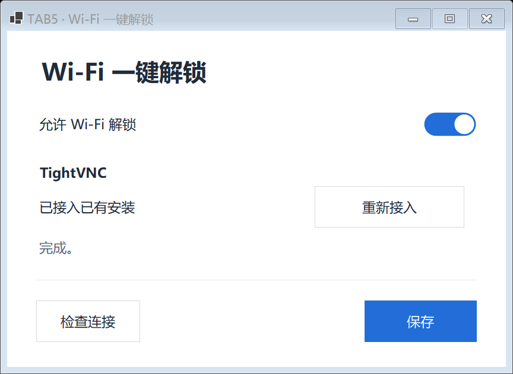

# TightVNC 组件安装与管理

## 设计与验收范围

在 Wi-Fi 一键解锁页提供按需离线安装、随机组件密码与本机 DPAPI 保存、状态检查、受归属校验约束的卸载。保留已验收的白底、统一开关、× / Esc 关闭与底部检查/保存布局。Windows PIN 不由安装器读取或修改。

布局令牌沿用 Microsoft YaHei UI（正文 9.5pt、标题 17pt），白色 #FFFFFF，正文 #202B3B，次要文字 #586577，主操作 #226DD7，浅背景 #F6F8FB，边线 #D3DAE4。内容左对齐，28px 内边距；组件行只表达当前状态和可执行操作，不增加重复说明或独立关闭按钮。

```text
Wi-Fi 一键解锁
允许 Wi-Fi 解锁                         [开关]

TightVNC
未安装 / 已就绪 / 待接入      [安装并启用 / 自动接入]
                              [卸载组件，仅自有安装]

必要时显示操作结果或配置要求
──────────────────────────────────────────
[检查连接]                         [保存]
```

设计复核：标题下的副说明和重复描述已移除，状态与操作同行。所有场景均不提供密码输入或更换入口：新安装自动生成；兼容的已有 TightVNC 点击“自动接入”，通过官方存储格式读取现有认证，在本机完成真实认证后用原用户 DPAPI 保存，不修改原密码。已有安装不被接管为 AI-bot 所有，不兼容或无法验证时明确停止。仅用于互通的存储格式和固定编码常量经过核对，转换独立使用 .NET DES 实现，未复制上游 GPL 加密例程。

实现与验证结果随开发追加。安装包内保留官方未修改 MSI、GPL 文本与准确版本对应源码；安装前复核固定 SHA-256 与厂商签名。管理员辅助流程与原用户配置保存分开，支持以另一管理员账户完成 UAC。安装回传通过按用户/管理员限定且验证双方进程的本地管道，不把密码写入命令行或结果日志。

English: Add on-demand offline TightVNC Server installation, local random credentials protected with the original user's DPAPI, read-only checks and ownership-checked removal. The page never requests a manually entered VNC password, including first use. Compatible existing installations automatically import their local authentication through the verified vendor storage format, authenticate without input, and retain their original password and external ownership. Unsupported configurations fail explicitly without being overwritten. Storage interoperability is independently implemented with .NET DES; no GPL vendor encryption routine is copied. The installer does not read or change Windows PINs. Bundled official MSI, GPL and matching source remain separate components. Privileged work and caller-profile credential storage use a bounded authenticated local process channel.

## 实现

- `TightVncComponent.cs` / `TightVncMachine.cs`：固定官方包的 SHA-256、厂商签名、规范服务路径、LocalSystem 身份、服务与配置检测。只安装 Server，禁止防火墙例外，RFB 仅回环连接。已有兼容安装支持自定义 RFB 端口，原设置及归属保留。
- `TightVncElevation.cs`：管理员辅助进程仅处理固定的安装、启动、授权和卸载动作。双方校验管道进程，原用户保管 DPAPI 凭据。MSI 调用不传密码命令行、不启用安装日志，密码属性设为隐藏；安装事务上限 10 分钟，认证检查仍为 4 秒。
- 服务真实认证通过后，在敏感认证/网络设置及二进制不变的前提下保存最终配置快照。安装和设置页检查只验证认证，不启动桌面；实际解锁继续执行完整初始化。AI-bot 的归属登记由 SYSTEM / Administrators 写入，普通用户只有读取权限；他人安装、升级或修改后的安装不自动卸载。
- 官方 MSI 保留 Server 注册表配置。回滚和正常卸载在服务、产品和二进制已移除后，仅清理仍与归属快照完全一致的配置。需要重启时保留登记，重启后可完成清理；配置被修改时停止清理。
- UAC 取消恢复原记录；安装检查失败回滚本次安装。无法确认提交时保留停用的组件凭据，防止遗失已提交服务的访问认证。成功卸载只删除组件访问文件，不处理 PIN 或配对文件。
- `setup.iss`：卸载 AI-bot 时，对当前用户的自有组件询问是否同时移除；已有外部组件跳过。普通 Windows 包及 ZIP 均带固定官方 MSI、完整对应源码、GPL 和来源校验记录。

本次将此前已验收的电脑控制、PIN、Wi-Fi 解锁、蓝牙交互优先级、解锁诊断和无线启动核验依赖接回根目录的常规 Windows 构建。没有协议改版或固件改动，没有把构建成功视作真机解锁验收。

## 本地验证

证据目录：`artifacts/development/tightvnc-lifecycle-20261019/`。

| 项目 | 结果 |
| --- | --- |
| Release / win-x64 publish | 通过，无编译错误；测试用自带运行时与交付 DLL 相同 |
| DLL SHA-256 | `3da41643d198d3fcde92bbd13aa22e64f69fa384b04478c8fd21ffb17bb5cda1` |
| 组件测试 | 1,242 项；10 种状态、3 种几何缩放、无密码输入、自动首次接入、权限取消、加密回退、并发关闭与有界 IPC |
| Wi-Fi 回归 | 149 项，合成 RFB / 生命周期 / DPAPI / 加密 RPC；认证检查不发送 ClientInit 或按键，实际解锁完整初始化保留 |
| PIN 回归 | 135 项，合成凭据；未向设备发送输入 |
| 完整公共回归 | `PUBLIC_SELF_TEST_OK`，独立隐藏桌面及隔离配置，无生产凭据或设备输入 |
| 无线启动核验回归 | 63 项，鉴权、身份、会话、重放、指纹及取消检查 |
| 安装器 | Inno 真实编译通过；编译后的 SELFTEST 和 CHECKONLY 通过 |
| ZIP | 88 个清单文件逐字节 SHA-256 核验，官方 MSI / 完整源码 / GPL / 来源文件均在包内 |
| 当前电脑 | 自动读取的认证与已保存记录一致，完整 RFB 初始化通过；无按键、无设置修改，凭据仍为格式 2 |
| Windows Sandbox：失败回滚 | `install-08/lifecycle/rollback.json`：真实 MSI 安装后注入检查失败，服务、配置和凭据回退，最终 Missing；此用例独立记录 |
| Windows Sandbox：成功路径 | `success-10/lifecycle/sandbox-result.json`：真实 MSI / 管道 / DPAPI / 自动读取原认证 / 认证 / 重复安装拒绝 / 修改及他人归属拒绝 / 卸载清理通过，10 项检查，无按键 |
| Sandbox 状态采样 | `success-10/status-once-result.json`：退出 0；在隔离系统执行，不冒充主机状态采样 |
| 环境收尾 | 本次沙盒已关闭，`wsb list --raw` 返回空列表 |

界面已在本机 168 DPI 原生窗口核验；1 / 1.5 / 2 是几何缩放模拟，不等于三台真实显示器验收。页面不再出现 TightVNC 密码输入或“更换密码”。保留统一开关、同行状态/操作、底部左“检查连接”右“保存”、× / Esc 关闭。



此前失败结果保留：运行时准备停滞后改用自带运行时测试构建；测试脚本重复启动后增加单实例锁；测试 TCP 默认产生 IPv6 映射地址，已改为与生产一致的 IPv4，没有放宽生产对端校验。真实 MSI 的配置残留已修正，安装期限从 3 分钟调整为 10 分钟，归属快照在认证后定格。分阶段诊断确认自动密码匹配、认证通过，沙盒卡在后续桌面初始化；安装/设置检查因此改为仅认证，实际解锁的完整初始化保留，并在当前电脑只读实测通过。失败记录不计作通过；成功路径不冒称同一轮执行过失败回滚。

## 交付边界

本次是本地候选，沿用根目录 `VERSION=0.6.7`，不是正式版本更新。最终候选 EXE / ZIP 在上述证据目录的 `delivery-verified/`，此前候选保留作过程证据。未替换当前主机的常驻桥接，未重新安装或卸载主机 TightVNC，未刷入固件，也未提交、推送或发布。

跨管理员账号的交互式 UAC、真实重启返回 3010 分支和主机卸载向导的人工选择仍需独立验收；界面/取消状态测试不冒充这些真实系统操作。已有解锁速度验收不因本次构建而扩大为新版本验收。

English: This is a local candidate, not a public release or deployment. Native UI and synthetic regressions pass. Actual MSI failure rollback and the successful install/authentication/import/ownership/uninstall path pass in separate Sandbox cases. Setup/check authenticates without starting a desktop or sending input. The unchanged full input-session initialization also passes a read-only check on the current PC, with imported authentication matching its saved record. The Sandbox has been closed. The running host bridge, host TightVNC and firmware have not been replaced. Cross-account interactive elevation, a real reboot-required installation and the host uninstall wizard remain separate acceptance scopes.
